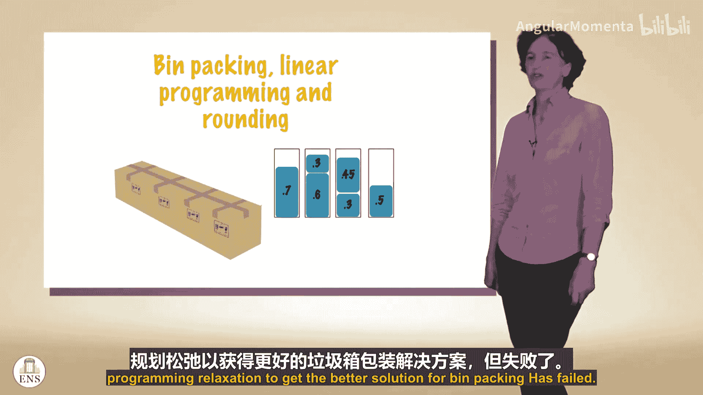

**近似算法：第1章：线性规划松弛**

在本节中，我们将学习如何为装箱问题设计一个线性规划松弛模型，并探讨其局限性。

---

上一节我们介绍了“下次适应”算法及其渐近近似比。本节中，我们来看看能否设计出更好的算法。为此，我们将尝试为装箱问题构建一个线性规划松弛模型。

我们的最终目标是设计一个渐近近似方案，即一个算法，对于任意给定的 ε，能输出一个装箱方案，其所需箱数不超过 `(1 + ε) * OPT + 低阶项`。为了实现这个目标，我们首先采用组合优化问题的标准方法：将其建模为整数规划，然后尝试其线性规划松弛。

首先，我们需要为装箱问题找到一个整数规划模型。回忆一下，在装箱问题中，我们有 n 个物品，目标是用最少的单位容量箱子装下它们。

我们将为一个稍有不同的决策版本问题建立整数规划：给定 n 个物品和 K 个单位容量箱子，目标是判断是否存在一种将这 n 个物品装入这 K 个箱子的方案。显然，如果能解决这个问题，就能解决原问题，两者是等价的。

如何为这个问题建立整数规划呢？我们需要使用一些 0-1 变量。一个装箱方案需要决定每个物品放入哪个箱子。因此，我们为每个物品 i 和每个箱子 j 定义一个变量 `X_ij`。

`X_ij` 的定义如下：
*   `X_ij = 1` 当且仅当物品 i 被放入箱子 j。
*   `X_ij = 0` 当且仅当物品 i 未被放入箱子 j。

例如，考虑屏幕上的装箱方案。物品 A 放入箱子 1，所以 `X_A1 = 1`。物品 B 和 F 放入箱子 2，所以 `X_B2 = 1` 且 `X_F2 = 1`。其他情况以此类推。所有未使用的 `X_ij` 都等于 0。

这样，物品的装箱方案与变量 `X_ij` 的 0-1 赋值之间就建立了一一对应关系。现在，我们需要为这个整数规划添加约束条件。

以下是约束条件：

1.  **每个物品必须放入一个箱子**：对于每个物品 i，它必须被放入 K 个箱子中的某一个。这意味着对于每个 i，所有箱子 j 对应的 `X_ij` 之和必须等于 1。
    *   **公式**：对于每个物品 i，`∑_{j=1}^{K} X_ij = 1`。

2.  **箱子容量限制**：对于每个箱子 j，放入其中的所有物品的大小之和不能超过箱子的容量（假设为 1）。对于物品 i，如果 `X_ij = 1`，则贡献其大小 `s_i`；如果 `X_ij = 0`，则贡献 0。因此，对于每个箱子 j，所有物品 i 的 `X_ij * s_i` 之和必须 ≤ 1。
    *   **公式**：对于每个箱子 j，`∑_{i=1}^{n} X_ij * s_i ≤ 1`。

3.  **变量为整数**：每个 `X_ij` 必须是 0 或 1。
    *   **公式**：对于所有 i, j，`X_ij ∈ {0, 1}`。

综上所述，我们的整数规划模型如下：
*   **变量**：`X_ij`，对于所有物品 i 和箱子 j (1 ≤ i ≤ n, 1 ≤ j ≤ K)。
*   **约束**：
    1.  对于每个物品 i：`∑_{j=1}^{K} X_ij = 1`。
    2.  对于每个箱子 j：`∑_{i=1}^{n} X_ij * s_i ≤ 1`。
    3.  对于所有 i, j：`X_ij ∈ {0, 1}`。

这个整数规划是可行的（有解），当且仅当存在一种将物品装入 K 个箱子的方案。

现在，为了得到线性规划松弛，我们只需将最后一个约束条件 `X_ij ∈ {0, 1}` 替换为 `X_ij` 是介于 0 和 1 之间的实数。

因此，线性规划松弛模型为：
*   **变量**：`X_ij`，对于所有物品 i 和箱子 j。
*   **约束**：
    1.  对于每个物品 i：`∑_{j=1}^{K} X_ij = 1`。
    2.  对于每个箱子 j：`∑_{i=1}^{n} X_ij * s_i ≤ 1`。
    3.  对于所有 i, j：`0 ≤ X_ij ≤ 1`。

我们想利用这个线性规划松弛来设计装箱算法。首先需要评估这个松弛模型的质量，即它是否足够接近原始的整数规划。我们损失了多少精度？

这里有一个坏消息。考虑以下反例：
*   有 5 个物品。
*   每个物品的大小均为 0.6。
*   箱子容量为 1。

显然，至少需要 5 个箱子才能装下这些物品，所以最优解 `OPT = 5`。

然而，对于线性规划松弛模型，如果我们设定箱子数量 `K = 3`，可以构造一个可行的分数解：
*   令所有 `X_ij`（对于 i=1..5, j=1..3）都等于 `1/3`。

验证约束：
1.  对于每个物品 i：`X_i1 + X_i2 + X_i3 = 1/3 + 1/3 + 1/3 = 1`。满足。
2.  对于每个箱子 j（例如箱子 1）：`∑_{i=1}^{5} X_i1 * s_i = 5 * (1/3) * 0.6 = 1`。满足容量限制（≤1）。

因此，根据线性规划松弛，这 5 个大小为 0.6 的物品似乎可以“分数地”装入 3 个箱子。但在现实中，需要 5 个箱子。这意味着线性规划松弛的最优值（此处为 3）至少比整数规划的最优值（5）小了 `5/3` 倍。

这个例子表明，我们为获得更好装箱方案而设计的第一个线性规划松弛模型失败了。它的整数间隙（Integrality Gap）至少为 `5/3`，这意味着任何基于此松弛模型的算法，其近似比可能不会优于 `5/3`。

因此，我们必须寻找更好的思路，探索装箱问题更深层的结构或性质。这将是我们在下一部分要着手进行的工作。

---

本节课中，我们一起学习了如何为装箱问题构建整数规划和线性规划松弛模型。我们定义了决策变量 `X_ij` 来表示物品 i 是否放入箱子 j，并建立了相应的约束条件。然而，通过一个简单的反例，我们发现这个基本的线性规划松弛模型的整数间隙较大（至少 `5/3`），无法直接用于设计高质量的近似算法。这促使我们需要在后续内容中寻找更强大的建模技巧。