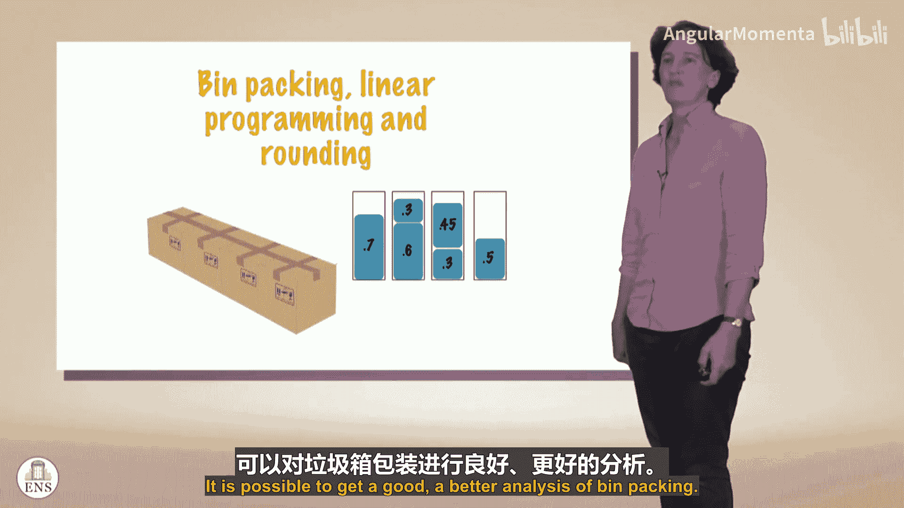

# 018：特殊案例分析

在本节课中，我们将学习如何通过分析装箱问题的特殊案例来获得算法设计的直觉。我们将首先回顾之前尝试线性规划松弛法的失败，然后转向一种新的元工具：通过解决特殊案例来发展直觉。我们将从所有物品尺寸都较小的情况开始分析。

---

## 特殊案例：小物品

上一节我们介绍了线性规划松弛法在解决一般装箱问题时的局限性。本节中，我们来看看一个特殊的案例：当所有物品的尺寸都小于箱子容量的三分之一时，情况会如何。

### 小物品情况下的“下次适应”算法

以下是“下次适应”算法在这种特殊输入下的行为分析。我们通过一个例子来观察：

假设物品尺寸序列为：0.2, 0.3, 0.25, 0.33, 0.24, 0.29, 0.33, 0.2...

执行“下次适应”算法后，我们可能会使用三个箱子：
*   第一个箱子装载了尺寸为0.2、0.3和0.25的物品，总装载量为 **0.75**。
*   第二个箱子装载了尺寸为0.33、0.24和0.29的物品，总装载量为 **0.86**。
*   第三个箱子目前装载了尺寸为0.33的物品，总装载量为 **0.53**。

此时，即使我们还没有看到下一个物品，我们也可以预测它能放入第三个箱子。因为它的尺寸至多是箱子容量的三分之一（≤ 1/3），而 0.53 + (≤ 1/3) < 1。因此，下一个物品将能放入第三个箱子。

### 关键结构观察

这里发生了一些之前没有的情况。我们可以观察到：

**如果一个箱子的装载量小于三分之二，那么我们保证能放入下一个物品。**

这意味着，在“下次适应”算法中，我们只会在一个箱子的装载量达到至少三分之二时才会关闭它（最后一个箱子除外）。因此，除了最后一个箱子，所有被使用的箱子都至少被填充到了三分之二。

### 性能分析推导

从这个观察中，我们可以推导出算法的性能上界。

1.  **算法使用的箱子数与物品总尺寸的关系**：
    由于每个箱子（最后一个可能除外）都至少装载了三分之二，所有物品的总尺寸至少是 `(2/3) * (使用的箱子数 - 1)`。
    用公式表示为：
    **总尺寸 ≥ (2/3) * (NF - 1)**
    其中 `NF` 代表“下次适应”算法使用的箱子数。

2.  **最优解的下界**：
    我们知道，最优解 `OPT` 至少需要能容纳所有物品总尺寸的箱子数。由于箱子容量为1，所以：
    **OPT ≥ 总尺寸**

3.  **结合两者得出近似比**：
    将上述两个不等式结合：
    `(2/3) * (NF - 1) ≤ 总尺寸 ≤ OPT`
    整理后得到：
    **NF ≤ 1 + (3/2) * OPT**

### 定理总结

我们刚刚证明了一个定理：

**当所有物品尺寸都小于箱子容量的三分之一时，“下次适应”算法使用的箱子数至多为 `1 + 1.5 * OPT`。**

这个结果（1.5倍近似）比之前针对一般情况分析的2倍近似要好得多。

### 分析的启示与扩展

这个分析过程传递了一个方法：从一个特殊例子（小物品）出发，得到一个结构性的观察（箱子至少填充三分之二），然后利用这个观察，结合关于物品总尺寸的上下界，推导出算法的性能保证。

这种方法可以进一步扩展：
*   如果物品尺寸小于四分之一呢？
*   如果小于五分之一呢？
*   更一般地，如果物品尺寸小于 `ε`（一个很小的正数）呢？

那么，“下次适应”算法将几乎是最优的（误差主要来自最后一个箱子）。这是一个很好的练习。

---

## 过渡到下一个案例

至此，我们已经看到，当所有物品都很小时，可以对装箱算法进行更好的分析。接下来，我们将看看另一个特殊案例，可以说是相反的情况：当物品都很大时。在分别对“全小”和“全大”两种极端情况建立直觉之后，我们将能够结合这些见解，最终分析一个能很好处理所有可能输入的算法。

---

### 本节课总结

在本节课中，我们一起学习了如何通过分析装箱问题的特殊案例来设计近似算法。我们重点研究了当所有物品尺寸都小于箱子容量三分之一的情况，并证明了在此条件下，“下次适应”算法的近似比可以提升至1.5倍。这个过程展示了从具体例子中提取结构性观察，并将其转化为严格性能证明的分析方法。