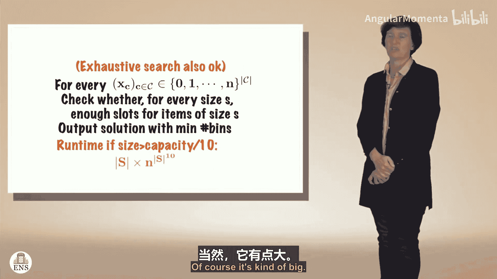

**近似算法：第1章：大尺寸物品装箱问题** 🧳

在本节课中，我们将学习如何处理物品尺寸较大的装箱问题。具体来说，我们将探讨当所有物品的尺寸都大于某个下限值，且物品尺寸的种类有限时，如何设计精确或近似最优的装箱算法。

---

上一节我们介绍了如何处理小尺寸物品的装箱问题。本节中，我们来看看相反的情况：当所有物品尺寸都较大时，问题依然相当困难。为了找到解决方案，我们先从一个特殊的子问题入手。

以下是解决该问题的核心思路：当物品尺寸较大且种类有限时，每个箱子可能的物品组合方式（我们称之为“配置”）是有限的。我们可以通过枚举这些配置，并利用整数规划或穷举搜索来找到最优的装箱方案。

首先，我们通过一个例子来建立直观理解。

**例子分析**

考虑一个箱子容量为12的情况。物品尺寸有两种：3和4。假设我们有10个尺寸为3的物品和10个尺寸为4的物品。

如何装箱？尺寸为3的物品，4个恰好装满一个箱子（4×3=12）。尺寸为4的物品，3个恰好装满一个箱子（3×4=12）。因此，我们可以先用2个箱子装尺寸为3的物品（用掉8个），再用3个箱子装尺寸为4的物品（用掉9个）。剩余物品为：2个尺寸为3，1个尺寸为4。它们可以装入第6个箱子（3+3+4=10<12）。总箱子数为6。经过思考，可以确定这是最优解。

从这个例子中，我们得到了什么启示？当物品尺寸较大时，一个箱子能容纳的物品数量有限。因此，所有可能的箱子配置也是有限的。

**一般化建模**

现在，我们将这个思路推广到一般情况。设物品尺寸集合为S，其中每种尺寸s的物品数量为n_s。每个箱子可以有不同的物品组合，我们称之为配置C。对于每个配置C，定义a_{s,C}为该配置中尺寸为s的物品槽位数量。

我们的目标是选择每种配置的使用数量x_C（整数），使得所有物品都被装入箱子，并且使用的箱子总数最小。

以下是该问题的整数规划模型：

**目标函数**：最小化总箱子数
\[
\min \sum_{C} x_C
\]

**约束条件**：对于每种物品尺寸s，所有配置提供的该尺寸槽位总数必须至少等于该尺寸的物品数量
\[
\sum_{C} a_{s,C} \cdot x_C \geq n_s \quad \forall s
\]

**变量**：\( x_C \in \mathbb{Z}_{\geq 0} \)

**求解方法**

由于物品尺寸较大（例如，每个尺寸至少占箱子容量的α倍），每个箱子最多能装⌊1/α⌋个物品。同时，物品尺寸的种类数K是一个常数。因此，可能的配置总数最多为K^{⌊1/α⌋}，这也是一个常数。

基于此，我们有两种求解策略：

1.  **近似求解**：求解上述整数规划的线性松弛（允许x_C为分数），然后将每个变量向上取整。这会引入最多每个变量+1的误差，总误差不超过配置总数，即一个常数。因此，我们得到一个箱子数不超过OPT + O(1)的近似解。

2.  **精确求解**：由于每种配置的使用数量最多为物品总数n，我们可以穷举所有可能的配置数量组合（最多(n+1)^{(配置总数)} 种可能性）。对于每种组合，检查是否满足所有物品的约束，并选择箱子数最少的方案。由于配置总数是常数，该算法的时间复杂度是n的多项式级别，虽然可能较大，但在理论上是可行的。

---

本节课中，我们一起学习了如何处理物品尺寸较大且种类有限的装箱问题。我们通过分析例子引入了“配置”的概念，并建立了整数规划模型。我们了解到，由于配置数量有限，该问题可以在常数误差内近似求解，甚至可以通过穷举搜索精确求解。

接下来，我们将尝试放宽“物品尺寸种类有限”这个假设，探索更一般的算法。