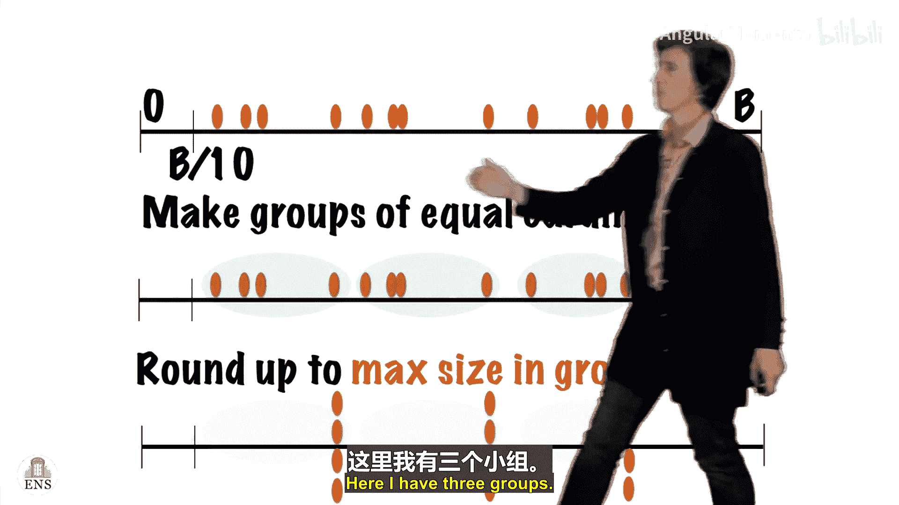

# 020：大型物件多尺寸装箱问题 🧳

在本节课中，我们将学习如何处理物品尺寸较大且尺寸种类繁多时的装箱问题。我们将介绍一种基于自适应舍入的核心技术，它能将复杂问题转化为我们已知如何高效求解的简单情况。

---

上一节我们解决了物品尺寸较大但种类较少的特殊情况。本节中，我们来看看当物品尺寸仍然较大，但尺寸种类繁多时的情况。这是本章最重要的部分。

核心思路与解决背包问题时类似，即使用**舍入**技术。我们有许多不同的物品尺寸，但希望将其减少为少数几种尺寸。我们将对尺寸进行**向上舍入**。这样，如果舍入后的物品能装入一个箱子，那么原始物品也一定能装入，因为它们也满足箱子的容量限制。

以下是舍入方法的一个初步尝试：
*   假设箱子容量为 `100`。
*   最小物品尺寸至少为 `10`。
*   将每个物品尺寸向上舍入到最接近的整数。

这样，我们最多只有 `90` 种可能的物品尺寸，从而可以在多项式时间内求解舍入后的问题，并且其解也是原问题的可行解。这个想法源自上一章的背包算法。

但这种舍入方法的效果如何呢？让我们通过一个例子来分析。

假设箱子容量为 `100`。我们有 `50` 个尺寸为 `33.333...` 的物品和 `50` 个尺寸为 `66.666...` 的物品。最优解是将这两种物品配对装箱，恰好装满 `50` 个箱子，即 `OPT = 50`。

现在应用整数向上舍入：
*   `33.333...` 舍入为 `34`
*   `66.666...` 舍入为 `67`

此时，`34 + 67 = 101`，超过了容量，无法配对。因此，舍入后问题的最优解变为 `75` 个箱子。虽然每个物品的尺寸只增加了一点点，但整体解的质量却大幅下降。这说明这种简单的舍入方法失败了。

---

我们需要一种新的舍入方法，即**自适应舍入**。这是本章乃至本周课程中最重要的概念。

以下是自适应舍入的步骤：
1.  **排序**：首先将所有物品按尺寸从小到大排序。
2.  **分组**：将排序后的物品分成若干组。每组包含固定数量的物品（例如，每组包含 `n * ε²` 个物品，其中 `n` 是物品总数，`ε` 是精度参数）。
3.  **舍入**：将同一组内所有物品的尺寸，都向上舍入到该组中**最大**的物品尺寸。

通过这种方式，舍入后不同尺寸的种类数就等于**组的数量**。只要组的数量是一个常数，我们就能将问题归约到上一节已解决的“少量尺寸”情况。

---

现在，我们正式描述针对大型物品的近似方案算法。假设所有物品尺寸都至少是箱子容量 `B` 的 `ε` 倍。

算法步骤如下：
1.  将物品按尺寸从小到大排序。
2.  将物品分组，使得每组恰好包含 `n * ε²` 个物品（最后一组可能不足）。
3.  在每一组内，将所有物品尺寸向上舍入到该组的最大尺寸。
4.  使用上一节的方法，求解这个舍入后（尺寸种类数为常数）的装箱问题。
5.  输出对应的装箱方案。

由于所有物品尺寸都大于 `B * ε`，且舍入后尺寸种类数为常数，因此该算法可以在多项式时间内运行。

我们接下来将证明，该算法输出结果所使用的箱子数量，最多为 `OPT * (1 + O(ε))`。这证明了它是一个渐近近似方案。

---

本节课中，我们一起学习了如何处理物品尺寸较大且种类繁多的装箱问题。我们认识到简单舍入的局限性，并引入了关键的自适应舍入技术。通过先排序、再分组、最后组内统一向上舍入的方法，我们将问题有效简化，并设计出了一个多项式时间的渐近近似方案。在下一节中，我们将对这个算法进行严格的分析，证明其近似比。