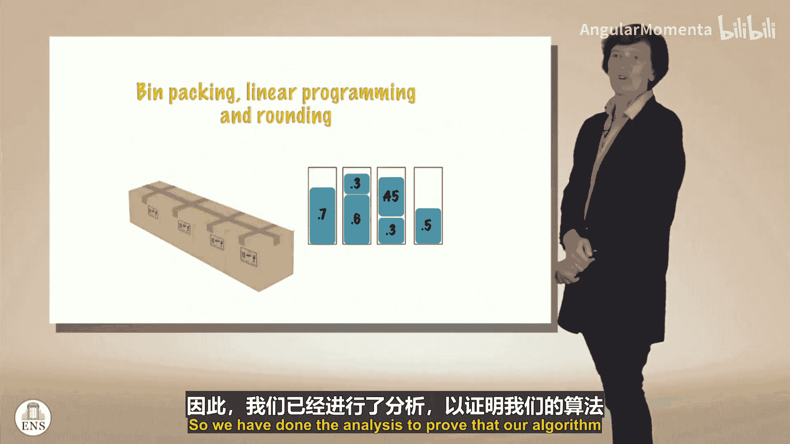

# 021：大型项目分析

在本节课中，我们将学习一个针对特定装箱问题的近似算法，并分析其性能。我们将证明，当所有物品尺寸都大于某个阈值时，该算法能找到接近最优解的方案。

---

上一节我们介绍了当所有物品尺寸都大于 `ε * B`（其中 `B` 是箱子容量）时，所采用的算法框架。本节中，我们来详细分析这个算法的性能，并证明其输出值接近最优值。

## 算法回顾

首先，我们简要回顾算法步骤：
1.  将物品按尺寸分组，每组包含 `n * ε²` 个物品。
2.  将每组内所有物品的尺寸向上取整（round up）为该组中的最大尺寸。
3.  对取整后的问题（记为 `U`）求最优解。
4.  输出对应于原始物品的装箱方案。

算法的输出值，即我们使用最优算法求解取整后问题 `U` 得到的值，记为 `OPT(U)`。我们的目标是证明 `OPT(U)` 与原始问题的最优值 `OPT(I)` 非常接近。

## 核心分析思路

分析的关键在于构造另一个取整方案，并与算法中使用的向上取整方案进行比较。

以下是分析中最重要的部分。考虑输入物品 `I`。我们已通过向上取整得到问题 `U`。现在，我们定义一种向下取整方案 `D`：
*   对于每一组物品，将其尺寸向下取整（round down）为**前一组**的最大尺寸。
*   第一组物品则向下取整为尺寸 `0`。

因此，`D` 看起来像这样：每组有 `n * ε²` 个相同尺寸的物品，第一组尺寸为 `0`。

这之所以有帮助，是因为装箱问题是单调的：**增大物品尺寸只会使最优值 `OPT` 增加或不变；减小物品尺寸只会使 `OPT` 减少或不变**。

于是，我们得到以下关系：
*   由于 `D` 是将 `I` 的尺寸减小得到的，因此 `OPT(D) ≤ OPT(I)`。
*   由于 `U` 是将 `I` 的尺寸增大得到的，因此 `OPT(I) ≤ OPT(U)`。

这样，我们就把 `OPT(I)` “夹”在了 `OPT(D)` 和 `OPT(U)` 之间：
`OPT(D) ≤ OPT(I) ≤ OPT(U)`

## 比较 `U` 与 `D`

为什么这很好？现在让我们忽略原始输入 `I`，只观察两个取整后的问题 `U` 和 `D`。

观察 `U` 和 `D`，它们几乎相同：
*   从第二组开始，`U` 和 `D` 都包含相同数量（`n * ε²`）的、相同尺寸的物品。
*   唯一的区别在于：
    1.  `D` 包含第一组尺寸为 `0` 的物品，而 `U` 没有。这无关紧要，因为尺寸为 `0` 的物品不影响 `OPT` 值。
    2.  `U` 包含第一组尺寸较大的物品（尺寸在 `εB` 到 `B` 之间），而 `D` 没有。这组物品的数量最多为 `n * ε²`。

基于此，我们可以得出：**任何针对 `D` 的装箱方案，都可以通过为 `U` 中那最多 `n * ε²` 个“特殊”大物品每个单独分配一个新箱子，从而转换成一个针对 `U` 的装箱方案**。

因此，`U` 和 `D` 的最优值之差最多为 `n * ε²`：
`OPT(U) - OPT(D) ≤ n * ε²`

## 推导近似保证

结合前面的不等式，我们可以进行推导：
1.  我们有 `OPT(D) ≤ OPT(I) ≤ OPT(U)`。
2.  我们有 `OPT(U) ≤ OPT(D) + n * ε²`。

由此可得：
`OPT(U) ≤ OPT(I) + n * ε²`

这意味着，我们算法求得的取整后问题的最优值 `OPT(U)`，最多只比原始问题的最优值 `OPT(I)` 大一个加性误差 `n * ε²`。

## 将加性误差转换为相对误差

分析还剩最后一步：我们需要将加性误差 `n * ε²` 与 `OPT(I)` 联系起来，转化为相对误差。

由于我们假设所有物品尺寸至少为 `εB`，且箱子容量为 `B`，因此**每个箱子最多只能装下 `1/ε` 个物品**。更准确地说，每个箱子最多装 `floor(1/ε)` 个物品，但为简化分析，一个直接推论是：装下所有 `n` 个物品至少需要 `εn` 个箱子。

因此，原始问题的最优值满足：
`OPT(I) ≥ εn`

那么，加性误差项可以表示为：
`n * ε² = ε * (εn) ≤ ε * OPT(I)`

## 最终结论

将以上所有步骤结合起来，我们可以得出最终的结论：

**当所有物品尺寸都至少为 `εB` 时，我们的算法能在多项式时间内，给出一个装箱方案，其使用的箱子数量最多为 `(1 + ε) * OPT(I)`。**

---

本节课中，我们一起学习了如何分析针对“大物品”装箱问题的近似算法。我们通过构造向上和向下两种取整方案，将原问题最优值“夹”在中间，并比较两个取整后问题的差异，最终证明了算法具有 `(1 + ε)` 的近似比。在下一节中，我们将完成这个算法系列的开发，得到一个适用于**一般情况**（包含任意小物品）的完整近似算法。