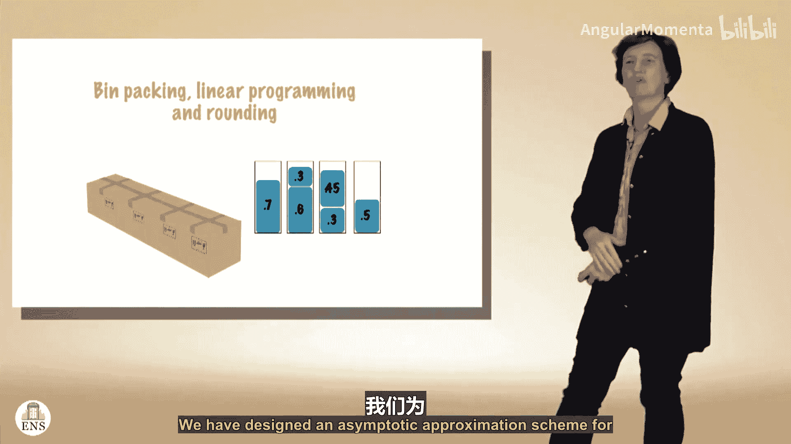

# 022：通用装箱算法

在本节课中，我们将学习如何设计一个适用于任意物品大小的通用装箱算法。我们将通过将问题归约到之前已解决的“大物品”情况，并巧妙地处理小物品，最终得到一个渐近近似方案。

---

上一节我们解决了所有物品尺寸都大于 `εB`（即“大物品”）时的装箱问题。本节中，我们来看看如何处理物品尺寸任意的通用情况。

我们的策略是将通用情况归约到之前已解决的大物品情况。以下是具体做法。

首先，我们需要区分物品的大小。以下是算法的第一步：

1.  **分离小物品**：将所有尺寸小于 `εB` 的物品定义为“小物品”，并将其暂时搁置。剩余物品则全部是“大物品”。

现在，我们面对的是一个仅包含大物品的输入。这正是我们上一节已解决的问题。因此，算法的第二步是：

2.  **打包大物品**：对剩余的大物品应用上一节的算法。该算法通过尺寸取整，将问题转化为仅有少数几种尺寸的大物品装箱问题，并高效求解。

这个过程就像俄罗斯套娃：我们先解决一个最特殊的子问题（尺寸取整后的大物品），然后用它作为黑盒来解决更一般的子问题（所有大物品），最后再用这个结果来解决最通用的问题。

---

解决了大物品的打包问题后，接下来需要处理之前搁置的小物品。以下是处理小物品的方法：

3.  **贪心填入小物品**：查看上一步得到的大物品装箱方案。我们尝试将小物品**贪心地**填入这些已有箱子中剩余的空间里。如果某个小物品无法放入任何现有箱子，则为其开启一个新箱子。

这个思路借鉴了我们在学习“所有物品都很小”的情况时获得的直觉。

---

以上就是完整的算法描述。现在，让我们分析这个算法的近似性能。分析将分为两种情况。

**情况一：在填入小物品时，没有开启任何新箱子。**
在这种情况下，算法的最终输出值（所用箱子数）就等于打包大物品所用的箱子数。根据上一节的结论，这个值最多为 `(1 + ε) * OPT(L)`，其中 `OPT(L)` 是仅打包大物品 `L` 所需的最优箱子数。由于 `L` 是整个输入 `I` 的子集，显然 `OPT(L) ≤ OPT(I)`。因此，在此情况下，算法输出值 ≤ `(1 + ε) * OPT`。

**情况二：在填入小物品时，开启了一些新箱子。**
此时，除了最后一个被开启的箱子，其他所有箱子都被填充到了很高的程度。具体来说，因为我们是贪心填入，只有当一个物品无法放入任何现有箱子时才会开新箱，所以每个现有箱子的剩余空间都小于 `εB`。这意味着每个现有箱子的填充量至少为 `(1 - ε)B`。

由此我们可以推导出，所有物品的总体积至少是 `(箱子总数 - 1) * (1 - ε)B`。另一方面，最优解 `OPT` 必须能装下所有物品，因此总体积 ≤ `OPT * B`。将两者结合，经过代数变换（注意到 `1/(1 - ε) = 1 + O(ε)`），我们可以得出算法输出值 ≤ `OPT * (1 + O(ε)) + 1`。

---

综合以上两种情况，我们得出结论：该算法能在多项式时间内，给出一个装箱方案，其使用的箱子数最多为 `OPT * (1 + O(ε)) + 1`。

本节课中，我们一起学习了如何为通用装箱问题设计一个**渐近近似方案**。我们通过将问题归约到已解决的大物品情况，并利用贪心策略处理小物品，最终证明了算法的近似性能。这标志着我们对装箱问题近似算法的探索取得了重要进展。