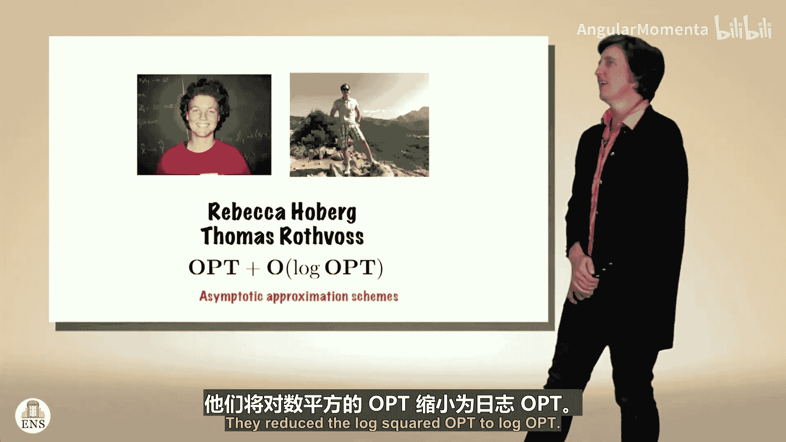

# 023：装箱问题课程结论

在本节课中，我们将总结在装箱问题研究中学习到的核心技术与算法思想，并回顾该领域的重要发展历程。

## 课程概述

我们通过研究装箱问题，学习了两项重要的算法设计技术：**自适应舍入**与**俄罗斯套娃**技术。此外，我们也了解了该问题的复杂性背景与研究脉络。

## 核心技术

上一节我们介绍了处理不同规模物品的算法，本节我们来总结其中用到的核心思想。

以下是我们在装箱问题工作中学习到的两项关键技术：

1.  **自适应输入舍入**
    这是一种新颖的技术，并非像背包问题中那样舍入到最接近的整数或分数，而是一种**依赖于输入其他部分的舍入方式**。这项技术对于简化输入非常有用，常见于输入为一组数值的许多问题中。

2.  **俄罗斯套娃技术**
    这是一种逐层简化的技术。最内层的“套娃”解决了物品**体积大且尺寸种类少**的特殊情况。其外一层是处理所有物品**体积都大**（但尺寸种类可以很多）情况的算法。最外层的“套娃”则处理**对物品体积和种类没有任何限制**的一般情况。如果想使用更专业的术语，这也可以称为**连续归约技术**。这项技术在算法设计中通常非常有用。

## 问题变体与研究背景

装箱问题只是组合优化与运筹学中许多实例的一个简单案例。它存在多种变体：例如当输入不是数字而是正方形或矩形的二维变体；当每个输入物品由三个数字（而非一个）描述的三维变体；以及物品以在线方式随时间到达，必须在看到全部物品之前决定其放置位置并关闭容器的在线变体。过去人们对许多版本的装箱问题进行了研究。

## 重要贡献者

接下来，我们回顾一下在装箱问题研究中做出严格证明贡献的研究者们。

以下是该领域的几位先驱：

*   **Stephen Cook**：以其1972年关于NP完全问题的论文而闻名。他证明了装箱问题在一般情况下是困难的（NP完全）。
*   **David S. Johnson** 与 **Micha Garey**：他们是首批为装箱问题设计并证明近似算法性能界的研究者。这实际上是David Johnson博士论文的一部分，并且他职业生涯中从未停止对装箱问题的兴趣。

在问题被证明是NP完全且出现了常数因子近似算法之后，研究在20世纪80年代转向了**平均情况分析**。早期工作由 **Boris Pittel** 和 **Joseph Kruskal** 等人完成，随后许多数学家和计算机科学家都参与了装箱问题平均情况分析及特定算法的平均性能研究，其中 **David S. Johnson** 是突出代表，**Lisa McGough** 也在此方向有所贡献。

## 渐近近似方案

本周我们还学到了另一点：如果我们无法找到一个近似方案（因为区分两个箱子和三个箱子是NP完全的），那么我们可以改变定义，专注于**渐近情况**。

以下是该方向的关键进展：

*   **W. Fernandez de la Vega** 与 **George S. Lueker** 率先在此方向取得突破。他们发明了自适应舍入法，并用以设计了我们在课程中看到并分析的算法。
*   此后不久，**Nicolas Karmarkar** 与 **Richard M. Karp** 采用了相同的思路，但使用了更好、更复杂的分析，并巧妙地运用了线性规划。他们成功设计出一个算法，其所需箱子数最多为 **OPT + O(log² OPT)**。当OPT趋向无穷大时，log² OPT远小于OPT，因此这几乎是最优的，是对装箱问题更精细的审视方式。
*   随后该领域沉寂了约30年，直到2015年，**Rebecca Hoberg** 与 **Thomas Rothvoss** 将 **log² OPT** 的余项改进到了 **log OPT**，这是一个更优秀的渐近近似方案。

我们才刚刚开始学习近似算法，但已经触及了当前研究的前沿。如果我们能学习更多关于线性规划、差异理论以及巧妙舍入的知识，就能阅读这些论文并理解装箱问题的当前研究了。

## 总结

本节课中，我们一起学习了解决装箱问题的两项核心技术——自适应舍入与俄罗斯套娃（连续归约）技术，回顾了该问题的各种变体，并梳理了从NP完全性证明、常数因子近似、平均情况分析到渐近近似方案的研究历程。现在，你可能已经对这个问题、对装箱、对处理数字感到足够了，在下一章中，我们将重新开始研究图论问题。