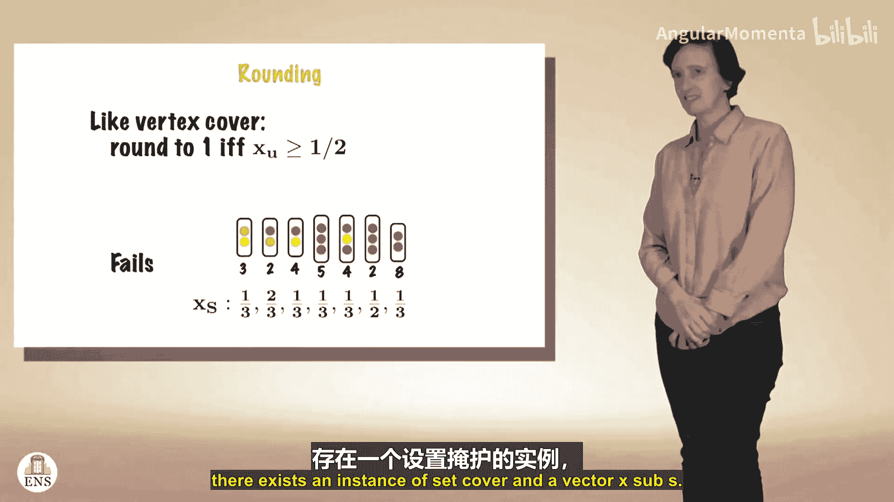

# 024：集合覆盖问题

在本节课中，我们将学习集合覆盖问题。这是一个经典的组合优化问题，也是顶点覆盖问题的推广。我们将探索一种新的近似算法设计技术：使用线性规划的解，并通过随机舍入进行处理。这将是本课程中第一个随机化算法。

## 输入与输出

集合覆盖问题的输入包含两部分：
1.  一个由元素构成的“全集”，例如图中的1到6号元素。
2.  一系列该全集的子集，每个子集都有一个成本。例如，蓝色子集包含了橙色和绿色元素。

这对应着现实中的许多场景。例如，你需要购买一系列烹饪食材，不同的商店（子集）以不同的价格（成本）提供不同的食材组合（元素）。你的目标是选择一些子集（商店），使得所有需要的元素（食材）都被至少一个选中的子集覆盖，同时最小化所选子集的总成本。

输出是一个选中的子集集合。例如，图中三个被轻微着色的子集，其成本分别为4、2和2，总成本为8，并且可以验证每个元素都被至少一个选中的子集覆盖。

## 与顶点覆盖的关系

集合覆盖问题听起来是否似曾相识？是的，它与我们之前学过的**顶点覆盖**问题密切相关。实际上，顶点覆盖是集合覆盖的一个特例。

在顶点覆盖问题中，我们需要用最少的顶点覆盖所有的边。我们可以将其重新表述为一个集合覆盖问题：
*   **元素**：图中的每条边。
*   **子集**：每个顶点对应一个子集，该子集包含所有与该顶点相连的边。
*   **成本**：如果目标是使用最少的顶点，则每个子集的成本为1。

因此，集合覆盖问题比顶点覆盖问题更一般化，也至少同样困难。既然我们曾用线性规划松弛和舍入的方法近似解决顶点覆盖，这启发我们对集合覆盖问题采用类似的方法。

## 整数规划与线性规划松弛

首先，我们为集合覆盖问题建立一个整数规划模型。与顶点覆盖类似，我们为每个输入的子集 `S` 引入一个变量 `x_S`。

*   **变量**：`x_S ∈ {0, 1}`。`x_S = 1` 表示子集 `S` 被选中加入覆盖，`x_S = 0` 则表示未被选中。
*   **约束**：对于全集中的每个元素 `e`，必须被至少一个选中的子集覆盖。即，所有包含元素 `e` 的子集 `S`，其对应的变量 `x_S` 之和至少为1。公式表示为：`∑_{S: e ∈ S} x_S ≥ 1`。
*   **目标**：最小化总成本。设每个子集 `S` 的成本为 `c_S`，则目标函数为：`Minimize ∑_S c_S * x_S`。

这个整数规划精确地描述了集合覆盖问题。接下来，我们将其松弛为线性规划。

*   **线性规划松弛**：将整数约束 `x_S ∈ {0, 1}` 放松为 `x_S ∈ [0, 1]`，允许变量取0到1之间的任意实数值。其他约束和目标函数保持不变。

## 从顶点覆盖舍入法的失败尝试

在顶点覆盖问题中，我们采用的舍入策略很简单：对于线性规划的解 `x_u`，如果 `x_u ≥ 0.5`，则将其舍入为1（选中该顶点），否则舍入为0。

我们能否将这一策略直接套用到集合覆盖上呢？即，对于每个子集 `S`，如果线性规划解 `x_S ≥ 0.5`，则选中它。遗憾的是，**这个策略会失败**，它可能无法产生一个有效的集合覆盖。

考虑一个例子：假设有三个子集，每个在线性规划解中的值 `x_S = 1/3`。某个元素恰好只属于这三个子集。那么，该元素被覆盖的“分数”总和为 `1/3 + 1/3 + 1/3 = 1`，满足约束。但按照 `≥ 0.5` 的阈值舍入，这三个 `x_S` 都会被舍入为0，导致该元素完全未被覆盖。

如果我们降低阈值，比如设为 `1/3`，那么在这个例子中所有子集都会被选中。但我们可以构造另一个例子，让所有 `x_S = 1/4`，此时 `1/3` 的阈值又会导致所有子集被舍弃。**对于任何一个固定的阈值，我们总能构造出一个反例，使得舍入后的解无法覆盖所有元素。**

因此，我们需要一种更智能的、非固定阈值的舍入方法。

## 引入随机化舍入

既然固定阈值的方法行不通，我们将采用**随机化舍入**技术。这种方法的核心思想是：根据线性规划解 `x_S` 的值，以一定的概率随机决定是否选中子集 `S`。具体来说，**我们以概率 `x_S` 独立地将每个子集 `S` 加入覆盖。**

这个想法非常直观：`x_S` 可以解释为“子集 `S` 应该被选中的倾向性”。通过随机化，我们期望在多次实验中，每个元素被覆盖的概率与其在线性规划中被满足的程度相关。

在下一节中，我们将详细分析这种随机化舍入算法的性能，并证明它能以高概率得到一个总成本可控且覆盖所有元素的解。

---

本节课中，我们一起学习了集合覆盖问题的定义，理解了它如何推广顶点覆盖问题。我们建立了该问题的整数规划模型及其线性规划松弛，并指出了直接沿用顶点覆盖的确定性舍入法会失败。最后，我们引入了随机化舍入作为解决方案，这将是我们在近似算法工具箱中的又一个强大工具。