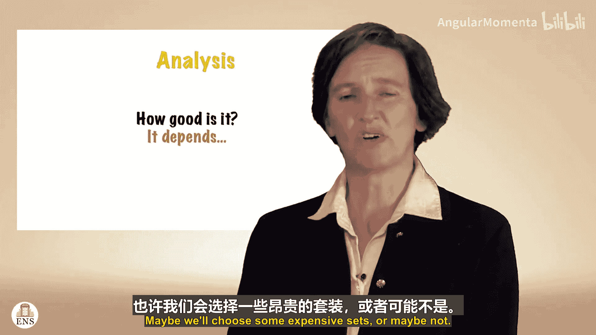

**近似算法课程：第1章：集合覆盖问题与随机舍入算法**

在本节课中，我们将学习集合覆盖问题，并探讨一种基于线性规划松弛和随机舍入思想的近似算法。我们将从问题定义开始，回顾之前尝试的失败，然后详细介绍随机舍入算法的步骤，并分析其效率、正确性和近似比。

---

我们定义了集合覆盖问题。我们认识到它是顶点覆盖问题的一个推广。

我们曾尝试将用于顶点覆盖的算法进行扩展，但未能成功。

现在，我们需要再次尝试，以得到一个求解集合覆盖的算法。

以下是我们之前使用的线性规划松弛模型。这个模型我们将保留。核心问题是：如何对线性规划的解进行舍入？

现在，我们将介绍一种使用随机舍入的算法。

考虑一个取值在0到1之间的变量，例如0.9。当我们想将其舍入为整数时，0.9很可能应该被舍入为1。另一方面，如果它的值是0.1，那么很可能应该被舍入为0。但正如我们所见，我们不能简单地设定一个固定阈值，规定高于阈值的都变为1，低于阈值的都变为0。

因此，我们需要更巧妙的方法。这里的思路是使用随机化，即利用概率。

具体如何操作？假设一个变量的值为0.8。我们不会总是将其舍入为1，而是以一定的概率进行。我们抛掷一些“硬币”。然后，我们以80%的概率（即0.8的概率）将该变量舍入为1。这就是我们如何利用分数值，将其转化为整数值的方法。

新的舍入算法非常简单。对于每一个集合S，我们查看线性规划解中对应的变量 \( x_S \)。以概率 \( x_S \)，我们将集合S放入集合覆盖中。以概率 \( 1 - x_S \)，我们不将S放入覆盖中。当我们对每个集合S都执行此操作后，就做出了一系列决策，然后输出最终得到的集合族。

这是一个非常简单的舍入算法。对于这类算法，我们通常需要回答三个问题。

以下是需要分析的三个核心问题：

1.  **效率如何？** 算法是否高效？
2.  **是否正确？** 算法的输出是否是一个有效的集合覆盖？
3.  **质量如何？** 输出覆盖的成本是多少？

第一个问题很容易回答。算法是否高效？是的。为什么？因为所需时间主要是求解线性规划的时间，我们知道这是多项式时间的。此外，对于每个变量，只需进行一次随机选择（在0到1之间生成一个随机数并做一次决策）。因此，总体上是多项式时间，前提是我们能够获取随机数，这在实践中是成立的。

第二个问题是关于输出的正确性。输出可能不是一个覆盖。因为我们对每个集合都做了随机选择，有可能我们决定不将任何集合放入覆盖中，导致输出为空，元素未被覆盖。所以，它可能是一个覆盖，也可能不是。

第三个问题是关于输出的质量。这也不确定。我们可能选择了一些昂贵的集合，也可能没有。

因此，对于这个算法，我们需要分析两件事：输出结果是一个覆盖的概率，以及输出集合族的成本。

---

**总结**

本节课中，我们一起学习了集合覆盖问题，并介绍了一种基于线性规划松弛的随机舍入算法。我们明确了算法的三个关键分析维度：效率、正确性和近似质量。算法的效率很高，但其正确性（是否能产生一个覆盖）和成本并非确定性的，需要通过概率分析来评估其期望性能。在接下来的课程中，我们将深入进行这种概率分析。