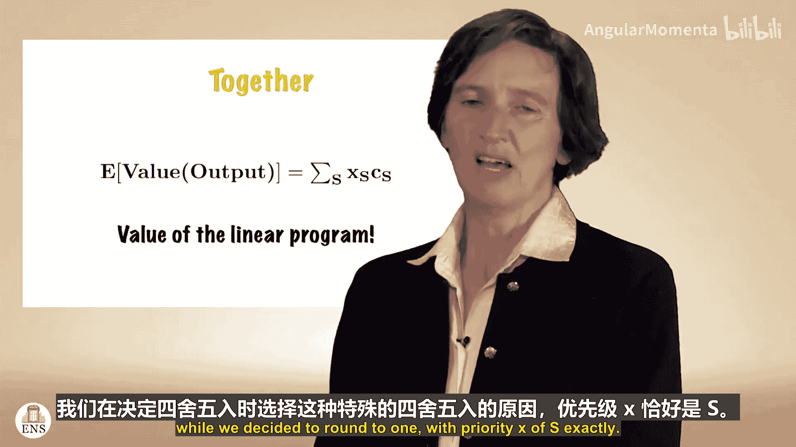

**近似算法：第1章：随机舍入的成本分析**

在本节中，我们将分析上一节介绍的随机舍入过程所产生的解的成本。我们将看到，该解在期望值上的成本与线性规划松弛的最优值直接相关。

---

现在，我们有了一个随机舍入程序，可以将线性规划松弛的解转化为整数解。接下来，让我们分析这个解的成本，并将其与线性规划的最优值联系起来。

输出的集合族质量如何？这取决于具体情况。首先，我们写出输出解的成本表达式。

输出解的成本是输出集合族中每个集合S的成本之和。这是一个随机变量，因为集合S是否在输出中取决于随机选择。因此，这个值有时大，有时小。对于随机算法，我们通常关心这个值的平均表现或典型表现。

为此，我们将输出解的成本重写为：对所有集合S，计算其成本 `C_S` 乘以一个指示函数。该指示函数在集合S被选入输出覆盖时取值为1，否则为0。

我们可以将输出解的成本表示为：
`Cost = Σ_S (C_S * I_S)`，其中 `I_S` 是指示函数。

我们关心这个随机变量的期望值。这里我们使用期望的线性性质，这是算法分析中一个非常有用的工具。对于任意随机变量A和B，有 `E[A + B] = E[A] + E[B]`。期望与求和运算可以交换顺序。

因此，输出解的期望成本为：
`E[Cost] = E[ Σ_S (C_S * I_S) ] = Σ_S E[ C_S * I_S ]`。

接下来，我们关注 `E[ C_S * I_S ]`。根据期望的性质，对于任意常数λ和随机变量X，有 `E[λX] = λ * E[X]`。这里 `C_S` 是常数，因此可以提到期望外面：
`E[ C_S * I_S ] = C_S * E[ I_S ]`。

现在，我们需要计算 `E[ I_S ]`，即指示函数的期望值。指示函数的期望值恰好等于该事件发生的概率。这是一个基本的概率论事实。

因此，`E[ I_S ]` 等于集合S被选入输出集合族的概率。根据我们的舍入规则，我们恰好以概率 `x_S` 将集合S包含在输出中。

综合以上推理，我们得出结论：输出集合族的期望成本等于：
`E[Cost] = Σ_S (C_S * x_S)`。

观察这个表达式。你认出来了吗？这个量恰好是线性规划松弛的目标函数值。我们知道，由于这是一个松弛，该值至多是原始问题最优值 `OPT`。

因此，我们的舍入过程产生的集合族，其期望成本至多为未知的最优值 `OPT`。这正是我们选择这种特定舍入方式的原因——我们决定恰好以概率 `x_S` 将变量舍入为1，就是为了得到这个目标函数关系。

---

现在我们知道，我们的舍入程序产生的集合族，其期望成本至多为 `OPT`。接下来，我们需要考察这个集合族能提供多少覆盖。