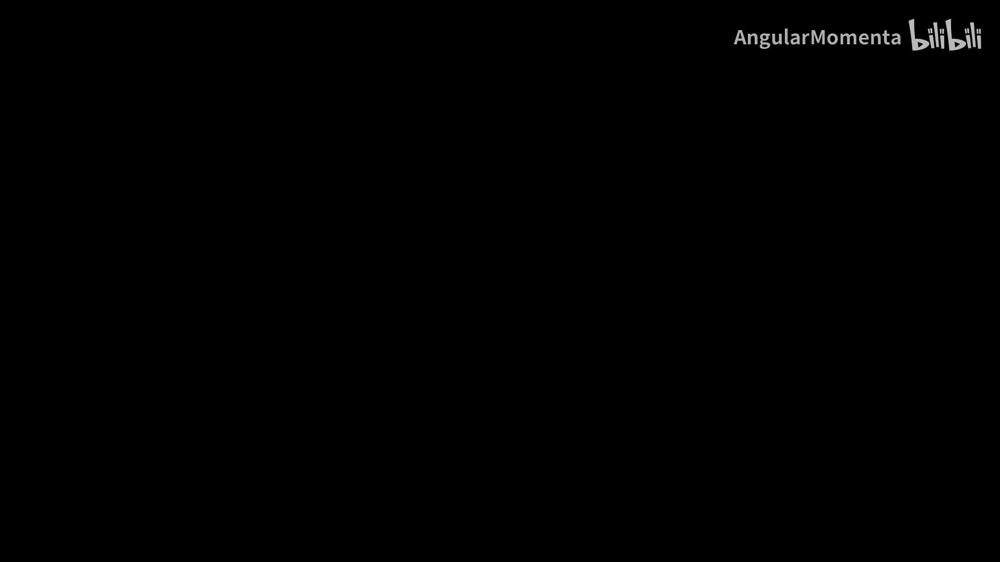

**近似算法：第一讲：集合覆盖问题分析**

在本节课中，我们将学习如何分析一个用于解决集合覆盖问题的随机算法。我们将看到，该算法能以不超过最优解（OPT）的期望成本输出一个集合族，但我们需要验证这个输出是否确实覆盖了所有元素。

上一节我们介绍了算法的成本分析，本节中我们来看看算法的正确性分析，即它是否总能输出一个有效的集合覆盖。

**算法正确性分析**

算法的输出是否构成一个集合覆盖？答案取决于我们的随机选择，可能“是”，也可能“不是”。因此，我们需要更仔细地分析这个性质。

具体来说，我们来分析被选中并放入输出结果的集合所覆盖的元素数量。这个数量可以表示为每个元素的指示函数之和：

`覆盖的元素数量 = Σ_e I(e被覆盖)`

其中，指示函数 `I(e被覆盖)` 在元素 `e` 被覆盖时为1，否则为0。这是一个随机变量，我们将分析它的期望值。

计算这个和的期望值。当我们看到和的期望时，可以交换求和与期望的顺序。指示函数的期望值等于该事件发生的概率。因此，我们得到：

`E[覆盖的元素数量] = Σ_e Pr(e被覆盖)`

现在，为了分析这个表达式，我们聚焦于一个特定的元素 `e`。元素 `e` 被覆盖的概率是多少？这是本章技术性较强的部分。

**计算元素被覆盖的概率**

元素 `e` 被覆盖，当且仅当输出集合族中存在一个包含 `e` 的集合 `S`。因此：

`Pr(e被覆盖) = Pr(∃ S ∈ 输出集合族，使得 e ∈ S)`

计算“存在”某事件的概率，常用技巧是使用其对立事件：

`Pr(e被覆盖) = 1 - Pr(所有包含e的集合S都未被选入输出集合族)`

现在我们需要分析这个概率。以下是关键步骤：

1.  **利用独立性**：算法为每个集合 `S` 独立地以概率 `x_S` 将其放入输出。因此，所有包含 `e` 的集合都未被选中的概率，等于每个此类集合未被选中的概率的乘积。
2.  **计算单个概率**：集合 `S` 未被选中的概率是 `1 - x_S`。

综合以上两点，我们得到：

`Pr(e被覆盖) = 1 - Π_{S: e∈S} (1 - x_S)`

**简化概率表达式**

接下来，我们对乘积项 `Π (1 - x_S)` 进行简化处理。

首先，利用对数的性质，将乘积转化为求和：

`Π_{S: e∈S} (1 - x_S) = exp( Σ_{S: e∈S} ln(1 - x_S) )`

其次，利用不等式 `ln(1 - x) ≤ -x`（当 `x ∈ [0,1)` 时成立），我们可以得到：

`Π_{S: e∈S} (1 - x_S) ≤ exp( - Σ_{S: e∈S} x_S )`

现在，观察指数中的求和项 `Σ_{S: e∈S} x_S`。我们在线性规划（LP）的约束条件中见过它：对于每个元素 `e`，所有包含 `e` 的集合的 `x_S` 值之和至少为1。即：

`Σ_{S: e∈S} x_S ≥ 1`

将这个不等式代入，我们得到：

`Π_{S: e∈S} (1 - x_S) ≤ exp(-1) = 1/e`

因此，元素 `e` 被覆盖的概率至少为：

`Pr(e被覆盖) ≥ 1 - 1/e`

**结论与当前状态**

将这个下界代入期望覆盖元素数量的公式中，我们得到：

`E[覆盖的元素数量] ≥ n * (1 - 1/e)`

其中 `n` 是元素总数。`1 - 1/e` 约等于 63.2%。

至此，我们证明了：通过随机舍入，我们得到了一个集合族，其期望成本不超过 `OPT`，并且平均至少覆盖了 **63.2%** 的元素。

然而，这还不是一个完整的集合覆盖。我们尚未保证覆盖所有元素，但已经非常接近了。接下来，只需要对算法进行一些修改，就能将其转变为一个完全正确的集合覆盖算法。

本节课中我们一起学习了如何分析随机舍入算法在集合覆盖问题上的覆盖能力。我们证明了算法能以低成本覆盖大部分元素，为最终构建完整解奠定了基础。