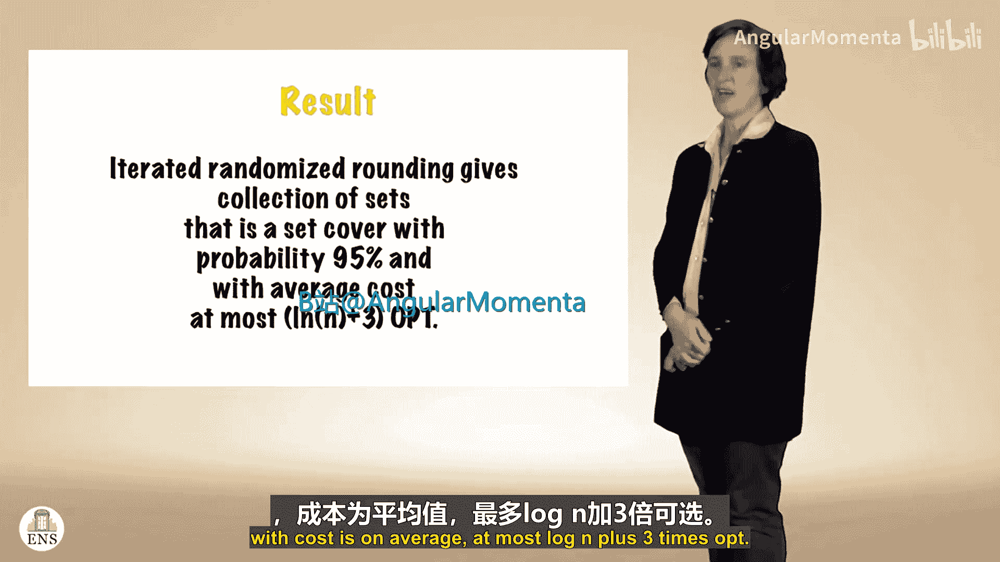
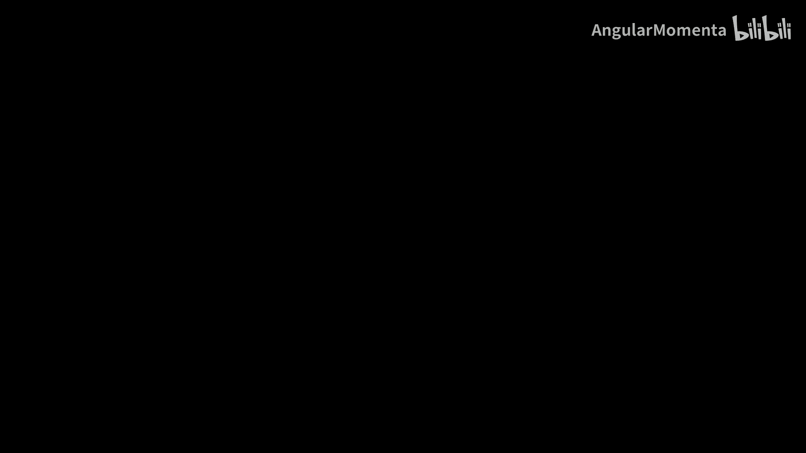

**近似算法：第1章：集合覆盖问题的迭代随机舍入算法**

在本节课中，我们将学习如何利用迭代随机舍入技术，为集合覆盖问题构建一个近似算法。我们将从一个成本最优但覆盖不完全的初始方案出发，通过迭代改进，最终得到一个高概率正确且成本有界的近似解。

---

上一节我们介绍了集合覆盖问题的线性规划松弛及其随机舍入方法，该方法在成本上表现优异，但在覆盖完整性上存在不足。本节中，我们来看看如何通过迭代来改进覆盖效果。

初始的随机舍入算法在成本方面表现很好，其期望成本至多为最优解（OPT）。但在覆盖方面表现不佳，它平均只能覆盖大约63%的元素。因此，我们需要改进算法以获得一个完整的集合覆盖。

解决方案的核心思想很简单：**迭代**。我们重复选择集合的过程，直到获得一个实际的集合覆盖。

以下是针对集合覆盖问题的随机舍入算法。设 **N** 表示集合覆盖中元素的总数。

我们将重复以下操作 **log N + 3** 次：
*   对于每个集合 **S**，我们以概率 **x_S** 将其加入我们的覆盖中（如果它尚未被加入）。

选择 **log N + 3** 次是因为 **e^3** 约等于20，这个数字在后续分析中会用到。

让我们分析这个迭代过程意味着什么。

**成本分析**
在期望值上，总成本至多是 **(log N + 3) * OPT**。这非常好，如果算法能产生一个集合覆盖，那么它就给出了一个 **log N** 倍的近似解。

**正确性分析**
算法输出一个完整集合覆盖的概率是多少？这等于1减去输出“不是覆盖”的概率。

输出“不是覆盖”的概率，即存在至少一个元素未被覆盖的概率。根据概率的并集界限（Union Bound），这个概率至多是所有元素“未被覆盖”的概率之和。

那么，单个元素 **E** 未被覆盖的概率是多少？

首先，看一次循环迭代。根据之前的分析，在单次迭代中，元素 **E** 未被覆盖的概率至多是 **1/e**（约0.367）。

当我们把所有的迭代放在一起考虑时，各次迭代之间是独立的。因此，元素 **E** 在所有迭代中均未被覆盖的概率，就是每次迭代中它未被覆盖的概率的乘积。

由于每次迭代的概率至多为 **1/e**，并且有 **log N + 3** 次迭代，所以这个乘积至多是 **(1/e)^(log N + 3)**。

这个值等于 **1/(e^3 * N)**，大约为 **1/(20N)**。

综合以上分析，所有元素未被覆盖的概率总和至多为 **N * (1/(e^3 * N))**，即小于 **0.05**。

因此，算法输出一个正确集合覆盖的概率至少为 **95%**。

---

综上所述，通过进行迭代随机舍入，我们得到了一组集合，这组集合有至少 **95%** 的概率构成一个完整的集合覆盖，并且其期望成本至多为 **(log N + 3) * OPT**。

我们几乎已经成功了。我们得到了一个本质上是集合覆盖的随机算法，它在 **95%** 的情况下都能输出一个集合覆盖。在下一部分，我们将看到如何将这个算法转化为一个**总是**返回集合覆盖的算法。