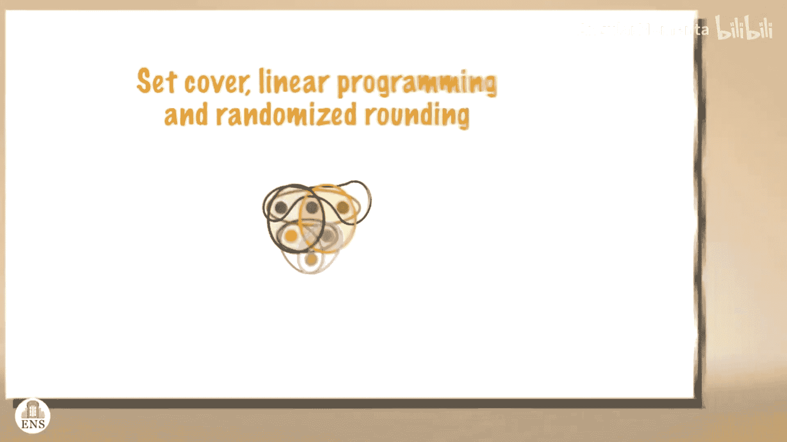

# 031：集合覆盖问题总结与展望 🎯

在本节课中，我们将总结集合覆盖问题的核心内容，并展望更优的算法及其理论极限。我们将介绍贪心算法，探讨其优势，并回顾该领域的重要贡献者。

## 关于集合覆盖的其他说明

关于集合覆盖问题，还有许多其他方面可以讨论。我们以几点说明作为结尾。

我们已证明的结果是，“采样与迭代”算法输出的集合覆盖，其平均成本至多是 **log n + 1** 乘以最优解的成本 **OPT**。

## 能否做得更好？ 🚀

我们能否做得比这更好？能否设计出一个算法，其成本总是至多 **log n + 1** 乘以 **OPT**？能否设计出更快的算法？这两个问题的答案都是肯定的。

实际上，一个答案可以同时解决这两个问题。我们在算法第一部分使用的线性规划需要多项式时间，但通常比纯组合算法慢。

## 引入贪心算法

因此，让我们尝试用组合算法替代线性规划。实现方法是采用贪心策略。

具体操作如下：我们进行一个循环，不断选择集合，直到形成一个集合覆盖。这与“采样与迭代”算法类似。

在每一步中，我们重复选择“最佳”集合。我们选择的集合会覆盖一定数量的尚未被覆盖的元素，并且其成本为 **C_S**。我们选择“最佳”集合，即最大化“新覆盖元素数量”与“集合成本”之比的集合。

## 贪心算法的性质

当你这样做时，就形成了一个自然的贪心算法。关于这个算法，已知的是：它当然会输出一个集合覆盖，并且其成本总是至多 **log n + 1** 乘以 **OPT**。

因此，它与我们研究过的“采样与迭代”算法一样好。

## 贪心算法的优势

以下是贪心算法的优势：
*   首先，贪心算法是组合算法，不需要求解线性规划。
*   其次，其结果的质量在最坏情况下是有保证的，而不仅仅是平均情况。

但两者的性能界限是相同的，这并非巧合。这两种算法有一些相似之处。实际上，你可以论证，如果采用随机化算法并进行适当的去随机化处理，就可能生成贪心算法。因此，这是生成良好近似算法的另一种技术。

## 能否超越对数因子？ 🧐

我们能否做得比 **log n** 更好？答案是否定的。

如果 **P ≠ NP**，那么不可能在多项式时间内得到一个成本总是优于 **log n** 乘以 **OPT** 的集合覆盖。因此，这个算法是最优的。如果 **P ≠ NP**，这就是我们所能期望的最好结果。它是集合覆盖问题的最佳近似算法。

## 重要贡献者

许多人都研究过这个问题并证明了这些优秀的结果。以下仅列举几位：
*   在20世纪70年代，**László Lovász**（匈牙利人）设计并分析了贪心算法。
*   在20世纪70年代，**David Johnson**（美国人）设计并分析了贪心算法。
*   等等，他们都做了同样的事情？实际上，这些都是独立的研究工作。我猜想，当时正是设计第一批近似算法和该领域初步发展的成熟时期。
*   关于最优性，即无法获得更好近似比的 **NP 难度**结果，是由以色列的 **Uriel Feige** 证明的。
*   最后，我在讲解“采样与迭代”算法最后一部分时的表述，主要灵感来源于 **Neal Young** 使用沃尔德不等式的讲义。

## 本章总结 📚

那么，我们在本章中学到了什么？
*   我们学习了一个著名问题：**集合覆盖**。
*   我们学习了针对这个基本问题的**基本算法和性质**。
*   这是我们遇到的第一个重要概念的例子：**算法设计中的随机化**。
*   对于近似算法，我们使用了基本技术：**随机舍入**。这项技术在其他场景中也非常有用，包括我们将在下一章看到的内容。
*   在分析工具方面，我们看到的最基本、最重要的工具（如果非要记住一个的话）就是**期望的线性性质**。这对于分析任何随机化算法都至关重要。
*   最后，就我们进行分析的方式而言，这种**缓慢而稳健**的方式——按部就班地列出方程，审视每一步——有点像**爬山**。你必须缓慢而小心地一步接一步，左脚，右脚，左脚，右脚。这样你就能到达山顶，而不会在路上感到疲惫。

## 下章预告

在下一章中，完成集合覆盖问题的学习后，我们将探讨线性规划的另一个应用，并研究针对**多路割问题**的一个有趣的随机舍入方法。