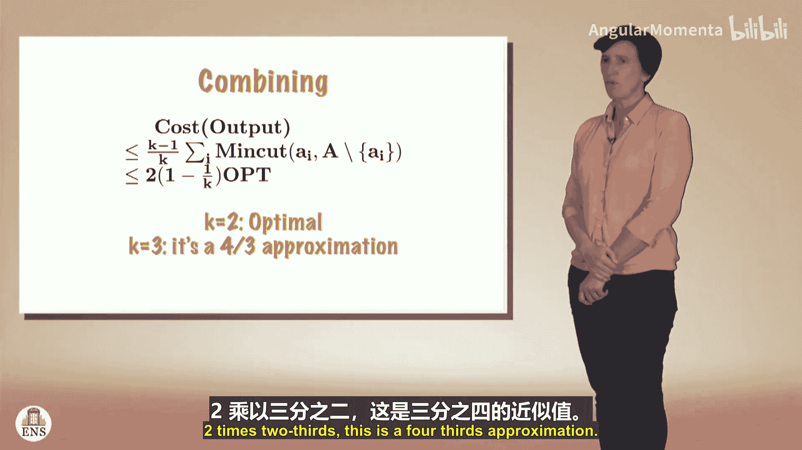

# 032：多路割问题

## 概述
在本节课中，我们将学习一个新的问题——多路割问题。我们将定义这个问题，分析其计算复杂度，并介绍一个简单的近似算法。随后，我们将探讨如何通过更精细的分析来改进这个算法的近似比，并引入线性规划松弛和随机舍入的概念，为设计更好的算法做准备。

## 多路割问题的定义 😊

多路割问题的输入和输出定义如下。

**输入**是一个图，图中的边带有权重。此外，图中有一些特殊的顶点，称为**终端**。我们有k个终端，k是一个固定的数，可能是2、3，或者像下图中的6个。

**目标**是通过切割边来将这些终端彼此分离。因此，**输出**是一个边的子集F，使得从图中移除这些边后，所有终端彼此都不再连通。我们的目标是**最小化**所切割边的总权重。

这就是多路割问题。

## 一个特例：最小割问题 😊

有一个我们熟悉**特例**：当K=2时。两个终端A和B。用最小权重的边集将A与B断开。这就是一个割，一个将A与B分离的割。这就是著名的**最小割问题**。我们知道，最小割问题可以在多项式时间内精确求解。

## 问题的复杂度 😊

下一个情况，k=3。三个终端A、B、C必须通过一个最小权重的边集彼此断开。这个问题已经是NP难的了。这并不奇怪，因为在组合优化中，k=2的情况通常简单，而k=3或更多的情况通常是困难且NP难精确求解的。

## 一个简单的三路割算法 😊

以下是一个针对k=3的简单算法。

我们取三个终端A、B、C。
1.  计算将顶点A与B和C分离的最小割。这是一个将顶点划分为两个子集的割，使得跨越割的边具有最小权重，并且它将顶点A与顶点B和C断开。
2.  解决相同的问题来隔离顶点B：找到将顶点B与顶点A和C分离的最小割。
3.  类似地，计算将顶点C与其他两个终端分离的最小割。

现在，我们取这三个割，选择其中**成本最低的两个**，并输出它们的**并集**。

在下图案例中，红色和紫色的割是三个中最便宜的，因此这就是你的解。

## 算法分析

上一节我们介绍了三路割的简单算法，本节中我们来看看这个算法是否有效。

**算法能在多项式时间内运行吗？**
我们需要找到一个子程序，用于在多项式时间内将顶点A与顶点B和C分离。这可以通过归约到最小割问题轻松完成。方法如下：
创建一个新顶点S和另一个新顶点T。用无限权重的边将S连接到A。用无限权重的边将顶点B和C连接到T。在这个新图中，求解从S到T的最小割。这个最小割永远不会使用无限权重的边，因为那样成本太高，所以它只会使用图内部的边，从而给出一个A与S在同一侧、B和C与T在同一侧的解决方案，因此它将分离A与BC。实际上，从S到T的割与从A到BC的割存在精确的一一对应关系。所以我们可以用多项式时间解决这个问题。

**输出正确吗？它是一个三路割吗？能分离三个终端吗？**
我们取了红色和紫色的解决方案。红色割将顶点A与B和C都分开了。所以现在A到B和A到C都没有连接。B和C之间可能仍然存在连接，但由于紫色割将C与其他两个顶点分开了，C与B是断开的。因此，该解决方案是一个三路割，是问题的正确解。

**它的效果如何？输出的成本是多少？**
我们说过，在分离A与BC、B与AC、C与AB的三个割中，输出的成本是这三个项中最便宜的两个。因此，其成本**至多**是这三个最小割之和的**三分之二**。

## 近似比分析 😊

我们已经上界了算法输出的成本。要继续分析，我们需要下界最优解OPT的成本。

考虑最优解OPT。OPT大于等于从A到BC的最小割。因为最优解分离了所有三个终端，所以它确实将终端A与其他两个终端分离，因此它是从A到BC的一个可行割，所以OPT的值至少是从A到BC的最小割。类似地，它至少是从B到AC的最小割，也至少是从C到AB的最小割。

因此，既然它至少是这三项中的每一项，那么它就至少是它们的**平均值**，即至少是这三个最小割之和的**三分之一**。

算法输出至多是三个最小割之和的**三分之二**，而OPT至少是三个最小割之和的**三分之一**，因此该算法是一个**2-近似算法**。

我们证明了我们的解决方案是一个2-近似。你能做得更好吗？通过更仔细的分析，你可以做得更好。

## 扩展到一般的K 😊

上一节我们分析了三路割的情况，现在让我们将算法扩展到一般的K个终端。

我们有K个终端，A1, A2, ..., Ak。
算法的自然扩展是输出所有k个最小割中**最小的k-1个**。其中，第i个割分离终端Ai与其他所有终端。同样，这可以在多项式时间内完成，因为要计算将终端Ai与其他终端分离的最小割，我们可以用无限边将源点S连接到Ai，用无限边将汇点T连接到所有其他终端，然后求解从S到T的最小割。

所以这是一个多项式时间算法，它给你一个K路割（多路割），我们需要做的是分析它的值。

类似地，我们输出k个割中最小的k-1个。输出的成本可以通过如果我们从k个割中随机选择k-1个割的平均成本来上界。因此，输出的成本**至多**是 `(k-1)/k` 乘以所有最小割之和，即每个终端Ai与其他终端分离的最小割值之和。

## 对OPT成本的下界分析 😊

现在，让我们对最优解OPT的成本进行下界分析。

我断言，对于每个终端Ai，可以找到一些割将其与其他所有终端分离。考虑属于最优解OPT的一条边E。为什么E是OPT的一部分？因为如果我们把E留在图中，那么两个终端就会连通，这就是为什么OPT必须移除边E。所以，一旦我们移除它，它就会分离某个终端Ai和某个终端Aj。让我们把这条边E放入边集F_i和边集F_j中。我们这样分配OPT的每条边：如果这条边连接一个在终端Ai簇中的顶点和一个在终端J簇中的顶点，这就是F_i和F_j的定义。

换句话说，F_i定义为OPT中那些将终端Ai与某个不同于i的终端Aj分离的边的集合。OPT中的每条边E属于两个集合F_i和F_j。所以，如果我们对所有F_i的成本求和，每条边出现两次，我们恰好得到**两倍的OPT**。

因此，这为我们提供了一种表达OPT值的方法：`2 * OPT = Σ_i cost(F_i)`。

接下来，我们如何分析F_i的成本？F_i由OPT中所有将终端Ai与其他某个终端分离的边组成。所以F_i将Ai与其他终端分离。因此，F_i的成本**至少**是将Ai与其他终端分离的**最小成本**，即F_i的成本大于等于将Ai与其他终端分离的最小割值。

现在进行求和。我们得到：`2 * OPT = Σ_i cost(F_i) ≥ Σ_i (MinCut separating Ai from others)`。

因此，`2 * OPT ≥ Σ_i (MinCut separating Ai from others)`。

## 结合上下界得出近似比 😊

现在我们要做的就是将这个结果与我们之前得到的算法输出成本的上界结合起来。

算法输出的成本至多是 `(k-1)/k` 乘以我们证明过的所有最小割之和。现在，这个最小割之和至多是 `2 * OPT`，所以这给出了什么？它表明该算法是一个 `2 * (1 - 1/k)` 近似算法。

该算法的近似比为 `2 * (1 - 1/k)`。

*   **K = 2**：这得到 `2 * (1 - 1/2) = 1`，即1倍OPT。该算法是最优的。确实，它只是计算一个最小割。
*   **K = 3**：`1 - 1/k` 是 `1 - 1/3 = 2/3`，`2 * 2/3 = 4/3`。这是一个**4/3近似**。

所以实际上，我之前概述的分析并不紧。通过进行这种更仔细的分析，我们能够证明该算法对于k=3是4/3近似，对于一般的k是 `2*(1-1/k)` 近似。

## 总结与展望

在本节课中，我们一起学习了多路割问题的定义及其计算复杂度。我们介绍并分析了一个简单的基于最小割的算法，证明了它对于k个终端的近似比为 `2*(1-1/k)`。特别地，对于三路割问题，该算法是一个4/3-近似算法。

然而，我们还可以做得更好。接下来，我们将尝试设计一个更好的算法，依赖于一个**有趣的线性规划松弛**和**随机舍入**技术。这将是我们在后续课程中探索的方向。