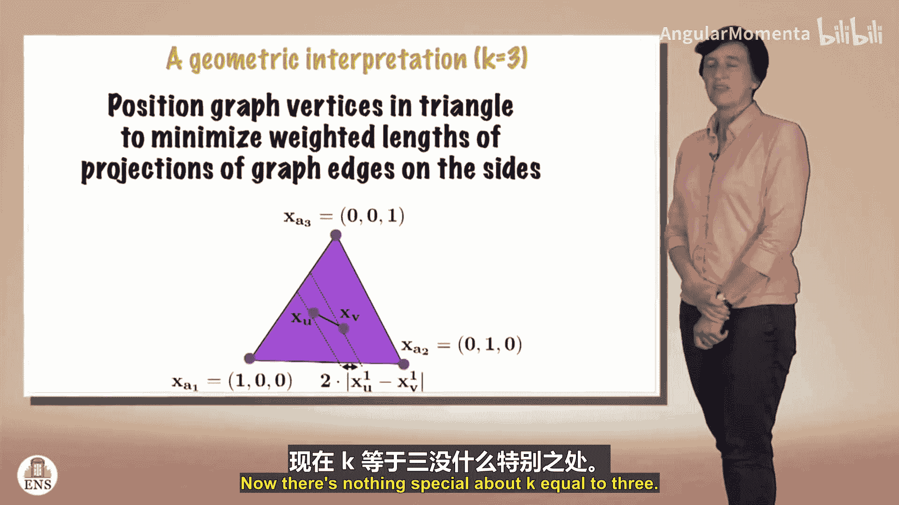

# 033：基于线性规划松弛的多路割问题建模 🧩

在本节课中，我们将学习如何为多路割问题设计一个更复杂、性能更好的算法。这个算法的核心思想是使用一个有趣的线性规划松弛方法。

## 整数规划建模

上一节我们介绍了一个简单的多路割算法。本节中，我们来看看如何为多路割问题设计一个整数规划模型。

我们需要定义一些变量。考虑到多路割的本质是将图的顶点划分为与各个终端对应的簇。

以下是定义变量的步骤：
*   对于每个图顶点 `U` 和每个终端 `i`，我们定义一个变量 `x_{U,i}`。这个变量的含义是：如果顶点 `U` 属于终端 `i` 的簇，则其值为 1。
*   对于每条边 `E` 和每个终端 `i`，我们定义一个变量 `z_{E,i}`。这个变量的含义是：当且仅当边 `E` 从簇 `i` 中穿出时，其值为 1。

接下来，我们需要为整数规划添加约束条件。

以下是主要的约束条件：
1.  所有变量 `x_{U,i}` 和 `z_{E,i}` 必须是 0 或 1。
2.  对于终端 `a_i`，它必须位于自己的簇中，因此 `x_{a_i, i} = 1`。
3.  每个顶点必须恰好属于一个簇。因此，对于任意顶点 `U`，所有 `x_{U,i}` 的和必须等于 1。
4.  我们需要表达“边穿过簇”这一条件。对于边 `E = (U, V)` 和终端 `i`，当且仅当 `x_{U,i}` 不等于 `x_{V,i}` 时，`z_{E,i}` 应为 1。这可以表示为：`z_{E,i} >= |x_{U,i} - x_{V,i}|`。由于这是“大于等于”绝对值的不等式，我们可以将其线性化为两个条件：`z_{E,i} >= x_{U,i} - x_{V,i}` 和 `z_{E,i} >= x_{V,i} - x_{U,i}`。

最后，我们定义目标函数。目标是计算割的权重，即所有穿过不同簇的边的权重之和。对于一条边 `E`，如果它连接两个不同的簇，则恰好有两个 `z_{E,i}` 值为 1（对应两个簇）。因此，目标函数是最小化 `(1/2) * Σ_{E} Σ_{i} (c_E * z_{E,i})`，其中 `c_E` 是边 `E` 的权重。

综上所述，我们得到了多路割问题的整数规划模型。

## 线性规划松弛与几何解释

现在，我们进行线性规划松弛。方法很简单：将变量 `x_{U,i}` 和 `z_{E,i}` 的 0/1 整数约束，松弛为在 [0, 1] 区间内的实数约束。其他所有约束和目标函数保持不变。

这个线性规划松弛的有趣之处在于，我们可以对其进行几何解释。我们将其视为一个几何对象来研究。

对于每个顶点 `U`，我们可以将其变量 `x_{U,i}` 视为一个 `K` 维向量（`K` 是终端数量）。由于所有 `x_{U,i}` 非负且和为 1，这个向量的 L1 范数等于 1。

让我们以 `K=3` 为例进行可视化。三个终端 `a_1`, `a_2`, `a_3` 对应的向量分别是 (1,0,0), (0,1,0), (0,0,1)。所有其他顶点的向量必须满足 `x1 + x2 + x3 = 1` 且各分量非负。这在三维空间中定义了一个三角形，三个终端位于三角形的三个角上。

目标函数可以重写为：最小化 `(1/2) * Σ_{(U,V)} c_{UV} * ||x_U - x_V||_1`，即所有边对应的向量之间的 L1 距离的加权和。

进一步分析这个三角形，我们可以发现一个关键的几何事实：两个点 `x` 和 `y` 之间的 L1 距离，等于它们在该三角形三条边上的投影之间的距离之和的一半。

因此，当 `K=3` 时，线性规划松弛所做的几何解释是：将图的顶点嵌入到这个三角形中（三个终端固定在三个角上），以最小化所有图的边在三角形三条边上的投影的加权长度。

对于 `K>3` 的情况，原理类似，只是将三角形推广到更高维的单形（如四面体），但 `K=3` 的情况更易于可视化。

## 总结

本节课中，我们一起学习了如何为多路割问题构建一个基于线性规划松弛的算法框架。我们首先设计了一个整数规划模型，然后将其松弛为线性规划。最关键的一步是，我们为这个松弛问题（特别是 `K=3` 时）找到了一个清晰的几何解释：将图的顶点嵌入到一个三角形中并优化投影长度。这为我们下一节将要讨论的舍入策略奠定了坚实的基础。