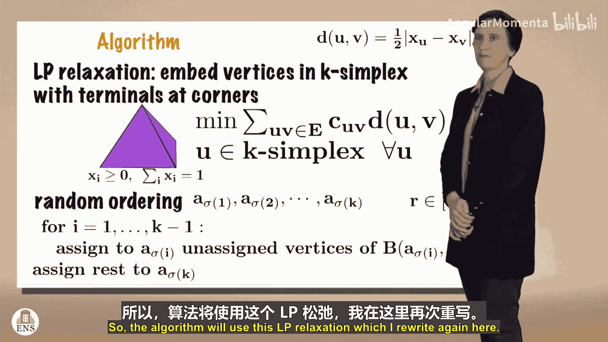

# 034：随机化舍入

在本节课中，我们将学习如何对线性规划松弛的解进行“舍入”，从而得到一个可行的、高质量的近似解。我们将聚焦于一个几何视角，并引入一种称为“随机化舍入”的巧妙技术。

上一节我们介绍了多路割问题的线性规划松弛及其几何解释。本节中我们来看看如何将松弛解“舍入”为一个实际的划分方案。

## 几何舍入问题

考虑 K=3 的情况。我们有一个三角形，三个终端分别位于三个角上。每个图顶点都嵌入到这个三角形中。我们的目标是将三角形划分为三个区域，分别对应三个终端。

以下是划分规则：
*   位于第一个区域（例如，靠近角 A1 的区域）的顶点（黑色）将被划分到终端 A1。
*   位于第二个区域（例如，靠近角 A2 的区域）的顶点（绿色）将被划分到终端 A2。
*   位于第三个区域（例如，靠近角 A3 的区域）的顶点（红色）将被划分到终端 A3。

这样划分后，就得到了顶点的一个三分划。割的成本是所有端点颜色不同的边的权重之和。例如，如果边 (U, V) 的端点 U（黑色）和 V（绿色）被分到不同终端，我们就需要支付这条边的成本 C_UV。

因此，一个好的舍入方案，就是找到一种将三角形划分为三个区域的方法，使得对应的割成本尽可能小。

## 从嵌入到舍入

回忆一下，线性规划松弛可以看作是将顶点放置在三角形中，以最小化边在三角形各边上的投影长度之和。这里，定义两个顶点 U 和 V 之间的距离为它们嵌入坐标的 L1 距离的一半，即 **`d(U, V) = 0.5 * ||x_U - x_V||_1`**。这样定义后，终端之间的距离恰好为 1。

因此，求解线性规划松弛，就是找到一种顶点嵌入方式，使得所有边 `(U, V)` 的权重 `C_UV` 乘以距离 `d(U, V)` 的总和最小。

现在我们需要思考如何舍入。一个直观的想法是：如果一个顶点离某个终端（三角形的角）很近，那么它就应该被划分给那个终端。

## 随机化舍入算法

我们如何实现这个直观想法呢？我们使用“球”的概念。考虑以终端 A1 为中心、半径为 R 的球（在 L1 距离下）。这个球是三角形中的一个区域，由一条平行于对边的直线界定。如果 R 较小，这个球就靠近角 A1；如果 R 接近 1，这个球几乎覆盖整个三角形。

以下是核心思路：我们将离终端足够近（即在以该终端为中心、半径为 R 的球内）的顶点分配给该终端。但这里有两个问题：
1.  我们应该以什么顺序考虑各个终端？
2.  半径 R 应该取什么值？

当我们不知道答案时，一个经典的策略是：引入随机性。

以下是完整的随机化舍入算法（针对一般 K 值）：
1.  **求解线性规划松弛**：将顶点嵌入到 K-单纯形（例如，K=3 是三角形，K=4 是四面体）中，终端位于角上。目标是最小化 `∑ C_UV * d(U, V)`。
2.  **随机排序**：随机生成终端的一个排列 `σ(1), σ(2), ..., σ(K)`。
3.  **随机半径**：随机均匀地选取一个半径 `R ∈ [0, 1]`。
4.  **顺序分配**：
    *   对于 `i` 从 1 到 `K-1`：
        *   将**所有尚未分配**的、且位于以终端 `σ(i)` 为中心、半径为 `R` 的球内的顶点，分配给终端 `σ(i)`。
    *   将所有剩余的顶点分配给最后一个终端 `σ(K)`。

## 算法分析（思路）

为了理解这个算法的效果，我们需要分析一条边 `(U, V)` 被割（即其两个端点被分到不同终端）的概率。

考虑我们首先处理终端 A3 的情况（在随机排序中它可能出现在任何位置）。随机半径 R 会与顶点 U 和 V 到 A3 的距离 `d_U` 和 `d_V` 进行比较。有三种情况：
*   **情况一**：`R < min(d_U, d_V)`。球很小，U 和 V 都不在球内，它们都不会在这一轮被分配给 A3。
*   **情况二**：`min(d_U, d_V) ≤ R < max(d_U, d_V)`。球包含了离 A3 较近的那个顶点（比如 V），但不包含另一个（U）。因此 V 被分配给 A3，而 U 不会被分配给 A3（可能被分配给其他终端），导致边 `(U, V)` 被割。
*   **情况三**：`R ≥ max(d_U, d_V)`。球很大，U 和 V 都在球内，它们会被同时分配给 A3，因此边 `(U, V)` 不会被割。

可以计算，**情况二发生的概率正好是 `|d_U - d_V|`**，而在线性规划的几何解释中，这个差值正好等于顶点 U 和 V 在某个坐标上的差值。对所有终端和所有可能的排序进行概率分析后，可以证明：**边 `(U, V)` 被割的期望成本，不超过线性规划松弛中该边贡献的成本的某个常数倍（对于 K=3，这个常数是 2）**。

通过期望值的线性性质，整个割的期望总成本也就不超过线性规划松弛最优值的常数倍。由于线性规划松弛的最优值是原问题最优解的下界，这就证明了我们的随机化算法是一个常数因子的近似算法。

本节课中我们一起学习了如何利用几何视角和随机化技术，将多路割问题的线性规划松弛解舍入为一个可行的近似解。我们介绍了随机化舍入算法的完整步骤，并概述了其分析的核心思想——通过计算边被割的期望概率，将其与线性规划松弛中的贡献联系起来，从而证明算法的近似比。这种方法将组合优化问题与概率论、几何直观优美地结合在了一起。