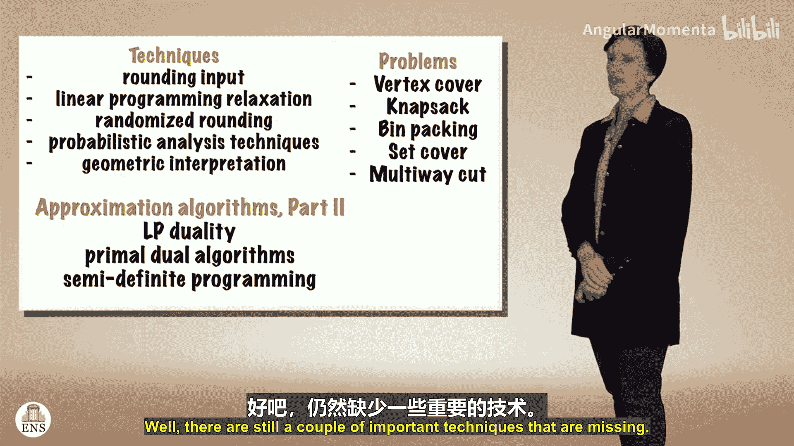

# 036：多路割问题结论

在本节课中，我们将总结关于多路割问题的近似算法设计，回顾已学的核心技术与问题，并展望后续课程内容。

## 算法设计与分析回顾

上一节我们介绍并分析了一个针对多路割问题的近似算法。

我们设计并分析了一个针对多路割问题的近似算法。

## 关于问题的进一步探讨

关于这个问题，我们还能说些什么？

首先，我们使用了一个巧妙的几何嵌入方法来解释线性规划松弛。随后，我们以此为灵感设计了舍入方案。

我们能否通过更好的随机舍入方法，为多路割问题获得更优的近似比？是否可能得到优于 **3/2 - 1/k** 的近似比？

答案是肯定的。例如，对于 **k=3** 的情况，通过使用线性规划松弛并找到更好的舍入方法，可以获得 **12/11** 的近似比。

因此，我们不仅仅使用这些“球”进行舍入，还可以将寻找良好随机舍入的问题表述为一个线性规划问题。寻找正确的随机舍入方式可以表达为线性规划。我们通过一个线性程序来对线性规划松弛解进行舍入，这非常巧妙。

对于更大的 **k**，同样可以使用此方法来尝试获得更好的近似比。超越 **3/2** 近似是可能的。然而，该问题是 **APX-hard** 的。如果 **P ≠ NP**，则不可能得到 **1 + ε** 的近似，即不存在该问题的近似方案。

## 多路割问题的背景故事

让我们简要了解一下多路割问题背后的故事。第一篇处理近似算法的论文为我们提供了一些关于应用背景的介绍。

以下是他们的说法：该问题出现在并行计算系统中通信成本最小化、将程序模块分配给处理器、在网络节点间划分文件、在多计算机环境中将用户分配给计算机，以及将电路元件划分到不同芯片上的子电路等场景中。最后一个问题在某种程度上更具几何特性，因此可能稍微容易一些，因为它是一个更特殊的特例。

这些问题的变体出现在许多需要将某物分配给另一物，且存在底层图结构的场景中。

那么，谁最先从近似算法的角度研究这个问题呢？

以下是设计本章开头所见基础算法的先驱者：Elias Dahlhaus, David Johnson, Mihalis Yannakakis, Christos Papadimitriou 和 Paul Seymour。他们证明了问题的 **NP-hardness**，并给出了使用最小割的近似算法。其中一些名字您可能之前见过，这些人在近似算法领域非常知名。

谁提出了几何表示法？Kalev, Karger 和 Rabani。他们提出了几何嵌入以及如何使用它。这非常巧妙，我认为这是本章最具新意的想法。他们正是通过这个方法得到了 **3/2 - 1/k** 的近似比。

第三，谁提出了通过使用线性规划寻找正确的舍入方式，以获得更好的随机舍入，从而改进近似比的方法？David R. Karger, Philip Klein, Cliff Stein, Neal Young。他们得到了 **12/11** 的近似比。

以上就是为多路割问题设计近似算法的主要步骤。

## 课程技术总结

在过去的五周里，我们学习了近似算法设计中的一系列技术。

以下是我们在课程中学习到的主要技术：
*   **适应性舍入输入**：以可能具有适应性的方式对输入进行舍入。
*   **线性规划松弛**：我们深入研究的工具。
*   **随机舍入**：有时是复杂的随机舍入版本。
*   **概率分析技术**：特别是在集合覆盖的背景下，用于证明我们结果的优良性。
*   **线性规划松弛的几何解释**：将抽象的松弛解赋予直观的几何意义。

这已经是一套很好的工具集，开始构成了近似算法领域的扎实知识。

## 已研究的问题

在过去的几周里，我们研究了哪些问题？

以下是五个组合优化的基础性问题：
*   顶点覆盖
*   背包问题
*   装箱问题
*   集合覆盖
*   多路割

它们都是 **NP-hard** 问题。对于所有这些问题，我们都设计了良好的近似算法，并且每一个问题都为我们提供了学习新技术的机会，无论是用于设计近似算法还是用于分析解的质量。

## 后续展望

那么，我们还缺少什么呢？仍然有一些重要的技术尚未涉及。

如果您想探索它们，您需要学习后续课程——近似算法（二）。在那门课程中，我们将研究：
*   **线性规划对偶性**：使用线性规划的一个基础、核心工具。
*   **原始对偶算法**：利用线性规划对偶性来设计高效的近似算法。
*   **半定规划**：一种非常强大的技术，用于解决以前看似无法处理的问题。

因此，如果您想学习这些技术，请参加近似算法（二）课程。希望在那里见到您。

---

**本节课总结**：本节课我们一起回顾了多路割近似算法的设计与改进思路，总结了本课程第一部分所涵盖的核心技术（如线性规划松弛、随机舍入、几何解释等）和五个经典 **NP-hard** 问题（顶点覆盖、背包、装箱、集合覆盖、多路割），并展望了将在第二部分课程中学习的线性规划对偶性、原始对偶算法和半定规划等高级主题。