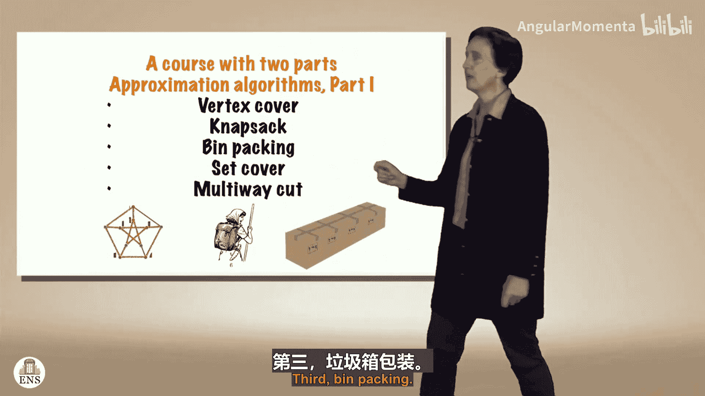
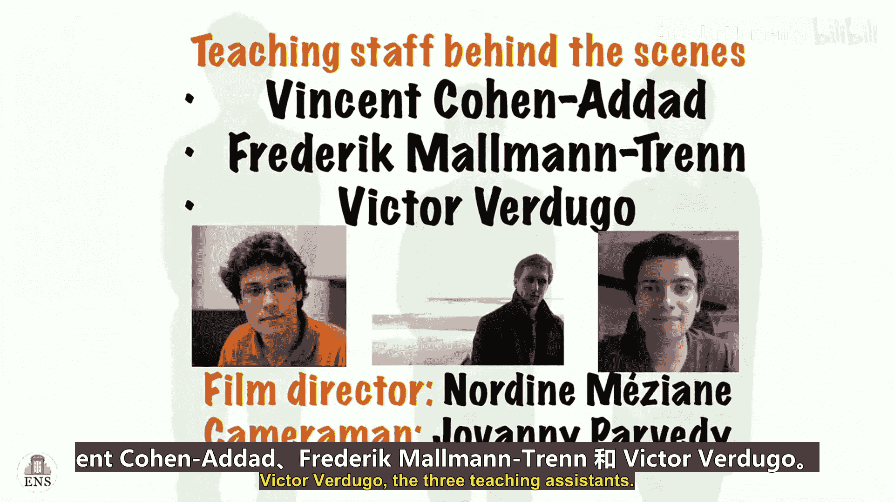
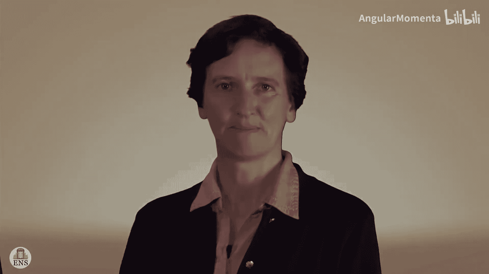

# 【巴黎高等师范学院】近似算法（一） ｜ Approximation Algorithms Part I p01 01_01_01_课程导论 -BV1X4rrBgEzg_p1-

Yeah。

Hello and welcome to the Cosera courseur on Appation algorithmris。This is a two part course。

 and I would like to tell you about the first part of this course。

These algorithms are for dealing with problems from communetal optimization。

Communetal optimization problems come up all the time in daily life。 for example， scheduling classes。

You want to schedule classes to avoid overlap when students are signed up for several different classes to make sure that there are always classrooms available for your classes and to take into account various constraints having to do with your school。

Or perhaps you own a truck company and you need to plan delivery routes for your trucks。

What kind of delivery routes you need to deliver your goods to all the customers who ask for them。

 and perhaps you wish to minimize the amount of fuel spent by your trucks。

There are many other instances of communatal optimization problems。Unfortunately。Most of them。

R and behold。Mining。If P is different from N。There is no hope for finding an efficient solution in all cases。

Plyymmal time solution for all instances in the worst case。So what to do。

Dealing with NP heart problems can be done in several different ways。Number one， give up。

 This problem is impossible。 You cannot hope to find a good solution in reasonable time。All right。

 this is not an option when you have to deal with real life problems。Option number two。

 roll up our sleeves。 Okay， let's try to look at all possibilities and take the best one。Yes。

 it will take a long time， but let's just be brave and roll up our sleeves。Well， unfortunately。

 this is about the same as giving up because on many instances。

 as soon as they become a little bit large。😊，This will take you forever。

 and you won't be able to give the best solution。All right， third option。

Perhaps you're just going to try something and hope to be lucky。For example， delivery routes。

 you'll say， okay， let me try to send one truck here， there， there and there。

 and another truck to another sequence of customers。And maybe， maybe your solution will be good。

This for a theoretician like myself is not acceptable because you have no control over your solution。

 this design of heuristics is not the kind of things we are striv for。😊，Fourth solution。

 Let's try to do a rough。But good enough job。What does it mean now？First。

We limit ourselves to work in pannormal time。Second。We give up on finding the optimal solution。

 Instead， we try to find a good enough solution。What does good enough mean。

 it means there's a certain objective we have in mind。

 and our goal is to find a solution whose value is not too much worse than the optimal solution。

 Provably within a small factor of the optimal solution。

So how do we go about designing approximation algorithms？First。

 we recognize that real life problems are too complex。

 This is out of our reach for most real life problems。

 instead what we will do in order to be able to prove things is study idealized versions of the problems that come up。

Idealized version of the Napsack problem， for example。

And then on these simple idealized problems with few parameters defining the input。

 we can hopefully prove theorems。These theorems give us new algorithmic and structural insights on the difficulty of the problems。

And so。We start from real life situations。 we distill the difficulties to define basic theoretical problems。

On those problems， we do theory。We design a solution。An algorithm。We prove some theorems about it。

On route to doing that， we get some new ideals。Then。😊。

We have to go back to real life and apply that theory to the real life situation。In this course。

 I will focus on the theory for basic problems。I will not talk about going back and forth between real life and to theory and back to real life。

 I will be focused solely on the theory of approximation algorithms for basic problems。

So what problems are we going to study？😊，The choice of problems is guided by two concerns。One。

 I want famous problems， well studied problems that you would like to know about you it's good for your culture to have heard about these problems。

Two， I would like problems， each of which gives you an opportunity to learn about techniques for the design of approximation algorithms。

😊，In this part of the course， the first part of the course。

 there are five chapters corresponding to five problems。

 five different techniques in the design or in the analysis。First， vertex cover。Second， Napsack。

Third， bin backing。

Fourth， set cover， five， the most difficult problem in this part of the course。

 the multi weight cut problem。So I will start shortly with the first problem in our list。

 the vertex cover problem， and it will be a chance to introduce one important technique in the design of approximation algorithms。

😊，Having a linear programming relaxation for the problem。But before I start with the technical part。

 let me introduce all the staff that is helping with this course。Vas Coenaad。

 Fredderic Malmanen and Victor Verdogo， the three teaching assistants。 Unfortunately， Victor is here。

 Vason is here， but Fredderig is not here today。 He's out sick。

 but Verso and Victor can both introduce themselves。😊。

Vso， would you like to say a few words about yourself Sure thanks Hi I'm Vanson Kenaad。

 I'm a PhD student here at ENS working on approximation algorithm I'm very happy to be a teaching assistant for this Sc Amook。

😊，Thank you， Vso， Victor， would you like to say a few words about yourself I'm Victor I'm from Chile。

😊，And Im currently working in Paris， for my PhD thesis。I'm very glad to be part of this Coursra Muk。

 a station assistant。😊，Thank you， Victor。 Let me also mention our film director。

 Nodine Mian and our cameraman， Joe Parvidi， who unfortunately are both camera shy。 Once again。

 welcomee to the Cora course on approximation algorithms， Part 1。😊。

