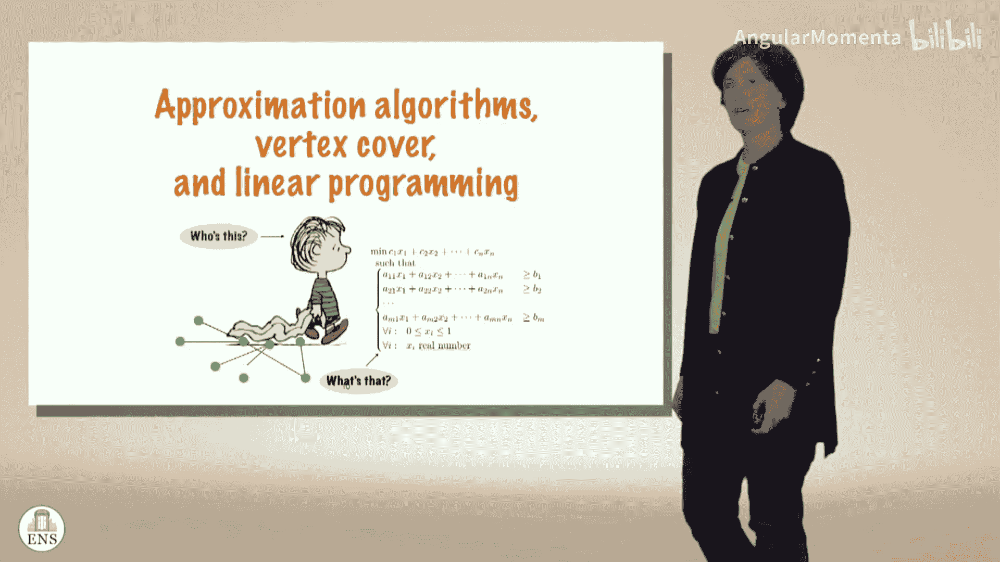

# 【巴黎高等师范学院】近似算法（一） ｜ Approximation Algorithms Part I p02 01_02_01_讲座定义 -BV1X4rrBgEzg_p2-

So far， we have discussed approximational algorithms in general。

Now we are going to study a specific problem， the vertex cover problem。First。

 I need to give you the definition of the vertex color problem。Here is。AFtex cover。

Look at this blanket。The vote says on that blanket。Catch all the edges of the graph。

That appears at the bottom of this screen。So the vertex is under the blankets。

 three of them are a vertex cover for that graph。And by the way。

 the character represented here is Linus， a cha Brown character。

I'd like to give definitions from examples。 So let us start with a famous example of a graph that is often used to prove。

Counter examples to show that certain conjecture do not hold。On this graph。

 how will you construct a vertex cover， We have to pick a certain set of vericees。 Let me start。

Let's say I will take the top vtex。Vex a。A covers three edge of the graph。 I drew them in red。

3 edges。 so far， so good。But there are still edges uncovered， not yet covered on this graph。

 So I have to keep going。 So I will pick another vertex on this graph。For example。

 I can pick a vertex at the bottom left of my figure。B。B。Covered three edges。Good的。Now。

 I need to continue。 Take more oices to cover all the edges or another one。C。C covers three edges。

 but one of them is already covered by vertex B。 No matter。

 it does not matter that a edgedge is covered by both end pointss。 C covers two more edges。

 I keep going。 Let me pick。Vertex D， then。Fortex， E， F。嗯。voa。This， my set of6 vertics， A， BC， D， E。

 F。 That is a vertex cover of the graph。 Every edge in this graph is covered by at least one of these vertices。

 E B， C is covered twice。But all in all， every edge has at least one end point in the cover。

So that's the vertex cover of size 6。If every thetex has weight 1。

 then the weight of my cover is  one plus 1 plus 1 plus 1 plus 1 plus one。s。This is optimal。

It is not possible to cover all the edges of this graph， with five vertics。Why is that。It's easy。

Easy to find an argument， to prove that5 is not possible。Indeed。Observe the outer part of the graph。

 It a cycle of length 5。Well， if you want to cover all the edges of a five cycle。

 you need at least three vertics。Now， observe the inner potgraph。It's a star。A star with five points。

Well， a star is just another way to draw a five cycle。

So we also need three vertices inside the graph to cover the inner cycle of a graph。All in all。

 we need at least 6 vertics， So the solution I give you ABC， D， E， F is optimal。

 It minimizes the weight of the vertices that got chosen。So that's the vertex color problem。

Given as an input， a graph。Where every vertex in the graph has a weight。We have constructed。

 as an output。A subset of the graph whatice is。That covers every single edge of the graph。

And whose total weight is minimum。 The sum of the vertex weight is minimum。

This is one of the most fundamental problems of combinator optimization。So。

I have given you a definition of the vertex cover problem。

Now， I will give you another formulation。 more algebra as an integer program。

