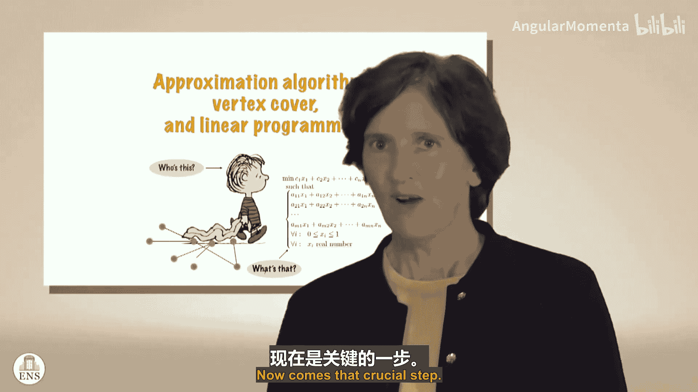

# 【巴黎高等师范学院】近似算法（一） ｜ Approximation Algorithms Part I p04 01_04_01_讲座：线性规划松弛 -BV1X4rrBgEzg_p4-

We have seen。The definition of an individual program for the vertex cover problem。

Now I want to discuss a related linear programming formulation。

What is an individual program in general？The general form is as follows。 minimize or maximize。

An objective of the form C 1 x 1 plus C2 x2 plus plus C， N X， N。Subject to。

The constraints such as a1，1 x1 plus a1，2， x2 plus plus a1 and X N greater than I to B1 for the first constraint and a whole set of say。

 M constraints。In this course， all of our problems will be modeled by Integer programs where you can add the constraint that for every eye。

Variable Xi must be between 0 and1。 Finally， for every I， verex I must be an integer。An integer。

That's why it's called Integer programming。So we have this perfect integer program for Vtex cover。😊。

If only we could use an algorithm for solving integer programming we be done， but of course。

 it's not possible。 Integer programming is NP beyond。

Why then why are people so interested in integer programs， Because they provide inspiration。

 they provide initial tools to use to design better algorithms for related problems。In particular。

 let me show you a related linear program。This linear program is the same as the integer program。😊。

Minimize the same objective with the same first constraint with B1， same second constraint。

 same last constraint， except for the last line。Xi。That no longer has to be an integer。

 X I now is just any real number。With this apparently small， apparently harmless modification。

 suddenly the complexity of the program changes， linear programming can be solved in polynommal time。

😊，This was discovered about 30 years ago， and since then。

 linear programming has been a basic tool for the design of many， many problems。

 many solutions for communet oil optimization。😊，There are two ways to present a linear program。

 One is more detailed， the other one is more abstract， but both of them are equally valid。

The same linear program can be represented by writing C1， C2， CN， A11， A12， B1， B 2 B，N and so on。

Everything， explicitly。Or in a more compact fashion by saying， minimize the dot product of C and X。

 What is C。C is a vector in R which coordinates C1 C2 CN。What is x？

X is also a vector in Rn which coordinates x1， x2 X，n。

What is the dot product of vector C with vector X， It is C1 x1 plus C2 x2 plus plus C and Xn。

 So by writing C dot product X， we just have a more compact notation for the same objective function。

Similarly， if we look at the constraints。The constraints can be written more compactly using a matrix matrix A with M rows N columns。

Coordates AI J。Matrix a。Apply to vector X must be。Greater than integral equal to vector B。

 B is a vector in R M M dimensional space， vector B1， B2 BM。

Greater than income means coordinate per coordinate。X must be in the hypocube 01 to the n。

 meaning every x between 0 and 1， and x is a vector of rn， meaning every X is a real number。 Thus。

 these are two completely equivalent notations for the same linear program。

 No one is better than the other。 depending on your taste。

 You can choose to write it in the first or the second form。

 It's two presentations for the same thing。Thus， if you have an integer program。

 you have a similar linear program that looks identical except for the last line。

 replacing the constraint Xile integer by the constraint Xile real number。

The complexity changes drastically。An IP is and beyond the corresponding LP is solvable in polynomial time。

So we have an inte program for vertex color。Therefore， we can write the corresponding linear program。

😊，Every vertex U。The corresponding variable x u must be between 0 and 1。Every edge U V。

 we must have X U plus X v greater than numerical to1。

 and the objective is still the same as for the integer program it came from。

We now have a linear program related to the integer program for vertex cover。

Now comes the crucial step。 we are going to use this linear program。

To design a good approximation algorithm， finally， for vertex cover。😊。

