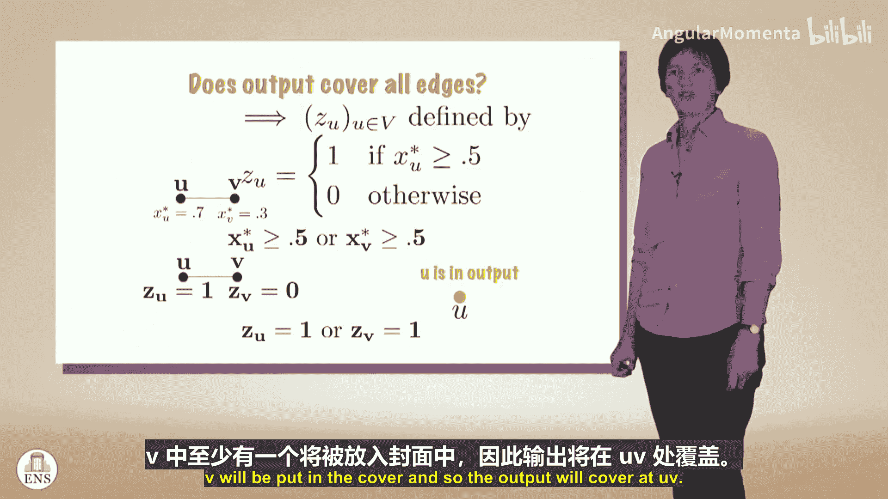

# 【巴黎高等师范学院】近似算法（一） ｜ Approximation Algorithms Part I p05 01_05_01_近似算法讲座 -BV1X4rrBgEzg_p5-

あ。Welcome back to the course on approximation algorithms。

 let us continue our study of the vertex cover problem。

We have designed a linear programming relaxation for vertex cover now let us see how we can use it to design an algorithm。

😊，As a reminder， here is the linear programming relaxation。😊，For every vertex in the graph。

 there's a variable whose value is between 0 and1。For every edge in the graph。

 the sum of the two values of the two variables must be at least one。

 and the objective is to minimize the weighted sum of the variables。😊。

What can we do with the Smia program？First， of course， we solve it。

Soalting it will give us in polynommal time values for each of the variables。

 the optimal values x2 star for verdex U， x v star for verdex v for every verdex in the graph。

These values satisfy all the constraints， and the objective is minimized。Now。

 what do we do with this？We need from this to deduce a vertex cover。For that。

 we need to decide for each vertex whether or not we put it in the cover。

 So what do we do with these values that are real numbers between 0 and1。 If the value is 0。7。

 it's like saying a vertex is 70% in the vertex cover。

So what do we do to decide whether to put the vertex in the cover or not。

 we simply round to the nearest integer。So if the value associated to vertex u is at least 0。5。

 we run to 1， if it's strictly less than 0。5， we run down to 0。

This defines an integer value z subu for each graph vertex。 Now we are back to integers。

 therefore this is an encoding of a set of vertices that will be our output。😊。

So that's the algorithm。So here you can see the global view of the algorithm。Step one。

 you saw the LP。Step 2， you run the LP solution。And finally。

 you output the set of all verices such that Z sub is equal to one。

The first thing we can note is that if we look at this algorithm， the runtime is polynomial。😊。

Solving the linear program can be done in polynommal time。 That's our black box。

 Runing the solution takes linear time， and then we just give the output。

So we do have a polynomial time algorithm。But。Does it solve vertex cover。

 Does it give a correct vertex cover。Does it cover all edges。

 It's a set of vericees in order for the algorithm to be correct。 The set output must be。

A cover of all weird is by vertices。So let us argue that the output set of vertices is a vertex cover。

 that it covers all edges of the graph。Does the output cover alllogs， Let's focus on the one of them。

Let's say that UV is an edge in the graph。Uv。What can we say about U。

We know that the linearar program has an associated constraint and that this constraint is satisfied by the LP solution。

😊，So what do we know， Xy star plus X star is at least one。This is a fact from the algorithm。

What can we infer from this？For example， Xv star could be 0。7， Xv star could be 0。3。The idea。AS idea。

 a very， very small idea。Is。If X star plus X v star is at least one。

Then at least one of these two values must be。Greater than equal2。5。Of these two values。

 at least one must be greater than or equal to 0。5。How does that help？

Let's look at the definition of the Z subu， though our choice of integers are rounding。

Z sub is 1 as soon as at least one of the variables， as soon as variable x star is at least 0。5。

So in the example。X U star is 0。7， xv star is 0。3。This means that Z U will be 1。0。7 is running to 1。

03 is running down to 0。This means that the output set of oices will contain vex U and therefore that a UV will be covered。

😊，This is general， since one at least one of the two variables， Xu star Xv star is greater than 0。5。

At least one of the two values Z U Zv will be equal to1。

 and so at least one of the two goddes U or V will be put in the cover。

 and so the output will cover at Uv。

This is true for every edge in a graph。 So the output covers all edges， so it is a vertex cover。

 and so our algorithm is correct。In this part， we have proposed an approximation algorithm for the vertex cover problem based on the solving a linear programming relaxation and rounding。

 and we have proved that it is correct that the output really is a vertex cover。

 Now what remains is to see how good it is， what is the quality of the output vertex cover。😊。

