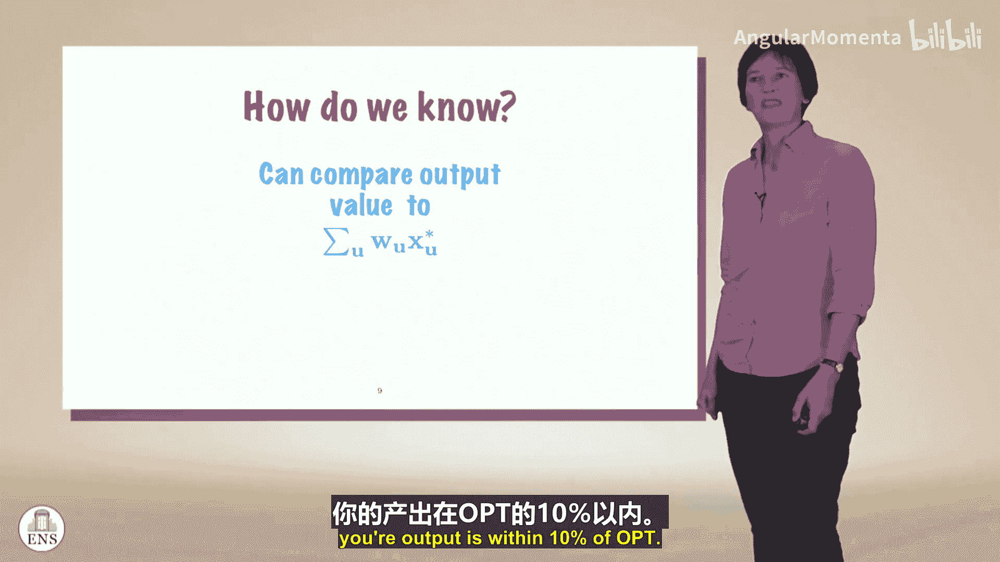
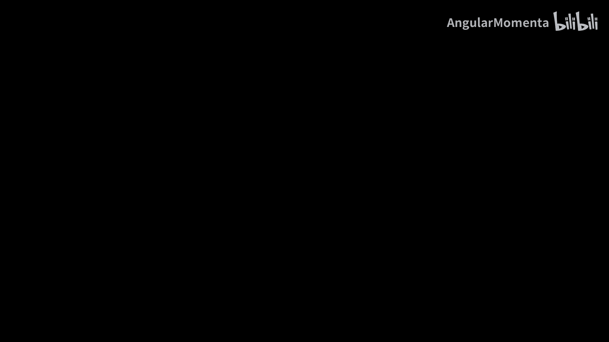

# 【巴黎高等师范学院】近似算法（一） ｜ Approximation Algorithms Part I p06 01_06_01_讲座分析 -BV1X4rrBgEzg_p6-

。

So far we have designed an approximation algorithm for vertex cover。

 and we have proved that it is correct， That is the output really is a proper vertex cover。

 we have also verified that it runs in polynommal time。

 The only thing remaining is we need to analyze the quality of the output。😊，How good is the output。

 We need to relate it to the unknown value of the unknown optimal vertex cover。

 This is what we will now proceed to do。Start from the output。Let us try to express its value。

What is the output， It is the set of vertics U， such that variable z sub equals 1。

The disease abuse are the rounded values obtained from the LP solution。Well。

 the output cost is the sum of the weights of all vertices that are chosen in our vertex cover。

 it can be written as sum over U of W Z U。 This is a algebraic expression for the cost of the output。

 so to analyze the output， we need to analyze this quantity up bound its cost。Second。

 now we have expressed the output cost in terms of Z subbu。

Let us try to relate the value of this sub to something else to the LP variables that it came from。

How was z sub defined， It was the rounded value obtained from variable Xu star Xu star was a real number between 0 and1。

 Z sub is rounded to 1 or20。Observe。Z sub you。Is always at most， two times x star。

There's a factor of2 between Z sub and X U star。Sometimes this can be very pessimistic。

 Sometimes Z sub is 0， but in any case， regardless of the value of Xu star。

 Z sub is at most twice as large。This factor of 2 is reached exactly when x star equals12。Next。

 what do we do with these X stars， We need to relate the X stars to the value of the unknown optimal vertex cover。

For this， we will go back to the definition of the linear program and remember that it is a relaxation of an integer program for vertex cover。

😊，Compare the interior program and the linear program。 put them side by side。

 You can see that the only difference is。😊，X U is 01 in the integer program。

XQ star is between0 and1 in the linear program。What does this mean。

 This means that the linear program is less constraining than the interiorte program。

 So when you're trying to minimize， the linear program can give you something smaller than the interiorte program。

 And so what this means is that if you look at the optimal value of the linear program。

 its value is sum of w sub X store。 It is smaller than the optimal value of the Integer program。

 smaller than opt。Now we have step by step， starting from the output cost related to opt。

 It only remains to combine our various observations， and we will obtain the proof。There you go。Look。

The output cost。Is equal to a weighted sum of these sub。

 which is at most2 times the sum of W sub X U star。And this sum is at most opt。

We have proved a theorem。The output of our algorithm is a vertex cover whose value is at most two times opt。

It's a factor of two approximation。For vertex cover。But is this analysis tight。

 Is this factor of two necessary。Unfortunately。Yes。

There are some cases where it's really a factor of two。Let me give you an example。

Consider this cycle。9 8。Take every other vertex along this cycle。You get the vertex cover or value4。

Solve the linear program to execute the algorithm。 What do you see。

It is possible that it will give you for every ex star。5。What does the round do next， Every。

5 is replaced by 1，1，1，8 times 1。 The cost is 8。The optimal cost is 4。 The output cost is 8。

 So we really have lost effect of 2。 Our analysis is tight。

 The algorithm is no better than a two approximation。Except。

Except we are talking about worst case here。The typical performance I have been told is usually within 10% of optimum。

And the nice thing about this algorithm is that in the cases when it really is close to optimum。😊。

You can tell。 You can see it。How do you know。You can just compare the value of your output。

To the value of the linear program。 you have the linear program。 So you know this expression。

 And so you have the output。 So you know its value。

 So you can see when the output is within 10% of the Lp value。

 And then you know you have proof that in that specific instance。

 your output is within 10% of output。

In this part， we have completed the analysis of a vertex cover algorithm。

 and we have proved that it is within a factor of two of optimal。 Now。

 all that remains is to summarize our approach and to see the vtex cover problem in general。😊。

