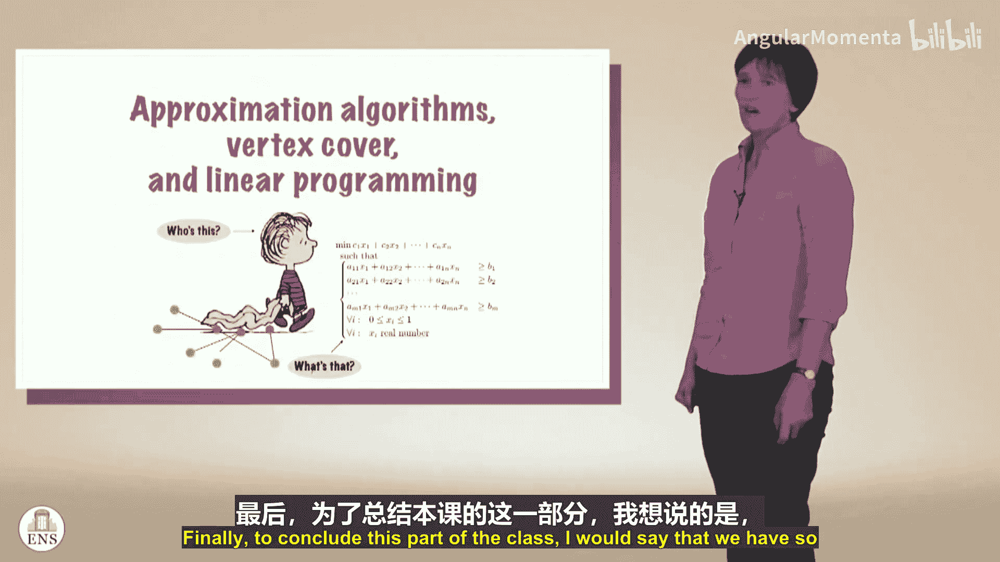

# 【巴黎高等师范学院】近似算法（一） ｜ Approximation Algorithms Part I p07 01_07_01_讲座概论 -BV1X4rrBgEzg_p7-

あ。We have done so far a detailed study of vertex cover。

 but that's not really what this course is about。 It's not so much about solving specific problems as it is about developing techniques。

😊，Teaching how to solve problems， teaching a methodology。

 So let us review what we have learned so far in that respect。

What is the method that we applied in the case of a tax cover？Designing an algorithm。We have seen。

On this example， how to do it in three steps。First， find an integer program to model the problem。

Second， solve a linear programming relaxation。😊，Third， round the solution to get an integer solution。

That is a standard algorithm technique， algorithmic technique used for approximation algorithms。

 We will see this over and over again in this course。

 and it is good to remember this as a standard technique。😊，How do we。Analyze such an algorithm。

There are three things that need to be done。First， when you try to get such an algorithm。

 you need to verify that it really is correct， that the output really satisfies the conditions。😊。

Second， you must verify that it really is efficient where efficient in this class means polynomial time。

 The runtime must be polynomial。Some people are also happy with such a definition。

 but you know we are theoreticians， we want polynommal runtime， that's our definition of efficiency。

Third， and most importantly， how good is the solution。

 You must analyze the value of the output solution and show that it is within a certain factor of the optimal value。

Here， the factor that we showed was a factor of two。Soon。

 we will see an algorithm where the factor is one plus epsilon。 Sometimes it can be login。

 sometimes it can be much worse。Finally， for this kind of algorithm。

 there's a particular method to try to analyze the quality of the output。

 The method is to go as an intermediate step through the LP value。You must， on the one hand。

 relate the output to the LP value。 On the other hand， relate opt to the LP value。

 and then it only remains to combine the two things。

The message for the analysis of the quality of the solution is focus on the value of the linear program。

Now， let me say a few more words about vertex cover。

We could say many more things about the vertex cover problem。

 but that may just address the question of the quality of approximation， this factor。😊。

We have a two approximation。How much better could we hope to get as an approximation algorithm。

Could we solve vertex cover optimally。No。Dick Cop in 1972 proved that vertex cover is NP complete。

 This was one of his original NP completete problems in his famous paper where he listed a few problems from diverse areas and proved them all NP complete。

Then can we hope to get something？Arbitrarily close to one。

 an approximation that is one plus epsilon for every epsilon。An approximation scheme， as we call it。

 No， impossible。 Why Christta Papidimitryu。Mihali Xnakais in 1991。

 they proved that you cannot get better than some very small number， something like 1。

001 of the optimal value， getting below that is NP complete。So if P is different from NP， of course。

 you cannot hope to get arbitrarily close to one。But that number is really quite small。

Can't you prove something better than this？Yes， in the early 2000s。

 Eri Diur and Moli Saffra showed that you cannot hope to get better than a 1。

36 approximation for vtex cover A P is different from NP。To date。

 it's the best result assuming P is different from N P with no other assumptions。

But we also have another result， a conditional result。If a certain conjecture is true。

 the unique game's conjecture。Then。2 approximation algorithm is optimal。

 It is impossible to get in polynommal time， something that would be。Strictly less than 2，1。

999 approximation。 This is a result by Subbaashkot and Od Reev from 2003。

So what can we say vertex cover is hard in the worst case。Finally。

 to conclude this part of the class， I would say that we have so far designed a method for approximation algorithms。

 applied it to vertex cover， and proved that it's a two approximation。

On the way to doing that， we have had a little fun with vtex cover。

 I could say many more things about it， but this is enough for this particular problem。😊。

