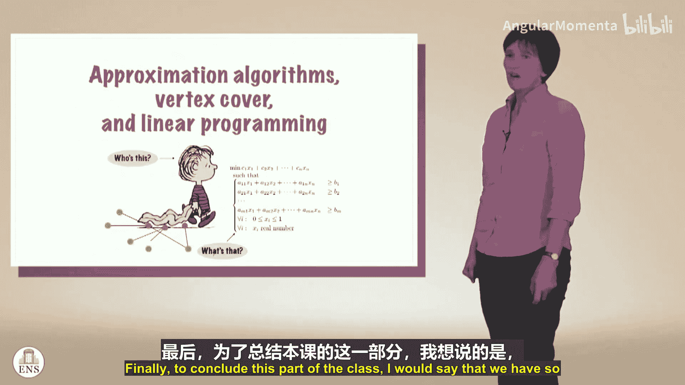

# 近似算法：1.7：课程方法论与顶点覆盖回顾 🎯

在本节课中，我们将回顾之前学习的内容，总结设计近似算法的通用方法，并以顶点覆盖问题为例，深入探讨算法的分析技巧和该问题的计算复杂性。

上一节我们详细研究了顶点覆盖问题。但本课程的核心并非解决特定问题，而是**传授解决问题的方法论**。因此，让我们从方法论的角度回顾迄今为止所学的内容。

## 设计近似算法的三步法 📝

在顶点覆盖的例子中，我们应用了一种标准的三步法来设计近似算法。以下是具体步骤：

1.  **建立整数规划模型**：首先，为待解决的问题找到一个合适的整数规划模型。
2.  **求解线性规划松弛**：其次，放松整数约束，求解对应的线性规划问题。
3.  **对解进行舍入**：最后，将线性规划的解通过某种规则（如舍入）转化为整数解。

这是一种在近似算法设计中反复使用的标准技术。

## 算法分析的三个要点 🔍

设计出算法后，我们需要从以下三个方面对其进行分析：

1.  **正确性验证**：必须验证算法的输出确实满足问题的所有条件。
2.  **效率验证**：算法必须在多项式时间内运行。在本课程中，“高效”即指多项式时间复杂度。
3.  **近似比分析**：这是最重要的部分。必须分析输出解的值，并证明它在一个特定因子内接近最优值。对于顶点覆盖，我们证明的因子是2。

## 近似比分析的核心技巧：借助LP值 📊

对于这类算法，分析解的质量有一个特定的技巧：**以线性规划的最优值作为中间桥梁**。

具体方法是：
*   一方面，将算法输出解的值与线性规划的最优值（LP值）联系起来。
*   另一方面，将问题的最优值（OPT）与LP值联系起来。
*   最后，结合这两个关系，即可得出算法输出与OPT之间的关系。

因此，分析解质量的关键信息是：**聚焦于线性规划的最优值**。

## 关于顶点覆盖问题的更多讨论 💡

现在，让我们再谈谈顶点覆盖问题本身，特别是关于近似比的质量。

我们得到了一个2-近似算法。我们能否期望得到更好的近似算法呢？

*   **能否精确求解？** 不能。Karp在1972年证明了顶点覆盖是NP完全问题。
*   **能否无限接近最优解？** 不能。Dinur和Safra在21世纪初证明，假设P≠NP，不可能得到优于1.36的近似比。这是目前基于P≠NP假设的最佳下界结果。
*   **2-近似是否最优？** 存在一个条件性结果：如果“唯一游戏猜想”成立，那么2-近似算法就是最优的，不可能在多项式时间内得到严格小于2的近似比（例如1.999）。

综上所述，顶点覆盖问题在最坏情况下是难以近似的。

## 总结 📚

本节课中，我们一起学习了设计近似算法的通用三步法（建模、松弛、舍入），并掌握了分析算法的三个要点（正确性、效率、近似比）。我们特别强调了通过**线性规划最优值**来分析近似比的核心技巧。最后，我们以顶点覆盖问题为例，回顾了这些方法的应用，并了解了该问题的计算复杂性边界。