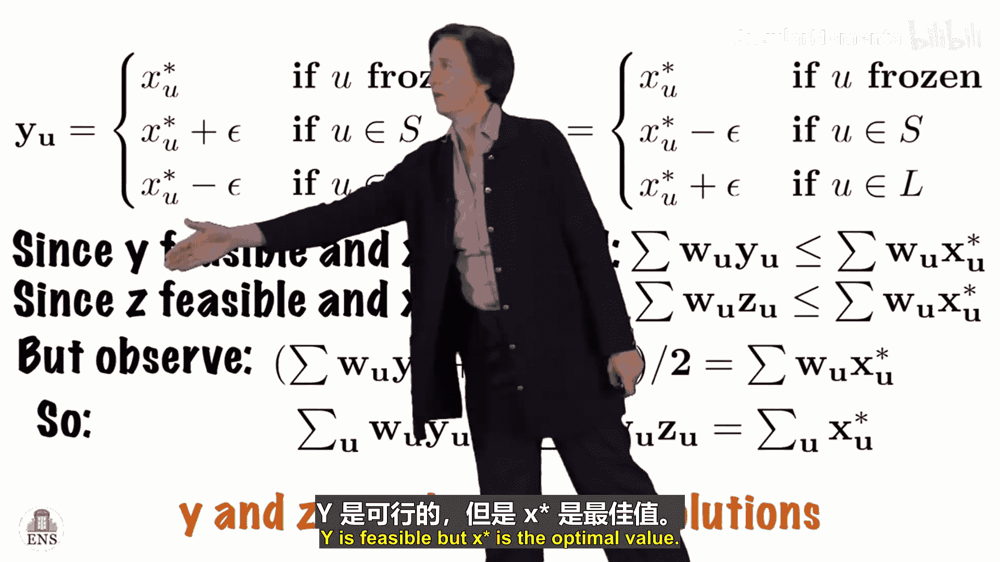
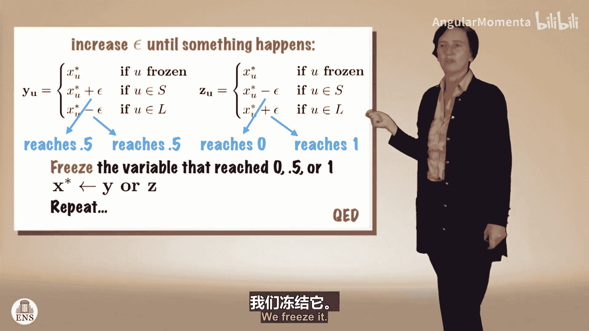

# 【巴黎高等师范学院】近似算法（一） ｜ Approximation Algorithms Part I p08 01_08_04_半整性7 35错误已在PDF幻灯片中修复 -BV1X4rrBgEzg_p8-

。

Hello， I am so happy that you are interested in this course and that you have been trying to do the first assignment and that you have some questions about this assignment that I am now going to answer。

😊，In the assignment， we said， consider the linear programming relaxation for the vertex cover problem and let us assume that we have a solution such that every coordinate is either zero or12 or1。

😊，And you had some questions。You asked， is this a special property or is it always true？I said， yes。

 it's always true。Then you said， but then is there an algorithm for computing such a solution or is it hard to calculate and I said yes。

 there is an algorithm and now given that you seem to be interested in this question。

 I thought it would be worth giving you a little proof so that is what this video is about。😊。

The CRM is。There exists an optimal solution。Of the L P relaxation for vortex cover。

Such that every coordinate x sub is either 0 or。5 or1。

 and there's a polynommal time algorithm to construct it。😊，Let's do this algorithm。

The algorithm first solves the LP。That gives it an optimal solution。

 X star that satisfies all the constraints and such that the weight of the resulting fractional vertex cover is minimized。

😊，But possibly these variables they're between 0 and 1。

 but possibly theyre not all equal to 0 or to 12 or to 1。So what do we do。

 We gradually modify the solution to have more and more coordinates equal to0 or to12 or to one。

First。All the variables that already have value in 0。5 and1 or1。We freeze them。

 We will not change them anymore。 They already have the value we want。Second。

 consider the remaining variables。There are two possibilities。Loge。Small。Launch。Between。5 and1。

Strictly。Small。Between 0 and 0。5 strictly。Every variable is either frozen or large or small。

Now there's an interesting property due to the constraints of the RPP relaxation。If you is small。

And if we have a edge from U to V。Then we only have two possibilities for B。Either v is launched。

 as in here， U has value 0。4。 x star U is 0。4。 V has value 0。7 The sum is。

Create it and integral go to one。Or。The value for V is one。4 plus  one。

What we cannot have is two small vertices adjacent to one another。If Q is 0。4 strictly less than 0。5。

 if D is strictly less than 0。5， then their sum would be strictly less than 1 and that would not be feasible。

 that is not possible。So if I vote that is small。Then its neighbors cannot be small。Now。

 what do we do。We try two things。The first thing we try is to do a small local modification。

Weve taken very small epsilon。There is more positive epsilon。We take every small value X star。

And try to increment it by Eilon。Every large value and tried to decrement it by epsilon。

What does that give us？What this means is that if we have a edge， we have a small。

Adjacent to a large。The small increased a little bit going say from 0。4 to 0。41， e epsilon is 0。01。

 the log decreased a little bit by the same amount， and the sum does not change。

 so it was greater than a equal to 1 before。 its still greater than equal to1 afterwards。

Even if the sum was exactly one before， it's still exactly one afterwards。

 so it still satisfies the constraint。Or if the two vertics we are both large。

 then they both decrease by epsilon 0。7 becomes 0。690。6 becomes 0。59。 So the sum decreases。

 but the sum。Was strictly more than one。 If you have two numbers that are both， strictly more than 0。

5， their sum is strictly more than1。 So when you do a little change of an epsilon。

 theres some decreases by two epsilon。 And for epsilon small enough。

 it's still greater than regular to one。So what this means is that for Epsilon small enough。

This y vector is still feasible。 It's still a feasible vertex color。That's the first thing we try。

Two， we try to do the opposite。They're small。Fortices were decrease by epsilon。

 The large fortices were increase by epsilon。Again， if we have a small adjacent to a large。

The sum doesn't change plus epsilon， minus epsilon， that's zero。If we have a small adjacent to one。

Well， the small decreases， but then。The value was one plus something。

 so it was strictly more than one。 And so it still strictly more than one afterwards。

4 eilons small enough。And if both were large， then it increases。

 so it satisfies the constraints even more than before。

So what this means is that for epsilon small enough， this vector Z is still feasible。

So we have two new solutions， one where all the small items increase by epsilon and the large items decrease by epsilon。

 and one where we do the opposite， the small decrease， the large increase。They are both feasible。

Why is feasible？

But x star is the optimal value。So we know the value of y is less and the value less than or equal to the value of x star。

Same thing for z， the value of z， because it's feasible is less than equal to the value of x star。😊。

But。Y and Z are so close。They're so close to one another。If you look at the average of Y andC。

On average， we get x star plus epsilon minus epsilon， The average is 0， minus epsilon plus epsilon。

 The average is a change of 0， in other words。The value of y。Plus， the value of z over a2。

 the average between the two is exactly the value of x star。

And they are both less than ever to X star。 So they have to be。Equal。If we have two values。

Both less than or equal to the value of x star， and on average they are equal to the value of x star。

 then they all have to be equal。Y and z are feasible。 Their value is the same as the value of X star。

 So there are also optimal solutions。They're also optimal solutions。So what do we do？We take why。

We take Z。We think of epstinome as being small， small enough。 What does it mean small enough？

What happens if we try to start from a very un infiniteital epsilon and we increase it， increase it。

 increase it until something happens？What can happen？What may happen is that this small X star。

 it was strictly between。0 and。5。We keep increasing it， eventually it might reach 0。5。

Or this large value。We decreased it， decreased it， it was between 0。5 and 1。

 eventually it may reach 0。5 or this small value here， we decreased it， decreased it。

 decreased it eventually we may reach 0 or this launch value。

 we increased it increased it eventually we may reach one。😊，So， as epsilon increases。

One of these events is going to happen。 whichever one happens first。That's when we stop。We stop。

 We look at the variable that just reached 0 or 0。501。

We freeze it。Now we have one more variable， we value 0。501， and we have this optimal solution。

 either y or z， depending on which of those events happens that has all these frozen variables。

And we can repeat the construction。In each iteration， one more variable will be frozen。

When does this end， it ends when every variable is frozen。At this point， every variable has value 0。

501， and we still， we worked only in the space of optimal solutions。

And so what we have done here is we have proved that there's an optimal solution of the vertex cover LP relaxation whose coordinateiness are all in0。

 12 and1， and we gave an algorithm to find it in polynommal time。😊。

