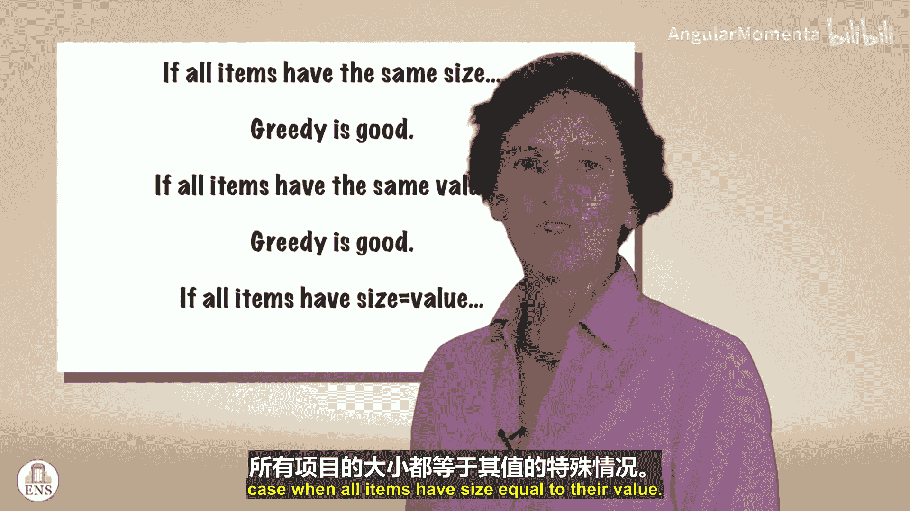

# 【巴黎高等师范学院】近似算法（一） ｜ Approximation Algorithms Part I p09 02_01_01_讲座定义 -BV1X4rrBgEzg_p9-

Welcome back to the course on approximation algorithms。So far。

 we have studied the Ttex cover problem in some detail。😊，Now， we will turn to another problem。

 which is a classic problem in approximation algorithms， namely thenapsack problem。😊。

This will be an opportunity for us to study another version of rounding on my vertex cover。

 we are not going to round some fractional solution to get the output。

 but we will round the input values to get a simplified input that will be more tractable。😊。

So studying the Napsack problem will be an opportunity for us to work on input rounding。First。

 let us start by defining the Napsack problem。It is a problem that comes up all the time。

 wheneverever you go on a trip， whenever you travel， whenever you go camping。

 you have to decide which items to take with you， which items to take in yournapsack。For example。

 let's say you're about to go camping somewhere and you have put in your room。

 you have taken out all the items that you might consider taking with you。

How can you do without your favorite cat， A hammock is good when you're going camping。

You like this piece of jewelry， isnn't it beautiful， et？But。

If you're going to carry everything on your back， youre can only carry so much。

 Every item has a certain weight， and you only have so much capacity。

So given how much value you give to each item and given the maximum weight you're willing to carry。

 which items should you take。For example， a pocket knife is relatively light， but very。

 very valuable when you're going camping。It is very hard to go camping without a knife。In general。

 the classic k napsacroone， given a capacity B， the maximum weight you can carry。😊。

Given a set of n items where item I has a certain size or weight， S sub I， and a certain value。

 v sub I， you have to choose which items to place in anapsack so as to maximize the value of what you take with you on your trip while respecting the constraint of capacity of B。

This problem， along with 20 other problems， was proved to be NP Ho in Dick Cop's famous paper on NP completeness。

So we cannot hope to solve it exactly in polynomial time in general。

That is why this problem is a good candidate for designing an approximation algorithm。

How to get started。 Here's a general recipe for designing approximation algorithms。😊，First。

 let's try to find a good representation for the problem。

A good representation for the input and for the output。In this case。

Let's think of the graphical representation。Item I is defined by its size， S I。And its value， V I。

Two numbers， characterizing item I。It is therefore natural to represent item I as a rectangle of side length V I S I。

When you choose to take several items。It means you choose to take several rectangles。

The things you take have a certain total value。 you sum the values， total size， you sum their sizes。

What does this mean， It means that you can represent your solution。Using two dimensions。

 one axis is for value。 The other axis is for size。

 You put the rectangles side by side or rather corner by corner。

 each northeast corner of one rectangle touching the southwest corner of the next rectangle。

And then that defines for a given set of items that defines。

A way to represent the sum of the values of the items and if you look at the vertical axis。

 the sizes， sum you can see visualize the sum of the sizes of the items。

What does it mean that you have a capacity of B， It means that the sort of staircase that you're building in this way。

Has to have height at most， B。Given that， you want it to go east as far as possible。

That's a graphical representation for the Napsack problem。You're limited in height。

 you want to go to the right as far as possible。What you desire is small size， high value。

 rectangles that are very flat。 These are clearly very desirable rectangles。

 You will want to take these rectangles more than others。

What this suggests is that you should consider items by order of ratio size over value。

You take them by increasing order of size over value。And then what。

 how can you choose which ones to take， the first attempt。

 the naive greedy algorithm is to just take them greedily in that order。So， the algorithm is。

It is sort the items by increasing size overvalue。And then place them one by one as long as they fit。

In an abstractack。Unfortunately。This greedy algorithm。Is not a good approximation algorithm。

It does produce something that fits in annapsack。 It's correct。 It gives you a solution。

It does run in polynommal time。 It's basically the time it takes to sort the ratios SI over VI。

 However， the solution could be quite bad。Let me give you an example。B equals 100。

You have a knapsack of capacity 100。N equals 2。One item。A little rectangle with value 1， size 1。

And another item， a big rectangle， a huge rectangle。With。Value 99， and size 100。What happens then。

If you look at the ratios。The little rectangle is slightly preferable。

 It has a slightly better ratio， So you will take it first， and it fits。 So you put it in。😊，And now。

You're doomed。Why， because the next item does not fit。 So that's it。

 Your output will be the little rectangle。Value 1。Whereas the optimal choice would have been to forget about the little one and take only the big rectangle value 99。

So the algorithm that works by increasing slope。Is bad。 The greedy algorithm is bad。

 The ratio we just gave an example。Is at least as bad as within effect factor 99 of optt and it can be arbitrary。

 really。So we have to design a better algorithm for Napsack。

Here's another general recipe to try to design approximation algorithms。

We need to develop more intuition。 How do we do that， Let's try some special cases。😊。

Here are some simple special cases。What if all items have the same size。Then。

We know exactly how many of them will fit。 And there's only a question of maximizing value。

Then it's easy。Greedy will take them by order of decreasing value。 It's the correct algorithm。

 Gredy is good。Too easy。 This special case was too easy。Let's try again。

 What if all items have the same value。Then greedy we'll take them by order of increasing size。

This is good。 Too easy again。All right， let's try again。What if all items have size equal to value。

Then all the ratios are equal to one and the greedy algorithm as we define it。

 doesn't really distinguish between them。 it takes them in arbitrary order。😊。

So now this is becoming interesting， and so we now need to design a new algorithm to deal with the special case when all items have size equal to their value。

😊。

So we have defined the Napsack problem。We have tried to define an algorithm。

 the increasing slope algorithm， and because of its failure to give a good approximation ratio。

 we have decided to temporarily focus on a special case when all items have size equal to value。😊。

This will be the object of the next section。