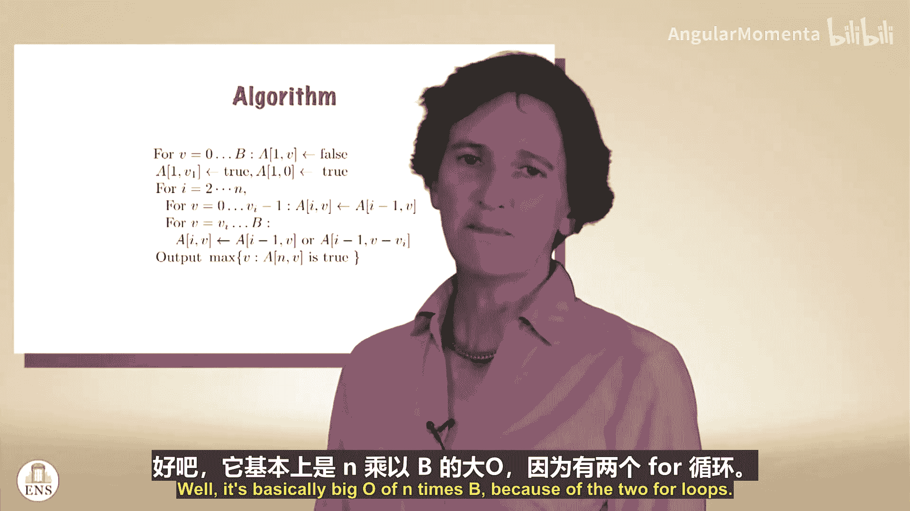

# 【巴黎高等师范学院】近似算法（一） ｜ Approximation Algorithms Part I p11 02_03_01_讲座专题动态规划 -BV1X4rrBgEzg_p11-

So far， we have designed a two approximation algorithm when every item has its size equal to its value。

Now， we want to do something better than two。For that， we're going to study a special， special case。

A special case of the special case。 A very special special case。😊。

All items have size equal to their value。 and in addition。There's one more assumption。 What is it。

The items。Have a value， which is a small integer。And the capacity of a Napsack is also a small integer。

Small， what does small mean， Small means。P11 and n。So let's say that all items have value。

Between1 and B， an integer value。Sence equal to their value， and the capacity B is a small integer。

For that， special， special case。I will now give you an optimal solution。

 This problem is no longer NP。 It's possible to solve it optimally。Let's see how。

The technique is a big classic technique of algorithms。Dynamic programming。Dynamic programming。

 Let's design a dynamic program for this special special case。😊，We have items already in。

The knapsack。Given the items already there， we want to add more stuff to the knapsack。We have。

 We want to decide what to add。So what is the question dynamic programming is defined using an interface that relates what we have decided to do in the past to what we will decide to do in the future。

😊，Given a partial solution for the first eye items。

What do we need to remember in order to complete the solution optimally？If。

We have packed a certain subset of the first items in an abstractpsack。

 What do we need to remember about them in order to be able to decide how to complete this optimally。

What to remember。 We don't need to remember the entire subset。 We don't need to remember exactly who。

We chose to place in an knapsack。The only thing that remembers that matters is。

Let's remember the total value， so far。Let's remember。Among the first eye items。

 what is the total value of the subset that we decided to place in a knapsack。

This leads us to define an array indexed by。I， for the first I items。

And the for the value achieved so far。For the first I items for a given value V。

Let's store in an array。The information of whether there exists a subset of the first eye items。

Whose son？Is equal to exactly V。V is what is any integer between 1，0 and B。This defines our array。

 one of the key components of a dynamic program。Now。

 the next step in designing this dynamic program is to have some recursive formula。

 some formula2 that tells us how to compute， how to calculate a of IV。

A of I V is whether value V can be achieved with some subset of the first I items。

What is the condition， when is value V achievable with the subset of first I items。V is achievable。

 if an if。If and only， if what。It depends。It depends。 Let's see。 Is the I item。

 Is it in a subset or not。Maybe， maybe not。Maybe， maybe not。That's two possibilities，2。

Let's look at the two possibilities。If。Item I is not in a subset。Then。😊。

We need to figure out whether value V can be achieved using a subset of the first I-1 items。

This is an information that should be in the entry a of V and I -1。Second case。

 imagine that the subset contains item I。Well， of course， this can only happen if V。

 the value of item I is at most V our goal value。And then what then item I goes in the subset。

 and then what we need to figure out is whether with some subset of the other I-1 items。

 it's possible to add up to value V minus V。So now we can express this algebraically。

A of I V is whether value V is achievable with a subset of the first I items。We have。The formula。

 A of IV。Is a bullolean function， which is equal to。Either or。It's true。If a of I-1， v is true。

We can already achieve value V with the first I-1 items。Or。

V is greater than record to V and A of I minus-1， V minus V is true。

This is a recursive formula to enable us to calculate the value of AIV。😊。

Now we only have to decide in which order to fill the table， and that is easy。

Order of increasing eye。So that leads us to our dynamic programming algorithm。

There's some initialization， which I will skip。 I will not detail it。Then。For every eye。

We got every V in term， every value V。From 0 to V I -1。And we have。 We copy a of I V in a of I V。

We consider all the remaining values of V from V to B。

 and for them we have the or of two things entry I minus-1 v and entry I minus-1 v minus V。😊。

Once we have done these four loops， we have filled the table A entirely and what will be the result？

The result will be。For I equal to n， when we look at all n items。

The maximum value V among all these between1 and B。Such that there exists a subset， summing to thee。

The maximum D such that a of N V is true。That gives us the exact optimal solution of the nextec problem in this special。

 special case。😊，What is the runtime of this algorithm？Well。

It's basically big O of n times B because of the two four loops。

So what have we done so far， we have designed an optimal algorithm for this special special case when every item has size equal to value。

😊，The max capacity of the Napssack B is a small integer。

 and every size and therefore value is an integer between1 and B。 In that case。

 we have an optimal algorithm with runtime big O of N B by dynamic programming。In the next section。

 we will study how to extend this algorithm to less special cases。

 we will try to get away from the special special case and design an approximation that works for more extended cases of the Napsack problem。

😊。