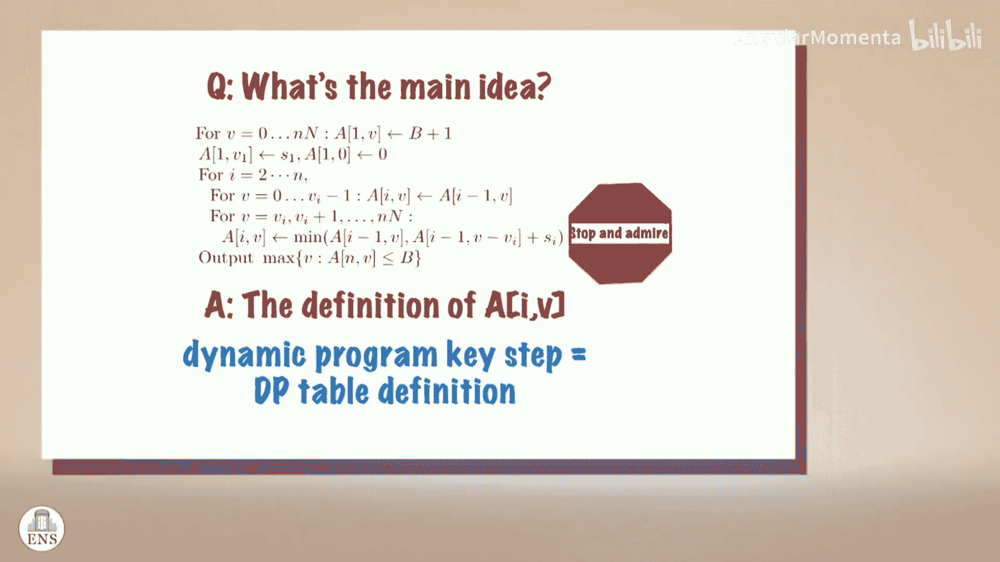

# 【巴黎高等师范学院】近似算法（一） ｜ Approximation Algorithms Part I p12 02_04_01_通用动态规划讲座 -BV1X4rrBgEzg_p12-

So far we have solved the NApsI problem for a special， special special case。

 it doesn't seem very interesting， but we're going to use the same ideas to try to solve a slightly more general case。

😊，What will be this less special special case？The case when the item values are small integers。😊。

So every item as before has a size and a value， but the size is no longer equal to the value。

 the size can be arbitrary， but the item values are small integers in the range 1 through capital n。

 where capital n is could be fixed。😊，How are we going to solve this？😊。

We will extend previous ideas from the special special case。

How did we solve the special special case， we used dynamic programming。

 so let's start again with dynamic programming。😊，The idea of dynamic programming。

 we have to figure out what interface to define。Given a partial solution。For the first eye items。

We want to remember enough of the partial solution so that we are able to complete the solution optimally。

So what will we do？We'll add some stuff。To this part。

We'll complete things optimally here for an arbitrary beginning。

 So we need an interface that tells us what to remember here。What to remember。

Before we remembered for every eye。For the first I items。

 whether there was a subset that could achieve a certain value V for every possible value V。Now。

 again， we are interested in the first I items， and we are interested in the particular value v。

 but in order to figure out。😊，Weather。Whether we can add some stuff on top of a solution。

What are we going to do， We're going to add some stuff。 Add some stuff here。 And for this。

 we need to remember。The size。So we must remember the size。 How are we going to remember the size？😊。

The size can be arbitrary。Can be small， can be large， can be long numbers， difficult things。

 Theres sums。 There are many， an exponential number of possibilities。

 So what we'll do is remember the interesting sizes。Inside the table entries， inside AIV。

 we remember the size。Let's be more specific。In AI V， we will remember。

The size is achievable for subsets of our first I items of value V。Really。😮，Not quite。

For any subset of a first items of value v， there could be many different sizes achievable。

 all we need to remember is the minimum， the minimum of these values， why。

 Because if for the same value， we can achieve it with this size， this size。

 this size inside Napsack， then we might as well use the minimum possible size。😊，So in AIV。

We define this entry of a table as the minimum size achievable。

By any subset of the first items whose total value equals V。

And now that we have the definition of our DP table。

 we need to figure out a recurrence so that we'll be able to fill these entries in the algorithm。😊。

When。When。There's some subset of the first I items。

 some to size S while having total value equal to V。Well， it depends。 It depends on item I。

 It depends on whether item I is in the subset or not。Depends on whether the subset contains item I。

 two cases， two cases， case1， item I is not in the subset， then it's easy。

 we just have to look at the first I minus-1 items and we have to be able to reach size S with total value v。

Case2。Item I is in the subset， then it's easy。It uses size S of the Napsack。

 So the other items of a subset must sum to size S minus S。And it gives us value V。

 so the rest of a subset must give us value v minus V。😊，So。

This now gives us this reasoning now gives us a recurrence formula can be expressed algebraically。

As follows。Let AIV denote the minimum size achievable。

By any subset of our first I items of total value V。If V is greater than record to V。

Then AIV is the minimum of two possibilities， the one when I item I is in the subset and the one when it's not。

😊，The minimum of two possibilities， the first possibility is a of I minus-1 v。😊，The second one is。

A of I -1， V minus V I。That's the total size， minimum achievable by a subset of a first line minus and items that's sum with total value V minus V。

😊，Plus。S I， the size of item I。What about the else else。Else。Ese。If V strictly less than V I。

 then what， then item I cannot go in the subset， and then AI V clearly is just A I -1 v simple。

So this gives us our recurrence， we will use it to fill the table entries by order of increasing value of I。

 and that leads us to our algorithm for this special case。😊，Here's the algorithm。

 I did not detail the initialization。I did not detail the last spot， but this is easy。

 You can check it yourselves by yourselves that this works。

 What's important is the line with the recurrence， the line with the min。This line。

And what is the runtime？Rand I。Line，1。Big O of Little N， Primes， capital N。Line 2。Constant。And3。

 a full loop with time big O of n。 This fall loop includes some other loops。Two loops that together。

Have little V scan from 0 to。N times capital N， Y N times capital n。

Because this is the maximum value conceivable， why， Because every item has value its most capital n。

 even if every item is put in a knapsack， the total value will be n times n。

 little n times capital n。😊，And so。Because of these two four loops。

 the runtime will be little O of n squared times capital n。 When capital n is a constant。

 this says quadratic。So if we look at the main idea of this algorithm。😊。

How did we design this algorithm， We had to think of trying the method of dynamic programming。

And the main idea really came up in the definition of the array of the DP array。

 a definition that was chosen in just the right way so that it would have a recurrence formula。

We look at this， we see that it works in polynommal time。

 it gives us the optimal way to put items in our Napsack so as to maximize the value while respecting the capacity。

😊，So at this point， what have we done， We have solved the NApsA problem exactly in the case where all the items had small value。

In the next part， what we will do is build on this to design an approximation algorithm finally for NapsSack。

