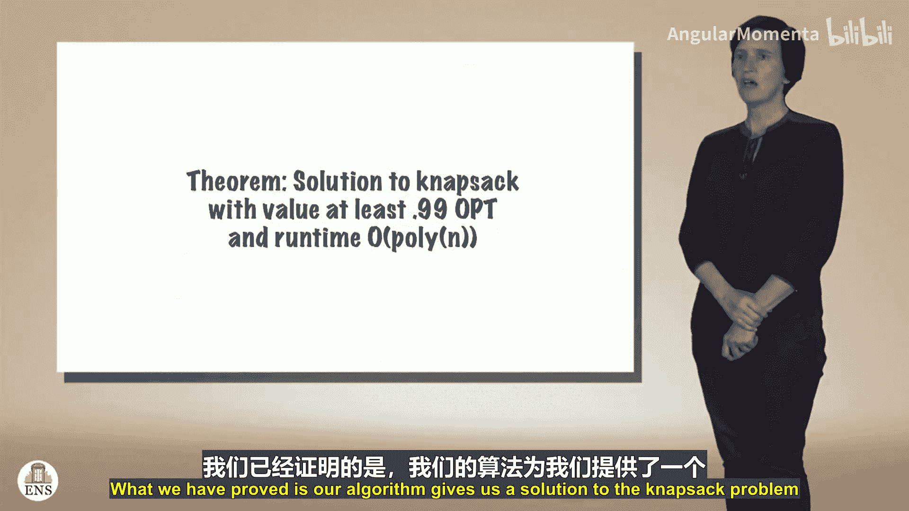

# 【巴黎高等师范学院】近似算法（一） ｜ Approximation Algorithms Part I p14 02_06_01_讲座分析 -BV1X4rrBgEzg_p14-

。

We have designed an algorithm for the general Napsa problem。

 We have proved that it runs in polynommal time。 Now。

 it remains to do what will be the climax of this chapter。Technically speaking。

 proving that it has a good approximation ratio。So in this section。

 we will do an analysis of the approximation ratio of our algorithm for NapsSAC。First。

 we need a little bit of notation。Our output set of items。 Let's call it S。Here's S。

What do we know about S， We know that S is optimal for the scaled rounded input iss a solution that was given us from solving the dynamic program。

😊，Second edition。S star。The optimal set of items。For the original input。

 since we know that scaling does not change the structure of optimal solutions。Well。

 a star is also optimal for the scaled un roundunded inputs。So we now need to relate the value of S。

 which is optimal for scale rounded inputs to the value of S star。

 which is optimal for scaled unrounded inputs。😊，First。We have done a reduction。

 so we really have two values to worry about the value of S for the original input and the value of S for the modified inputs。

Let us relate these two values。The value of S。Some are VI overRS。😡，Scale， multiply by alpha。

 P by alpha。 some of S of scaled inputs。Round。When you round， you round down2。The nearest integer。

 And so alpha V I is greater than equal to v prime I。

 And so the value of S is at least one over alpha times the sum of v primeise。

 That is the value of S for the scaled rounded input。Next。

We now look at the modified input and on that input。

 let us relate the value of S to the value of S star。😊。

What do we know about the value of S on the modified input。We know that S is optimal。

So its value is maximum possible， so its value is at least as good as the value of S star on the modify input。

😊，This we can write as some of V Prii over S。Is greater than the recall to the sum of V primei over。

S star。S。S star。S， S star。Now what do we do？Now we have managed to go from S to S star。

But what we have is not the value of S star on the original input， but on the modified input。

 So we need to go back to the original input。 We went from S on the original input to S on the modified input from there to S star on the modified input。

 and we need to go back up to S star on the original input。All right。 So how did the rounding work。

 We round it down to the nearest integer。So。They rounded value。I。😔，Less than the scale value。

 but by one at most， nearest integer is at most one away。So when we sum。

 the effect of Roning is the sum。Of the V Priise。Or at least alpha times the sum of the VIs。😊，-1，-1。

-1，-1。Size of S star times that is at worst end times。And what do we see appearing here？We see。

Some of over etorra V I。What is this。Opt。We have managed to make opt appear。

So now we can combine everything substitute。😊，Phi of s is at least one of alpha times the sum of R or v prime I。

 which is at least one of alpha sum of R star V prime I。

 which is at least one of our times alpha times sum of R star V minus n， which is at least。😊。

One over alpha than5 is 1。 so that's at least opt minus。And over alpha。Substitute the value of alpha。

 This is at least opt minus n times max v over capital N。We have found an additive error of。

N times max v over capital N。Al right。 now we have an additive error。

 which is often what we find when we study approximation algorithms。

 We need to work on this to prove something about the relative error of our solution。

 So we need to work on this term and somehow make up the peer。😊，For this。

 we will use another lower bound on optt。How do we lower bound opt。Now。

We go back to the pre processing， we had that little step that I didn't really say much about discard the items that don't fit in an Epsack。

😊，We can infer something from that。We discarded the items whose sizes were too big。

 So all the remaining items， if we take them alone。They fit in an abstractpsack。

 And so every VI alone would fit。 And so we know that optt is at least the maximum of all of them。

Now we could substitute opt for Maxa V and。We get that the value of S is at least optt minus little n over capital n times the optt。

😊，放到了。Remember， what is capital N，100 times little N。 We haven't used this yet。 It's time。Substitute。

 and what do you get， The value of S is at least 。99 times opt。99% Times up。We have a 1% error。

We're almost optimal。What we have proved is our algorithm gives us a solution to the Napsack problem。

That can be computed in polymable time。And whose value is at least 99% of the optimal value。

Excellent。Excellent， but we're not quite done yet。In the next and final section。

 we will extend this to design an approximation scheme for the Napsack problem。

