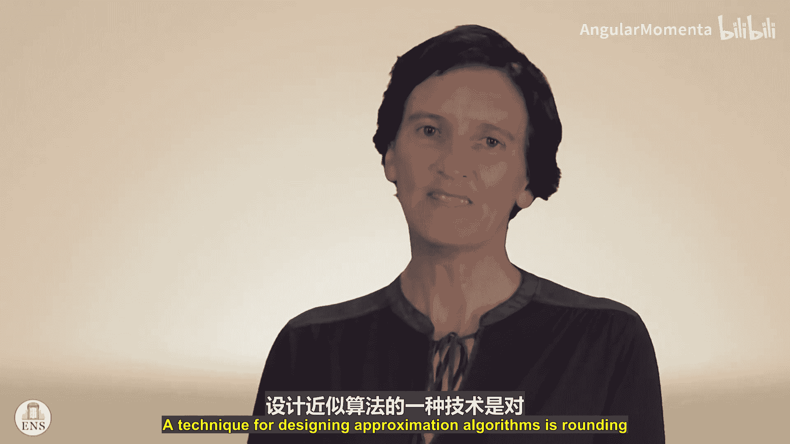

# 【巴黎高等师范学院】近似算法（一） ｜ Approximation Algorithms Part I p15 02_07_01_讲座近似方案 -BV1X4rrBgEzg_p15-

We have seen an approximation algorithm for the Napsack problem that gives us a solution that is quite close to the optimal solution。

😊，Now what。Now， what we want is an approximation scheme。That is， we want to do better than this。

 How can we do better。😊，Here's one way to get better。Instead of defining n as 1000 times little n。

We will use this as a larger value of capital N。😊，Capital N，1000 times little N。

 And then the rest is the same。We scale as before we round。

 as before we apply the D program as before， and we output the corresponding items。

 The only difference with the previous algorithm is that capital n is 1000 times n instead of 100 times n。

😊，What does this change？What changes is that this gives a solution to Napsack that is now instead of being a 99% approximation。

 it's a 99。9% approximation。😊，Very close to optimum， and the runtime is still polynomial。

We could keep going。We could keep going， That is， we could get an algorithm， one for each epsilon。😊。

That has a running time polynommal in the input and whose value is very close to optimum。

The value would be。Close to optimum with error at most epsilon opt。

So what this gives us is an approximation scheme。Napack has an approximation scheme。

 We can get to 99% of optimal。99。9% of optimal，1 minus epsilon times optimal。How Eilon comes in。

The smaller epsilon is， see how small it is。I can barely see it。

The closer we are to the optimal solution。So why not let Epsidon go to zero？😊。

And then we will find the exact optimum in polyymmal time。Well， this， we cannot quite go that far。

 why because the problem is NP hard， so we know we cannot do this and because the runtime increases as Epsilon goes to zero。

 the runtime is linear in capital n。When capital n is n over epsilon。

 then what we can see is that as epsilon goes to0， the runtime goes to infinity。

 and so that is why we cannot solve the problem exactly using the approximation scheme。😊。

So what is the method that we have developed for the approximation algorithm for the NApsec problem？

😊，We have shown how we can first simplify the input to reduce a complicated input to an easy special case and then designed an algorithm that worked for such simple inputs。

😊，The key to this is to simplify the input without losing much to the optimal value。

So with this technique， we have solved the naph sarom。

 it has been the occasion for us to study rounding。Rounding the input。

 as opposed to rounding to get the output output， as we saw when we are studying vertex cover。😊。

Notice that of all approximation algorithms， this is perhaps one of the most practical。😊。

The NApsa problem is a basic problem， and this algorithm is an algorithm that is。

Easy to implement and quite fast in practice。 Oberve that the runtime is not only polynomial in terms of the input。

 but also polynomial in terms of one over epsilon。As epsilon goes to zero， of course。

 the runtime goes to infinity， but only at polynomial speed。

 at a polynomial rate in one over epsilon。😊，And so such an approximation scheme is called fully polynomial time approximation scheme。

😊，The NapsA problem has a fully potable time approximation scheme。

This is the fact you can remember from this chapter。

 a technique for designing approximation algorithms is rounding the input to simplify the input to reduce it to a special case。

😊。

Next time we will see some other approximation schemes using more complicated rounding techniques。

