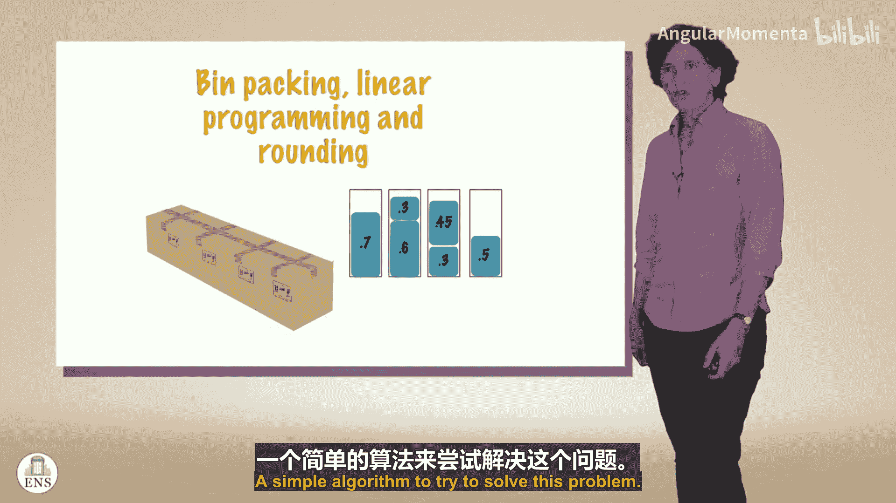

# 【巴黎高等师范学院】近似算法（一） ｜ Approximation Algorithms Part I p16 03_01_01_下一讲拟合 -BV1X4rrBgEzg_p16-

。

Welcome back to the course on approximation algorithms。

We are now going to turn to one of the most famous problems of Comatal optimization。

 the bin tacking problem。One of the first NP hard problems。

This is a problem that you've had to face many times。

 probably in your life without knowing that you were faced with bin backing。

Whenever you have to move， you need to pack your items into boxes and beforehand you have to order the right number of boxes。

 so you have to figure out how many boxes you need to pack your items。

The aim of the bin packing problem is given a set of items， pack them into as few bins as possible。

In real life， this is complicated by the fact that the objects you pack have various shapes。

 dimensions， weight here we will study the most basic version of the problem。

 a simplified version of the problem。😊，Where your input has n items and each item has a single parameter describing it。

 its size。 Let's say the size is S I 4 item I。And let's assume by convention that every item has size at most one。

 then your goal is to pack your items into the fewest unit capacity bins。😊。

That's the bed backing problem。Let us describe an algorithm to solve this， a very naive algorithm。

 probably the first algorithm you would come up with。 In fact。

 you might even discount that algorithm and try right away to get a better algorithm。

 but let's try to be as naive as possible。It's called the next fit algorithm。What is this algorithm。

 We just work one bin at a time。At any time， we have one open bin that we are trying to fill with items。

 We take the items one by one in any order， arbitrary order。For the currentt item。

 we try to place it in the bin。😮，And then maybe it fits。 Maybe it doesn't。 If it fits， we put it in。

 If it doesn't fit， we close the bin， open a new bin and put the item in a new bin。That's it。

 It doesn't get much simpler than that， does it。See this example。In this example， we have six items。

Of size 7。7。6。4。3。45 and 。5。Let's take them in that order。First， S1。7。We put it into the first bin。

 There it is。Next comes item 0。6。There it is。We try to put it in the first bin， but it doesn't fit。

 So we close the first bin， open the second bin and put 0。6 in。Then 0。3 arrives。

 we can put it on top of 0。6 because 0。6 plus 0。3 is less than 1， so we put that in and so on。

 and so you see that the result is you have four bins。

 you have used four bins to pack your six items。😊，Allright， so that's the algorithm。Clearly。

 this algorithm。Runs in pannoormmal time。It is quick to do。And does it do a good job？

It does pack all the items， but doesn't it waste some bins， How bad is it。So to answer that question。

 we have to turn to the analysis of the next fit algorithm。How do we analyze such an algorithm。

In approximation algorithm， we want to bound the value of next fit。

 the number of bins used by next fit compared to the optimal number of bins。

By used by a professional mover who would know exactly what is the best way to pack the items。

So let's try some example to develop some intuition。Let me scale things so as to deal with integers。

 Let's say we have capacity 100。 I'm going to take some items。 Let's say， random sizes。

So I have a sequence of items that all have sizes between 1 and 99。

I used next fit to pack them and in this example I used 31 bins。

Now look at the result and I try to see if there is any any kind of structure that arouses。

 arises from this input。 Can we see from this that there is some structure exhibited by the next fit algorithm。

😊，Let's focus on bin， number 7。Bin number7 contains three items。25。ourteen。25。

The next item arrives 61， but 25 plus 14 plus 25 plus 61 is greater than 100， so we close bin 7。

 open a new bin bin number 8 and put item 61 in bin 8。😊，So what have we seen。

 We've seen that 25 plus 14 plus 25 plus 61。😮，Is greater than 100。The content of been 7。Plus。

 part of the content of bin 8。Is greater than 100。In general。The content of bin 2 i minus-1。Plus。

 the next item。Is greater than 100。Why。😊，Because that was the rule for closing a bin。

 you would not close bin 2 I minus1 unless the next item didn't fit。

 unless adding the next item didn't make it overflow exceed its capacity。

Since the next item goes into bin 2 I， what we know is that the items in bins 2 I minus1 or 2 I altogether。

Have size greater than 100。So in this example， nextfi used 31 bins。What can we infer from this。

 we can infer that bins one and two together， the sizes of the items placed there is at least 100。😊。

Three and four together。At least 100 beanss five and 6 together， at least 100。

 and so on until 29 plus 30。Altogether， the total item sizes must be greater than 15 times 100。😊。

So we have now proved a bound relating the number of bins used by next fit to the total item sizes。

 the sum of all the item sizes， this is half of the analysis of next fit。In general。

 if nextF uses K bins。😊，The sum of the item sizes must be at least k minus-1 over2。Times 100。

Why the minus1 is by parity。 The last bin is special。😊，And then all the previous bins。

 you pair them up two by two， and each pair of consecutive bins， the item sizes is greater than 100。

 and there are k minus-1 over two of them。😊，What about optt。

That is the other half of the analysis of next fit。 So far， we've given a bound on K。

 the number of bins used by next fit。Now， we need to bound on opt the number of bins used by the omniscient professional mover who knows the optimal number of bins。

Well， even if optt packs each bin perfectly， it cannot do more than fill each bin up to 100。

And in that case， Op uses at least a number of bins equal equal to the total item sizes divided by 100。

😊，The sum of the item sizes is at most opt times 100。With that。

 we have related the unknown optimal number of bins to the total item sizes。So we have two relations。

 On the one hand， the number of bins used by next fit compared to the total item sizes。

On the other hand， the number of bins used by optt compared to the total item sizes。

All that remains is to combine them。Let's combine。Opt times 100。Is at least。

K minus on over 2 times 100。What does this mean， Eli the 100。Rearrange， and we get that K。

 That is the number of bins used by next fit。Is at most one plus two times optt？

The number of bins used by this very naive algorithm is at most twice as many as the optimal number of bins plus one。

So its if the plus one was not there， we would call this a two approximation。

 it's not quite a two approximation because of this plus one， this additional bin。

This annoying additional factor。But it's still essentially almost a factor of two。

 at least when up this launch， at least when the items require many bins。

So that's what we call an asymptotic to approximation。

 asymptotic as the value of opt goes to infinity。😊，Is this tight Is next fit better than this。

 We have proved that it's roughly a factor of two。Roughly， but maybe it's better than this。😊。

Actually， no。It's not hard to come up with an example where the optimal number of bins is。501。

 But next fit uses 1000 bins。This is a good exercise。What about non asymptotic。

 what about the cases when opt is small？Then it's hopeless。

 it's hopeless distinguishing between instances such that optt equals 2。

2 bins suffice and instances such that opt is 3， three bins are necessary。This is an MP hard problem。

So what have we learned in this section， We have learned that even very crude algorithms can give very good bounds。

 the message。😊，To try to solve a combinat all optimization problem。

 you should first try the simplest possible algorithm。Simpst can perform badly。

 but sometimes it's already a pretty good algorithm and the advantage of simplicity is that it tends to be easier to analyze。

 so if you want to prove theorems， you should always start with the simplest possibility。😊。

Keep it simple is the principle。For algorithmic design。What about analysis。

 How can you prove something about your algorithm。You have to first develop intuition and the message here is that in order to develop intuition。

 first you have to try executing the algorithm on some concrete examples。

So we have seen the definition of the bin packing problem。

 a simple algorithm to try to solve this problem， the next fit algorithm。

 we have analyzed next fit and proved that it is asympthetically a2 approximation。

To get a better algorithm， we will next try to use linear programming。

