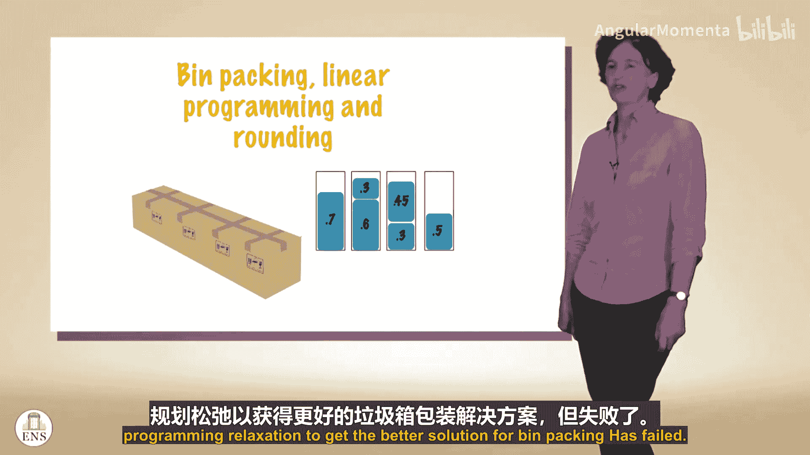

# 【巴黎高等师范学院】近似算法（一） ｜ Approximation Algorithms Part I p17 03_02_01_线性规划讲座 -BV1X4rrBgEzg_p17-

嗯。

So far， we have defined the bin packing problem。We have designed the next fit algorithm。

We have analyzed it and proved that it's asymptotically a to approximation。

Can we do better than this。Can we do better than the next fit algorithm In this part。

 to try to do better， we will design a linear programming relaxation for the problem。😊。

Let me reveal already。Our ultimate goal for bin peing in this course。

Our goal is to get an asymptotic approximation scheme。 Our wish is to design an algorithm。

That for each epsilon is parameterized by epsilon and outputs a packing into bins。

 a number of bins that is at most one plus epsilon times opt plus some lower order terms。For this。

 we will first try what is fast becoming our standard approach to comminatal optimization problems。

 model them as an integer program， and try a linear programming relaxation。😊。

So we now need to find to come up with an integer program for bin packing。Recall that in bin packing。

 you have n items， you want to pack them into the minimum number of unit capacity bins。😊。

We will find an inte program for a slightly different version of the problem。

 The decision version of the problem， given n items。And given K， the number of unit bins。

The goal is to decide whether or not there exists a packing of the N items into the K bins。

 whether they fit into K bins。Clearly， if you can solve one problem， you can solve the other。

 the two problems are equivalent。How do we get an integer program for this problem？

We're going to use some variables，0，1 variables。 What do we need to know。

 A packing is a positioning of the items into the bins。

A packing is a way to decide for each item in which bin iss going to go。

So this suggests defining a variable， X I J。😊，For each item I and each bin J。

 it's a two dimensional set of variables。X J will be equal to one。 if and only if item I。

Can be placed into binja。That's the definition of our variables。

 X I J will be1 If item I goes into bin J， X I J equals 0， if not。

Let us go back to the example we talked about originally。Let the， the items be called ABC， D， E， F。

In the case of the packing you see on the screen。Item A goes into bin one。 So X A 1 is1。

Items B and F going to bin 2。 So X， B2 and X F2 are both equal to1， similarly。Item D goes into bin4。

 So X D4 equals 1。The other two items go into bin 3， so x E3 and x F3 are both equal to 1。

 and for all the other possibilities， X I J is equal to 0。😊。

This defines a correspondence between placements of items into bins。Packings and assignments of 0。

1 values to the variables X I J。I ranges over all possible items。

 J ranges over all possible bins1 through K。Now we have our variables to define the In program。

 we need constraints。How do we define our constraints？What are the constraints。

The first constraint is easy， easy to phrase in English。Every item must go somewhere。

 Every item must go into one of the bins。Item B， for example， must go into bin 1，2，3， or4。

How can we express this algebraically， It's simple if we look at the variables Xb1， Xb2， Xb3 and Xb4。

 exactly one of them must be equal to 1 and the others equal to 0。😊。

The sum of these four variables must be equal to one。

We can write similar constraints for all the other items in our input。

 So we have one constraint for each item expressing the fact that the item must go into。

One of the bins。What other constraints do we have for the integer program。The bins have a capacity。

 The items that go in the same bin must not exceed the bin capacity。

How can we write this If we look at all the items that go in bin into bin number J。

 their sizes must sum to at most one the bin capacity。How can we express this algebraically？

If we look at X A J times the size of item A。This is equal to 0。

 if item A doesn't go in bin J and is equal to S sub A the size of item A otherwise。

Some this and similar expressions for all the items。 What do you get。

 You get a contribution of 0 for every item that is not in binja and a contribution of the item size otherwise。

There some。Is equal to the total item sizes in binja。 so that sum must be less than or equal to one。

That's how to express the constraint that the bin capacity must not be exceeded。

 There is one such constraint for each bin J equals 1，2，3， through K。So altogether。

 this defines our integer program for bin packing。N items， K bins， variables， X I J。

 whether item I goes into bin J。For every item I， it must go somewhere。

 the sum over all bins J of X I J must be equal to 1。For every bin，ja。

The bin capacity must not be exceeded。 The sum of X I J。

 S I over all items I must be less than equal to one， the bin capacity。Finally。

 X I J for every item I and bin J must be equal to 001。This integer program is feasible。

 has a solution。 if and not if there exists a packing of the items into cabins。

This is an individual program for bin peing。So I started by saying that we would try to find a linear programming relaxation from this。

 it is easy to deduce a relaxation。 we just replace the constraint that X Ij must be equal to 001 by the constraint that X Ij is a real number between 0 and 1。

😊，That is， the linear programming relaxation observe that it is exactly the same as before。

 except that the last line is replaced by。😊，X， I， J is between 0 and1。

Now we want to use this linear programming relaxation to design an algorithm for binpacking。

To find how to pack items。The first thing to design such an algorithm is to check that the linear programming relaxation is good。

😊，Good meaning it's close enough to the integer program。

So we turn to this linear program and we ask ourselves。

 we lost something some accuracy when we replace the condition X I J equal to 0 and1 by the condition X I J between 0 and 1。

 How much did we lose。 What is the interity gap of this linear programming relaxation。😊。

I have some bad news。Here's a bad example。Five items。Three bins。All the items have size。6。

The bins have unit capacity。 If you have five items that each have size equal to 0。6。

 you need 5 bins to pack them。 Obviously， opt is equal to 5。5 bits are necessary。

What about the linear program。I claim that it is possible。

 according to the linear programming relaxation。To solve the linear program and find a solution when K is equal to 3。

3 bins。Let's see how to do this。 J equals 1， J equals 2， j equals 3， case 3。5 identical items。

We need to define X I J for every I between one and 5 and for every J between1 and3， every item。

 every bin。Let's define every X， I J to be equal to one third， uniformly over all items and all bins。

We can check that every item fractionally is packeded somewhere。 For example。

 the first item is packed for one third into bin one。1 third into bin2，1 third into bin3。

 the sum of the X I Js for item 1 is equal to one third plus one third plus one third。Wan。Next。

 we need to check that the bin capacity is not exceeded。Let's look at bin1， for example。

 with some the X I Js times their sizes times 0。6。We have a sum with five terms。

 Each term is one third。Times 0。6。5 times 1， third times 06。 That's 1。

This constraint is also satisfied。So what we have just given here is a value of the XI Js that satisfies all the constraints of the linear programming relaxation。

According to the linear program， it seems that it should be possible to pack these items into three bins in reality。

5 bins are necessary。 This means that we are off by a factor of5 third。

 at least no matter what our algorithm will do， if it tries to use this LP。

 It risks being off by a factor of5 thirds。And so what we have seen here is our first attempt to design the linear programming relaxation to get a better solution for bin packing has failed。

 so we have to have some better idea， we have to explore more structure more properties of binpacking and that is what we will proceed to do in the next part。

😊。

