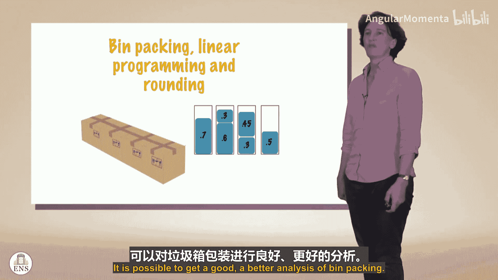

# 【巴黎高等师范学院】近似算法（一） ｜ Approximation Algorithms Part I p18 03_03_01_讲座零散资料 -BV1X4rrBgEzg_p18-

So far， we have studied the Ben tacking problem and tried to design a linear programming relaxation with the ultimate goal of finding a asymptotic approximation scheme for the problem。

😊，Here we will go back a little bit and try to solve some special cases。Why do we do that。

 remember that linear programming relaxation is our first our favorite tool to design approximation algorithms。

 but the attempt we did failed， we failed to have a good linear programming relaxation for linear for bintaing and so we will try our next meta tool。

 our next technique to design an approximation algorithm。😊，When you are stuck， what do you do。

 you reduce the problem further， you try to solve some interesting special cases。

That helps you develop intuition。For now， we will look at the special case when all the items are small。

Small compared to the bin capacity。Let's be more specific。😊。

How can you solve bin packing more efficiently when every item has sized less than one third of the bin capacity？

One third of the bin capacity。Let's do an example， 0。2。3。25，033。24。29。33。2 and so on。

How does next fit perform in this case， What does it do。We can execute it on this sequence。

 and we can see that so far it uses three bins。😊，The first bin is filled to。75 level。2 plus 0。

3 plus 0。25。The next bid bin contains a total of 0。86。The third bin contains a total of 053。

And right now， even before we have seen the following item。

 we could already predict that it's going to fit into bin 3。Why。

 because its size is at most one third。53 plus something less than a third is less than one。

 So the next item will fit in the bin。 We will be able to add it to bin number 3。

Something is going on here。 That did not happen before。

So what we can see is that if a bin is filled up to level less than two third。

Then we are guaranteed to be able to fit the next item。If a bin is filled to less than two third。

 then we will never close it。In other words， we only close a bin once it is filled to level at least two thirds。

Since next fit closes every bin， except the last one。All the bends， except the last one。Possibly。

 I fell to at least two thirds。All the bins are fit， are filled to at least two third。

 except possibly the last one。What can we say from this。

 This is good news if a bin is filled to two thirds， then it's already two thirds of 100% capacity。😊。

In other words。The total size of the items that are placed in the next fit bins is at least two third times the number of bins except for the last bin。

Much better than before。We have this way related the number of bins used by next fit to the total item size。

😊，We know that up is at least the total item size so we can combine。 And what do we de from this。

 The number of bins used by next fit is at most one plus。Three half times opt。

1 plus  three half times optt。 This is much better than before。 before we had two times opt。

 Now it's 1。5 times opt。To prove this， we took advantage of the fact that the items were smaller than one third times the bin capacity。

So we have just proved a theorem when all the items are smaller than one third of the bin capacity。

 the next fit algorithm uses a number of bins that is at most 1 plus 1。5 times optt。

So what is the message from this analysis？From an example with small items。

To a structural observation， every bin is filled to level two thirds， at least。From that observation。

 you can deduce an upper bound on the algorithm in terms of the total item sizes。

With a different argument， we also have a lower bound on opt in terms of the total item sizes。

Combining yields abound on next fit， with small sizes。This can be extended。

 What if the items are less than one quarter times the bin capacity， What about  one fifth。

What about11th。What if the items are less than epsilon times the bin capacity？

Then next it is almost optimal， except for the lastbin。This is a good exercise。

And so we have seen that in some special cases， when all the items are small。

 it is possible to get a good， a better analysis of bintaing。

Next， what we will do is look at some other special case。

 the opposite case so to speak when the items are launched， and after that。

 once we have derived intuition for the two special cases， everything small。

 everything launch will be able to combine the intuition and finally analyze an algorithm that is good for every possible input。

😊。