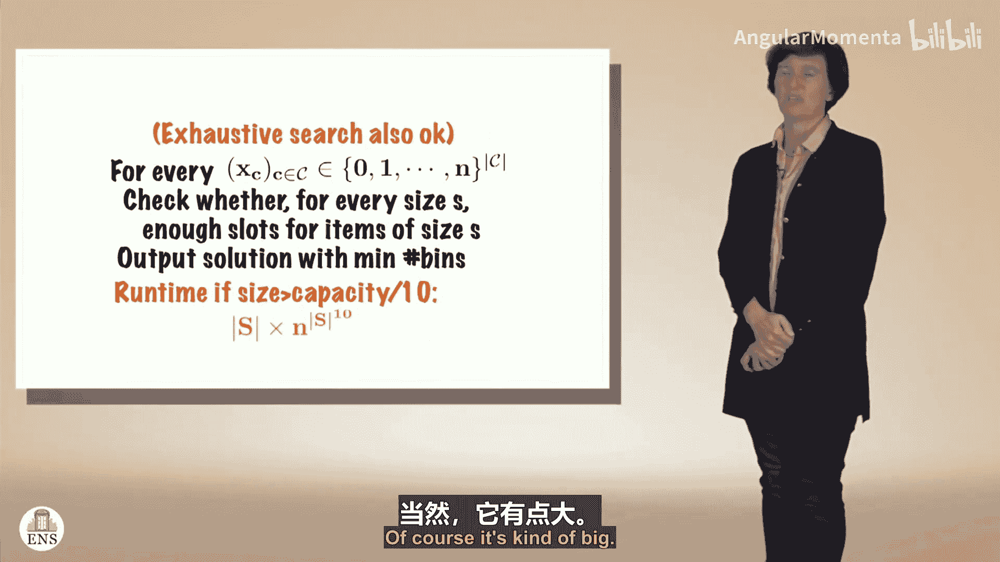

# 【巴黎高等师范学院】近似算法（一） ｜ Approximation Algorithms Part I p19 03_04_01_讲座大项少尺寸 -BV1X4rrBgEzg_p19-

We have seen how to solve bin packing when item sizes are small， small。

 As in there's an upper bound on the maximum size relative to the bin capacity。

Now let us look at the opposite case。When item sizes are large， that is。

 when there's a lower bound on the minimum item size。This is still a fairly hard problem。 In fact。

 it is kind of a head scratcher。So how do we solve this？

It's still too hard for us to solve right away in one shot。 So we go to a special， special case。

 At this point， you should be used to this。Special， special case。Large items。Few distinct sizes。

All items are large， and all item sizes are drawn from a small set， a set of small cardinity。

In this section， we get to solve this problem。How do we go about it。You know how to do this。

 There's a technique for this to design algorithms for this kind of situation。😊，First。

 we try an example。Then we gain some intuition from solving this example。

 and we derive a solution for the general setting of large items and few distinct sizes。😊。

So let's take an example。Consider this。Bin capacity。12。Item sizes，3 and 4。What is our input？

Let's say that we have 10 atoms of size 3，10 atoms of size 4。10 of size 3，10 of size 4。

We want to pack them in bits of capacity 12。How convenient 12 is three times 4 is four times 3。

How very convenient。 Look at this。Consider this example。 Think about it， and a solution emerges。

Naturally。How。Well， we have 10 items of size 3， but four items of size 3 fill exactly。

Be exactly to capacity。So， let's have two bins with。4 items of size 3 in each of them。

We have two items left over。Then take the items of size 4。Three of them filled a bin exactly。

So let's have three bins like that using up nine of our items。What is leftover。What's left over are。

Two items of size 3。One item of size 4。3 plus 3 plus 4 is 10。

The leftover items fit in one additional bin。That's our solution。Two bins。Filled with3。

 four items of size 3 each。Three bins filled with three items of size4 in each and one bin with the leftover items。

Total，6 bins。A little thought reveals that this has to be optimal。So what is the idea。

 what idea did we use for this？The idea we use is that there are not that many ways to fill a bin。

When items are large。You dont have you cannot put that many items in a bin。

 and there are only so many different bins。Let's call those。Configurations。

We have few possible configurations。We can have bins that contain items of size 4 only。Three of them。

Or two of them， or just one of them that I didn't draw。

Or we can have bins that contain items of size 3， only four of them， or three of them。

 or two of them， or one of them。Or we could have a bin that contains a mixture。

 It could contain two items of size 4 and one of size 3。😊，Two items of size 3 and one of size 4。

Or one of each。And that's it。These are all the bin types。 These are the only possible configurations。

So what does it suggest in general？Whenever we have large items and few distinct item sizes。

 let us define C， capital C as the set of all possible bin configurations。In configuration C。

Let us look at how many times we have a slot of size S。 Let's call this A sub S， C， for example。Here。

For this configuration C， a sub。3 C equals 1。 There's one possibility for an item of size 3， and a。

4 c equals 2。 There are two slots of size 4 in this configuration。All right。 then what。

Now we're going towards something that you probably guessed。An integer program now。Integer program。

So we have our set of sizes。That has constant cardinality。

The input gives us the number of items of size S， let's call it and S。😊。

The output chooses among the set of configurations， how many bins we have in each configuration。

Let X subsea， denote the number of bins that are filled according to configuration， little C。

That's a variable。These are the variables of our integer program。And what are the constraints。

 The constraints are that everything must fit。 Everything must fit in somewhere。 In other words。

 if we look at the items of size S， how many do we have and so best of them。

 There have to be enough slots for all of them。 How many slots do we have for items of size S。

Some oversee over all configurations of。Exopsy， the number of。

Bins in configuration C times A sub S C， the number of slots in that configuration for items of size S。

That has to be large enough to fit all the items of size S。 That's our constraints。And finally。

 what is the objective of the integer program， We want to minimize the number of bins。

 That is some oversea of x sub C。😊，Of course， X sub C must be an integer。

That's the integer program for bin packing when all items are large and there are only few distinct item sizes。

So what do we do with this？We have to figure out how many configurations we have。Easy。Not that many。

If。If every item size is at least 10% of the bin capacity， then obviously。

 we can fit at most 9 items per bin。Each configuration has at most nine items。😊。

And if we have less than， say，10 different sizes， then how many configurations do we have at most。

10 to the 10。So what do we do？10 to the10。Is pen is a constant。1啊。10% of capacity。

10 is another constant， the number of distinct sizes。Okay。

 here it so happened that these two parameters are。Both equal to 10。

 but that's a coincidence in general， the size is at minimum some alpha times the bin capacity。

 and the number of sizes is at most some K equals big over of one。Al right。

 at most 10 to the 10 configurations。 so we can solve the LT relaxation that has a number of constraints equal to the number of sizes。

😊，看了。A number of variables equal to the number of configurations， 10 to the 10。😊。

Then to the 10 is a constant。It's a big o of one。That's the beauty of theory。

And once we have solved this， we can round up to the nearest integer each variable。

 this adds at most plus one per variable plus 10 to the 10。

 So the output gives us a way to pack items with a number of bins at most equal to opt plus 10 to the 10。

😊，Almost optimal。Or let's say you don't like 10 to the 10。

 Let's say you want something that is exactly optimal。You can do it。Hao。Exhausive search。Easy。

Look at all possibilities。 You know that for each configuration C。

 the number of pins in configuration C is at most n。 Y， because you only have n items to pack。

 So even if you put one in each bin。That's at most ends。So， the total number of。

Collections of configurations， of conceivable solutions is at most。N plus one。

 all possibilities0 through n to the coordinate of C numbers considerations， to the 10 to the 10。😊。

For each such conceivable possibility， you can check whether for every size S things fit。

 You have enough slot to fit all the items of size S and then output the solution with the min number of bins。

 That's exhaustive search。😊，It gives you the exact optimal solution。 and the runtime is at most。

Size of S number of distinct sizes times n to the size of S to the 10。That's polyymmal time。

 Of course， it's kind of big， and it's possible to do much better than this using linear programming。

 but still。

It's about in the middle time。So in this section， we have seen how to solve the problem exactly or near optimally when all the items are large and there are a few distinct item sizes。

 Next we work on removing the assumption that there are a few distinct sizes。😊。

