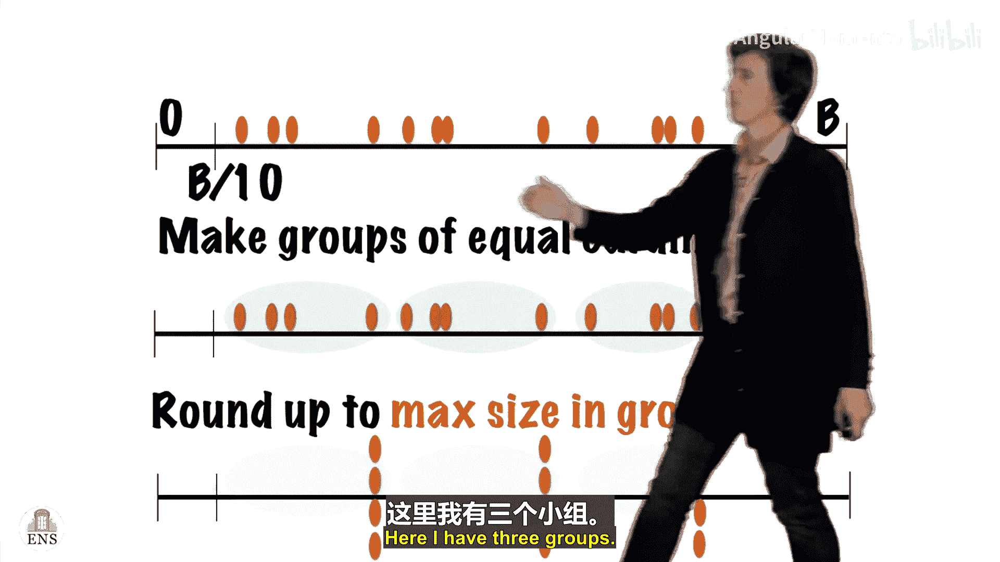

# 【巴黎高等师范学院】近似算法（一） ｜ Approximation Algorithms Part I p20 03_05_02_大型物件多尺寸 -BV1X4rrBgEzg_p20-

After solving the bin tacking problem when items are large and there are few distinct sizes。

 let us now move on to the less special special case when items are still large。

 but there are many different sizes。Large items， many different item sizes。

 This is perhaps the most important section in this entire chapter。What is the idea？

The idea as in Napsack is to use rounding。 We have many different item sizes。

 We want few different item sizes。 We will round the sizes。😊，After we have rounded item sizes。

 we have reduced the problem to the special special case that we already know how to solve。😊。

How do we run sciences， we round them up。😊，This way， if the rounded items fit in a bin。

 then the unrounded items also fit in a bin。 they also respect the bin capacity。

How are we going to round， for example， Let's say that the bin capacity is 100。

 The minimum item size 10%。 so let's say the minimum item size is at least 10。 What will we do。

 It is natural to say let's round the items up to the nearest integer。

 And then we only have 90 possible item sizes。 and so we can solve the rounded problem in polynommal time。

And the solution will be a feasible solution for the original problem。

So that is the most natural attempt to solve bin peing with large item sizes。

 It is inspired from the Napsack algorithm that we saw in the previous chapter。😊，But how good is it。

 How good is this， We can picture it as we have a bin of capacity 100。😊。

All item sizes are between 10 and 100。We slice the item sizes。Using integer points。

 And then for each size， we round it up。To the next integer。This is the actual size。 something。

 some fractional number。 That's the rounded size， almost the same。

The item sizes only increase by a little bit。The size increases by a little bit。

So how much does op change when you do this in Napsack。

 we argued that when we change the values by a little bit， it didn't have much of a consequence。

Unfortunately。Look at thisす。Let's say we have capacity 100。 Imagine we have 50 items of size。

One third of 100。And 50 items of size say  two thirds of 100。

What is the optimal solution for this input。The optimal solution is， obviously。

To pair up the items of size 100 times 1 third with the items of size 100 times  two thirds。

If you put two of these items together， it fills the bin exactly。And so with 50 bins。

50 items plus 50 items，15 in 50 bins。 That's opt。 And now let's look at the rounded input。

 rounded input， The items of size 33。333333 are rounded up to 34。 The items of size 6666。

66666666 are rounded up to size 67。😊，Ohoops。😔，They no longer fit。

 We can no longer put two of them together。All the 67。

Have to be alone in a bin because 67 plus 24 is 101。And then the items of size 34 go2 to a bin。

 So what does this mean， It means that for the rounded input。

 the opt value of the rounded input will be 50 plus 25，75。 This is really bad。😊，Really bad。

We want something that is very close to optimal。 We want the running to have a very small effect。

 And here， when we round it， indeed the items， the item values only changed by a little bit。

 but opt changed by a large amount。This is very bad rounding。So this rounding fails。Now， what。

We need to find another kind of rounding。And this is adaptive running。Where does it come from。It sir。

New idea。 A new idea。A new idea happens。And。Here it is。

This is perhaps the most important slide in this entire week， in this entire chapter。Okay。

Start from the input， the input。 That's the top line item sizes。At most B， the big capacity。

 at least B of a 10。 Here are my items here。On that scale。What do we do？

We will make a few groups of equal cardinality。Croup  one after solving the items。

 the smallest items。Another group with the next few smallest items。

 another group with the next few smallest items。 Here。 I have three groups。

Then around all the items in the same group。😊，To the same value， namely。

 I run them up and up and up and up。To the maximum size in this group， these four items。

Their size is rounded up。To the size of the maximum。Max sizeizing group。

 same thing for the next group。 These four items， we run their size up to what to this。

 And the next group， these four items， their sizes up to。です。And what if it doesn't quite fit。

 we don't care。 that's a detail。 Let's skip this。So that's adaptive rounding。 We round items up。

To a value that depends depends on the other items in our input。Observe。

The number of distinct item sizes is what？It's the number of groups。The minimum item size is what。

 it's still greater than B over 10。So as long as we have a constant number of groups。

 we're in good shape， we have a reduction to the previous problem。

Let's go directly to the general case， assume now that the item sizes are at least the bincapacitated times epsilon。

 I'm going to work towards an approximation scheme。The algorithm first， saws the sizes。

Next makes groups such that each group has cardinality n times epston squared。

How many groups do we have one of ver Cuander？Then in each group。

 round all the sizes up to the max size in the group。 Finally。

 solve the rounded problem as we saw previously。😊，And then we output the corresponding backing。

This is our algorithm for large items。In this algorithm。

 what is interesting is this adaptive rounding。The output is a packing of the input items。

All sizes are greater than a certain fraction of the bin capacity。

 and the number of distinct sizes is less than a certain constant。 Therefore。

 the runtime is polynomial。But as usual， we have the question of the quality of approximation。

 how good is it？😊，What we will prove very soon is that the value of the output。

 the number of bins used by the output is at most opt times 1 plus a big O of epsilon。😊。

So in this part， we have designed a good algorithm for the case when all items are large in bin backing in the next section。

 we will analyze it and prove that it is indeed an asymptotic approximation scheme。😊。

