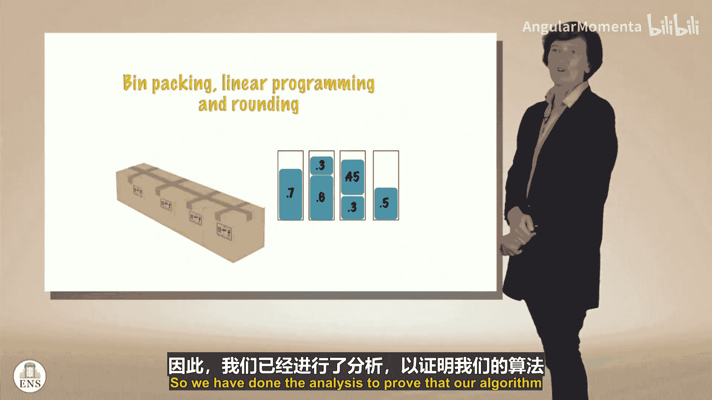

# 【巴黎高等师范学院】近似算法（一） ｜ Approximation Algorithms Part I p21 03_06_01_讲座大型项目分析 -BV1X4rrBgEzg_p21-

Now that we have a good algorithm when all item sizes are at least the bin capacityac times epsilon。

 let us analyze this algorithm and show that its value is close to optimum。😊，Recall the algorithm。

 So the item sizes。 make groups of cardinality n times aon squared in each group。

 run the item sizes to the max item size in the group， then。We have a reduction。

 and we can solve the rounded problem。 Let's call it U。 I is the input。 U is the。

Rounded problem where every item value is rounded upwards。And finally。

 output would the corresponding backing。How good is it？The value of the output， what is it。

 If we use the optimal algorithm to solve this， then the value of the output is opt of U。

The optimal value for the rounded items， rounded up。

So we must relate opt of view to opt of the input。And this。This is the idea。

 This is the most important slide for the analysis of our algorithm。Look at the input。

Contside the groups。Look at you。 We rounded every value upwards， up to the maximum of the group。

Consider。A different kind of rounding。Let's call it。第。D， like down。Down。

 instead of rounding up we round items down， down to what。Down to。

The maximum item in the previous group。The items in this group are rounded down。That size。

The items in that group are rounded down to that size， and what about the items of this group？

They are rounded down to zero。So what is D， D looks like this，4 items with this size。

4 items with that size and four items with size 0。How does this help？

It helps because bintaing is monotone。😊，The optimal value can only increase when you increase an item size。

 It can only decrease when you decrease an item size。So。We had our input。

 which I now draw in the middle。We have the upwards round。 This item is rounded up。

 We have the downwards round。 This item is rounded down。Iys are input。

 U is the rounded input upwards。 D is the rounded input downwards。 We don't use D in the algorithm。

 We use the for the analysis， only。Observe。Since increasing sizes can only increase opt。

When we round down。Ot cannot increase opt of D is less than to opt of Y。

When we round up optcon increase， Opta5 is less than a record to optta view。

We have sandwiched optta I between optta D and optta U。Why is this good？Now I raise I。

 I only look at U and D， the two rounded inputs。Look at that。 Look at this。 Look at that。

 look at this。 look at that。 look at this。 look at that。They're almost the same。

 It's almost the same input。 Of course， this and that really correspond because they came from the same input item。

 but we can forget about that。What happens in the end， U contains。

And epsilons squared items of this size as does input D。😊，An epson squares item of that size。

 as does input D。It's almost the same pin peing inputs。 What is the difference。

 The difference is that D， in addition， contains items of size 0 that you does not have。 Well。

 that's irrelevant。 We don't care about that。 itemss of size 0。 They don't change opt。And you。

You also contains some big items， these items。They have size。 How large is that size。 We don't know。

 It could be at most。 could be the maximum size。 the bin capacity。 But what we know is。

The number of items there is at most n epsilon squared。And so。

What we can write is that opt of U and opt of D are almost equal。Once we have a packing for D。

 we can deduce a packing for you that uses at most an Epon squared additional bins。

 one for each of these special items here， and so opt of v minus opt of D is at most an Eidon squared。

😊，So。Let's combine these ideass。Opttavi is sandwiched between opt of D and optta U。

Opt of D and opt of U are very close to one another。 They only differ by an evidencequed， therefore。

Optta view is at most opttabi plus an epsil squared。Optta view。

 the optimal value of the rounded items used by the algorithm is at most the optimal value that we are hoping to get close to plus an eon squared。

 So what this shows is that our algorithm is an approximation algorithm that is almost optimal。

 The additive error is at most an eon squared。Iデte Verra。

So we still have one step left in the analysis。One step left。

 which is to have a relative error instead of additive error。

 So we need to relate an Eence queryd to Opta I。 That's the last step。

But we have passed at this point， we passed the main difficulty。We have related optta view to Optavi。

 This was the main step。 The rest is standard。But let's do it anyway。All right。

All the items have size between B and Epsilon B。There are n items。Because these sizes are large。

 because the items are all bigger than Epsilon B， we know that every bin has at most one of our epsilon items。

Therefore。The number of bins to fit all the items is at least Epsilon n。

Ot has at least epsilon end bins。And so this addive term ands squared here。😊，It's effilon。

Times n epsilon。 It's that most epsilon times opt。 And so our additive error is that most epsilon times opt。

Putting everything together， what can we finally joyfully conclude？😊。

When all sizes are at least epsilon B， our algorithm in polynomial time gives us a packing with value at most opt times 1 plus epsilon。

😊，So we have done the analysis to prove that our algorithm gives us a near optimal solution。

1 plus epsilon times opt when all items are large in the next section。

 we will finish this development of algorithms by getting an approximation algorithm for the full general case。

😊。

