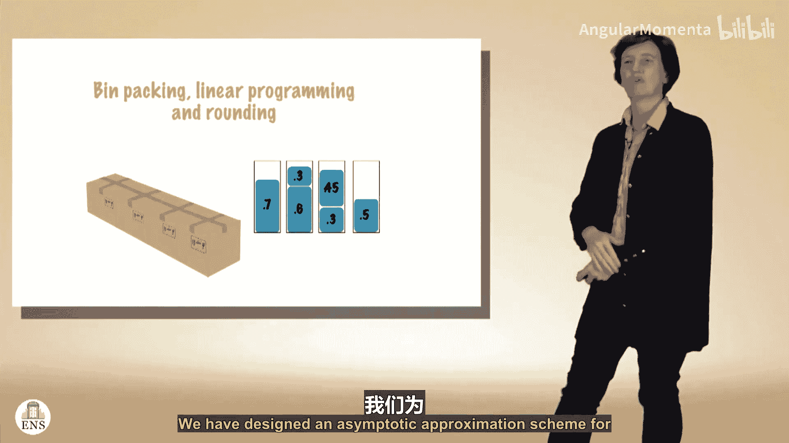

# 【巴黎高等师范学院】近似算法（一） ｜ Approximation Algorithms Part I p22 03_07_01_通用算法讲座 -BV1X4rrBgEzg_p22-

。

We have solved bin packing in the case when all item sizes are large。

 larger than the bin capacity times epsilon。 Now， let us move on to the full fully general case and design an algorithm when there are no assumptions about the item sizes。

😊，We're going to do a reduction to the previous case。How do we do it？😊，We want items to be long。

 So what do we do。We look at which items are small and which items are large。

Here is the general algorithm。We will set aside all the items that we don't want。

 The items whose sizes are less than the bank capacity times epsilon。 Let's call these items small。

We set the small items aside。And then what do we do， what do we do with the remaining items。

 They're all large。 They're all larger than the capacity times epsilon。

 So in the next four lines here， what we do is。We apply the previous algorithm。

 the algorithm indicates the case when all items are launched。

So this is a reduction from the general case to the case of large items。

The case of large items as a reminder is a reduction to a case when the sizes are rounded。

 when all items are large and there are a few distinct sizes。😊，So it's like Russian dolls。 you know。

 we solve a special special case， then a special case， then the general case。 We open the box。

 solve it， then we close the box again， close the doll again and use it as a black box for the next more general problem。

😊，Okay， so once we have solved the problem when the items are large。

 it remains to deal with the small items。 What do we do with them。😊，We do something simple。

 There's no big difficulty here。 We just greedily add the small sizes in the bins。

So let me do this in pictures。Here's the input。I have a bunch of items。Some of them are small。

 the ones that are less than Epsilon B。The others are large。Small。Launch。Set aside the small items。

Wsh。Here we go。New input， no small items， miracle。Solve the problem for the large items。Black box。

 we saw this before。 What do we get a certain packing of the large items into bins。

I drew this abstractly。I did not distinguish between which items went where。

 I only look at how much the bins are filled。And then。😊，We add the small items back in。

 So what do we do， Look at the small items。 Look at these bins， packing the large items。

We greedily add the little items there in those bins as much as we can here and there。

And maybe they don't fit here， so let's put them there。Face looks familiar。

Tace is where we reuseed the intuition we got earlier on when all items were small。

 it's a similar idea。And。😔，That's the algorithm。 That's it。Okay。

 so now this is too short for a section。 So let me do the analysis。

I will do the complete analysis in just a couple of slides。Analysis。Why is this good。

 Why is this near optimal？My in eye。Is divided into two parts， the small items and the large items。

 I is S union L。Two cases in analysis。When I added the small items back into my blue packing。Either。

I did not open any new bin。Or I opened some new bins。If I did not open any new bin。

Then what is the value of the output， It did not change in the last step。 So it's exactly the value。

Of the packing， of the launch items， packing of L。 And what is that。

That we know from the previous section is at most one plus epsilon times opttol。

And what do we know about this。 L is just a subset of I Its just the lot items are just a subset of the input items。

 So by monotonicity， this is Opta L is less than  Opta I。😊，In this case。

Our output has value at most one plus epsilon times opt。Very good。

When no new bins are open in the last step， our algorithm is near optimal。Case 2。

Some new bins are opened by S。When we greeded add the small items in our blue packing。😊。

We have to open some new bin at some point。So now we have more bins than before。

But now what we're going to do is get intuition from what we looked at early on when all the items are small。

😊，All the bins， except the last one， are still to a high level。Namely。

 two level at least one monocepsilon primes the bin capacity。W。Because we only open a new bin。

If an item doesn't fit in any of the existing bins。So。Every existing bin has to be filled to。

 at least。B minus epsilon B， The empty space must be less than absoluteps B。All right。

So from this statement。😊，We can deduce that。The sum of the size is， at least。

The number of bins minus-1 times1 minus epsilon。The sum of the sizes is the sum of the volumes of the bins。

😊，And if we look at all the bins other than the last one。

 they're all filled to at least one mono subpsalon。😊，Promise B。Okay。So on the other hand。

 we know that the sum of all the sizes is at most opt。 So what does this mean putting this together。

 The value of the output is at least one over one minus epsilon times opt。Plus。

 one for that single lastbin。All right， so in both cases， the output is good。😊。

Looking at both cases and putting them together， what we see is that the algorithm in polynomial time gives us a packing into the bins such that the value of the output is less than is at most opt times 1 plus a big of epsilon plus1。

😊，I said big O epsilon because of the1 over  one minus epsilon here。

One of the1 minus epsilon is1 plus epsilon plus epsilon。

 squarel plus Epsilon q plus epsilon to a fourth plus and so on， which is one plus big over Epsilon。

So what have we done here， we have designed a asymptotic approximation scheme for the bid backing problem。

😊。

And now， if you're tired of technical stuff， let us stand back a little bit and review some of the history of binpacking。

