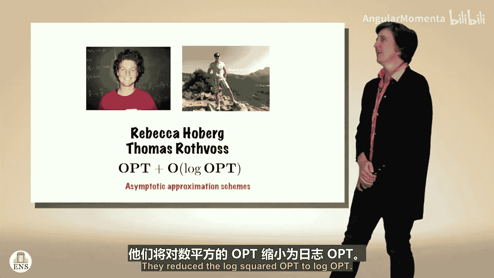

# 【巴黎高等师范学院】近似算法（一） ｜ Approximation Algorithms Part I p23 03_08_01_讲座结论 -BV1X4rrBgEzg_p23-

Now， what have we learnt in all this work on Benpacking。We have learnedt one very novel technique。

Adaptive rounding of the input。Not rounding to the nearest integer or to the nearest fraction of an integer as a Napsack。

 but a rounding that depends on the rest of the input。

That's one technique that is very useful for simplifying the input comes up in many problems where the input is a set of numbers。

The other technique that we have used is the Russian dolls technique。

The innermost doll was solving the problem in the special special case where items were large and there were few distinct sizes。

😊，Close that door。The doll outside it was an algorithm indicates the case where all items were large。

 all items were large， but not necessarily a few distinct items。 We could have many different sizes。

And then we closed that doorll and we got the outermost doll。

 the general case where there's no assumption on the item sizes and the number of distinct items。😊。

So。The Russian do technique is also a technique of successive reductions。

 if you want to use more a sophisticated terminology。Russian dolls。 Good to remember。

These techniques are very useful in general in the design of algorithms。

There are many variants of bin packing。 binpacking is just one simple case of problems that come up in many instances of commetal optimization and operations research。

 There are some variance in two dimensions when the input is not a number by the square or a rectangle。

 three dimensions， when the input each input items consist of three numbers instead of one。😊。

There are variants where the item arrive online over time in an online fashion。

 and you have to decide where to place them and when to close bins before you see the entire set of items。

Many versions of bin peing have been studied over the past。

If you look at studies where people proveence， rigorous results about binbeing。

Who contributed to this， Let's see。This is a familiar picture。 You know who this is now， the cop。

You know what he's most famous for。 He is 1972 paper on NP complete problems。Well。

 binintaking was one of them， so he was a pioneer who proved that this problem is hard in general。

Other pioneers， Johnsonen and Oman。They were the first ones to design and prove bounds on approximation algorithms for big peing。

 In fact， this was part of。The PhD thesis of David Johnson， and throughout his career。

 he never stopped being interested in bintaing。These are the pioneers。What happened next， next。

 the problem was NP complete， and we had constant factor approximation algorithms。😊。

Then people turned to average case analysis that was big in the 1980s in particular。So you know。

 in the worst case， you cannot solve the problem exactly。

 but what do you do if the items are drawn from some distribution？😊，Initially。

 there was some work by this submit guy whose name you should't know by now and comma car。They on。

 they did some initial work analyzing some algorithms for being peing on in the average case。😊。

Then more work was done by many people， there's a whole set of mathematicians and computer scientists working on average case analysis of binteing and analyzing particular binteing algorithm in the average case。

😊，Prominent among them is David Johnson， and I didn't have enough from here to give pictures of everyone who got involved in this direction。

 but I just wanted to give a picture of Lisa MagGo。All right， that's average case analysis。

 approximation schemes， asympotic approximation schemes。😊，What can we say about this， Oh。

 weve learned something else this week。We learned that if we cannot find an approximation scheme。

Because distinguishing between two bins and three bins is anticomplete。

 Then we can change the definition and focus on asympttic instances。😊。

And then this was done first by Fionand de de La Vega and Luukca。

 who invented adaptive rounding and used it to design the algorithm which we saw。

 designed and analyzed in this class。But you can do better than this after this shortly afterwards。

 K current Cop took the same ideas and used a better， much better。

 more sophisticated analysis and used linear programming in a sophisticated fashion。

 sophisticated fashion and they managed to get a algorithm using a number of pins that is at most opt plus a little bit。

😊，What is that little bit big O of log squared opt。When opt goes to infinity。

 log ground opt is much less than opt。 So this is almost optimal。 It's a much。😊。

Finer way to view binbeing。Then， nothing for 30 years。언tail。2015。Rebecca Hoberg and Thomas Ros。

Look at how young they are compared to the others。 That's because they've been doing this work in 2015。

😊，They reduced the log squared opt to log opt。 So this is an even better asympttic approximation scheme。

 So I wanted to show you this， because。😊。

We just started studying approximation algorithms and already we are at the level of current research。

If we were learning more about linear programming， about discrepancy theory。

 and about clever rounding， then we'd be able to read this paper and understand current research on binbeing。

So now probably you've had enough of this problem， enough of been backing。

 enough of working with numbers in the next chapter we'll start working on graph problems again。😊。

