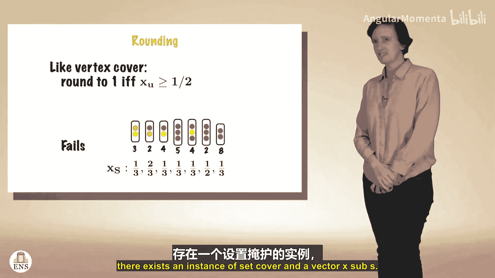

# 【巴黎高等师范学院】近似算法（一） ｜ Approximation Algorithms Part I p24 04_01_01_讲座定义 -BV1X4rrBgEzg_p24-

Welcome back to the course on App algorithms。In this chapter， we will study the set cover problem。

This will be an opportunity for us to explore a new technique in the design of approximation algorithms。

😊，Using the solution of a linear program and rounding it using randomized rounding。

This will be our first randomized algorithm in this course。But first。

 let us give the definition of the set cover problem。😊，Input and output。What is the input？

The input to the set color problem。Is a collection of elements here we have one， two， three， four。

 five， six elements in the universe。And then a collection of subsets of these elements， for example。

😊，The blue subset contains the orange and the green elements。Each subset has a cost。For example。

 what kind of situation does this correspond to？Perhaps you want to buy a certain set of items。

 you want to buy。Some various ingredients for cooking， let's say。

 and then you know that if you go to this store， you will get this particular set of elements。

 if you go to that store， you'll get another set of foods， that store。

 another set of foods with certain prices in each set。And then you have to decide which sets。

 which stores to visit， which bunches of items to buy so that in the end。

 you have everything you need。So。You have these elements， subsets with costs。

 and the output is a collection of subsets。 You choose certain of the subsets of the input。

 not all of them， but a few。So as to cover all the elements， every element in the universe must be。

Covered must be in at least one of the subset that you choose。

And your goal is to minimize the cost of the sets that you buy。For example here you。But three sets。

 perhaps maybe the three sets that are shaded slightly shaded， and these three sets have cost  four。

2 and 2 for a total cost of8， and you can verify that every one of the elements is covered by at least one of the sets。

Now， does's this ring a bell？Isn't this kind of familiar。Yes， of course。

 even if you don't understand anything to what I'm saying。You recognize one word， cover。😊。

We've seen this God before。Fertex cover。Vertex cover， set cover。 Indeed。

 these two primes are closely related。 and what is the relation。The vertex cover。

It's a special case of the set cover problem。The set cover problem is a generalization of the vertex cover problem。

😊，Let us see why。This is an instance of the vertex cover problem。A graph vertices， edges。

 you have to pick vertices to cover every edge， it was the one that was in the picture with Charlie Brown on first in the first chapter。

We want to cover alls with the fewest vertices。Cover edges。 So the edges are the elements。

Using vertices。 So the vertices are the sets。 What is the set associated to a vertex。

 It is the set of all the edges adjacent to that vertex， all the edges that touch that vertex。

What is the cost of a set， if you just want the few notices。

 then each set has cost one and you want to minimize the total cost I。e。

 minimize the total number of sets that you choose。So in this way。

 you can reformulate the vertex cover problem as a set cover problem。😊。

The set cover problem is more general， so it is at least as difficult as the vertex cover problem。😊。

And so， we will now study。Away an algorithm to solve approximately the set cover problem。

How did we solve vertex cover？We wrote the only digital program。

A linear programming relaxation and solved it by rounding。

So this suggests that here we should use a similar approach。Integer program。

 our integer program will be a natural extension of the integer program for vertex cover。😊。

So let me now give you an initial programming formulation of the set cover problem。😊，Integer program。

 we need variables。 In the case of vertex cover， we had one variable for each vertex。

 saying which can be interpreted to mean。Whether or not we take this vertex in a set cover problem。

 we now have one variable for each possible subset S given in the input。

The interpretation is x sub S will be 0 or1，1 if S is put in the cover and 0 if it isn't。😊。

Constraints。As in the vertex cover problem， there's one constraint for each element in the vertex cover problem。

 there was one constraint for each edge saying that for each edge you had to choose one or the other or both of its end pointss and put them in the cover。

Here。😊，We have one constraint for each element saying the element must be covered。 that is。

If you look at all the x sub S variables for all the sets containing S。

At least one of them must be in the cover。At least one of them must be equal to one。

If you sum the X or S over all those sets， the sum must be at least one。

Every vector x subs that satisfies these constraints is a set cover。For every set cover。

 there is a vector， a corresponding vector where each xabus is 0 or1。

That satisfies all the constraints。 So with those variables and constraints。

 we have captured every possible， feasible solution， and what is the objective。

 The objective is to minimize the cost。 Every set has a cost， let's call it C sub S。

 We want to minimize the sum of s of c sub S x sub S。 This when x sub S is 0 or1。

 is exactly the sum of the costs of all the sets such as x sub s is 1。

 It is the sum of all the costs of all the sets that are in the cover。So with this。

 we have an integer program for the vertex cover problem。😊，Now。

 let us continue imitating our solution for vertex cover。😊，Linear programming relaxation。

It is the same as the integer program， except that instead of positing that x sub S has to be 001。

 we write the constraint that x sub S has to be a real number in the interval， close interval 01。😊。

That is a linear programming relaxation for set cover。Next step。

 if we try to extend vertex cover rounding。How did we round in vertex cover。

 we said for every variable x sub associated to vertex u。

 we round x sub to 1 if and if in the solution of the linear program， the fractional variable。

 the real variable x sub is at least created and or equal to12。😊，Is at least one half。

What happens if we do this here？😊，We can do the same。 We can say。

Write the linear programming relaxation for set cover， solve it， and then each x or S。

 if it's at least one half， we round it to one。But that fails。

 It fails in the sense that it fails to give a solution that corresponds to a set cover。 It may fail。

Let me show this to you by an example。 We take the same input that I discussed earlier， this input。

I claim that this factor of variables x sub S is a solution to the linear program。

It satisfies all the constraints， why？Look at the yellow。 Look at the yellow element。

 It's covered one third by this set， one third by that set， one third by that set， total，100%。

Green 2 thirds，1 third，1 half total more than 100%。 It's covered and well covered。 yellow，1， third。

1 third。One third， its covered to 100%， orange， one third and two thirds were good， blue， one third。

 one third， and one third。 again we're good， purple and so on。

 for every element for every element that sum of the x subs values is at least one。

 and so we have a solution to the linear program here。Now， what happens when we run it to one？

Look at the values of x or S。Two third is rounded up to1。One half is rounded up to one。

All the other variables， they're all at one third。 they all get rounded down to 0。

What's going to happen now？Look at the yellow element。It belonged to three sets。

 the values of the three sets were 1 third，  one third，1 third， this gets rounded down to 000。

None of these three sets belongs to the output cover。The yellow element will not be covered。

Using this running here。We will not get a feasible solution to set cover。

 a feasible set cover if we run this vector x subs of x subs values。So what can we do？

Let's lower the threshold。To what。To one third， obviously here。If we lower the threshold to 13。

 then all of the x sub as variables here they do get rounded to1。

 and so the result is a feasible set cover however。😊。

It is easy to imagine another input where theres a feasible solution where every x sub S has value 1 quarter。

 for example。😊，Let's say that we have。A square， four elements。Or maybe even a Pentagon。

 five elements。All possible subsets of size 2。And each set， let's say that in exs， it has value。

1 quarter。5 elements。All possible subsets of size 2， each x sub S has value 1 quo。Then。

 each element belongs to。F subsets。Each of them has value 14。

1 quarter plus 1 quarter plus 14 plus1 quarter， that's1， every element is covered。

 but every variable has value14， so if you threshold is one third。

 then everything will be runed to 0 and this will not work again。

If you try to lower at the threshold， you have the same problem again and again and again for every choice of a threshold。

There exists an instance of set cover。

And a vector X sub S， such that rounding using that threshold will fail will give you something which is not a set cover。

 which does not satisfy all the constraints， which does not cover all the elements。

So we need to devise a better rounding。We need to devise a rounding that will not have a fixed threshold。

 but will somehow adapt to our output of the linear program。How do we do that？

We use randomized rounding。We have seen the definition of set cover。

 we have seen a linear programming relaxation for set cover。

 we have seen how the running use for thex cover does not extend to solve this problem。

 Now we are going to see a randomized running solution for a set cover。

