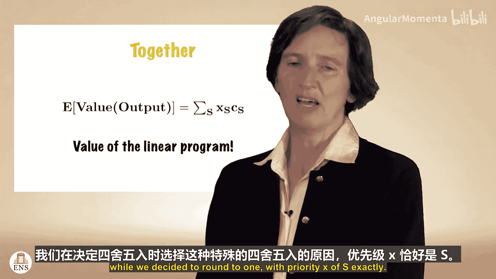

# 【巴黎高等师范学院】近似算法（一） ｜ Approximation Algorithms Part I p26 04_03_01_讲座成本分析 -BV1X4rrBgEzg_p26-

嗯。

We now have a randomized rounding procedure to take the solution of the linear programming relaxation and turn it into an integral solution。

😊，Now let us analyze the cost of the solution and relate it to the LP optimum。😊，How good is？

The output collection of sets。It all depends。First， we write the value of the output。

 the cost of the output algebraically。The cost of the output is the sum over every s set S in the output of the cost of S。

This is a random quantity because whether S is in the output or not depends on the random choices。

So sometimes it's large， sometimes it's small， and so the question now becomes as often for randomized algorithm。

 how good is this quantity on average？😊，How good is it typically？So for that。

 we are going to rewrite the quantity sum of C sub S for S and the output as sum over every set in the collection in the universe of C sub S times。

😊，A quantity， which is one， if S is in the output cover and 0， if it is not in the output。 Okay。

 so this is the indicator function。That takes value1 if s is in the output and 0。

 if s is not in the output， its a notation， and we can rewrite the sum over every s in the output of c sub S as the sum over every s in the output of c sub S times this indicator function。

What is this equal to on average？What is its expected value？Here we use the linearity of expectation。

 a very handy tool in analysis of algorithms when you have two random variables， A and B。😊。

The expected value of a plus B is the sum。Of the expected values。

The expectation of the sum is the sum of the expectations。Expectation and some commute。

 You can take them in whatever order you want。Here we want an expectation。Of some。

 as soon as we see this， automatically， we have a desire to exchange submissions。

We put the sum on the outside and the expectation on the inside。 We are allowed to do this。

 This is a valid transformation。So the expected cost of the output is the sum over every set of the expected value of the indicator function times C sub S。

😊，Let's focus on this expected value。Next， property of expectation。For any constant lambda。

 any random variable x， the expected value of lambda x equals lambda times the expected value of x multiplication by a constant and expectation commute。

😊，Here we have the expected value of an indicator function times C subus， C subus is a constant。

 and so we can take it out of the expectation。😊，So we do this， we do this。

 we are naturally drawn to doing this so that now we have to take some expectation of something simple。

 expectation for one particular set S of the indicator function that is1 if s is in the output and0 if s is not in the output。

😊，It is now easy to verify that the expectation of the indicator function of an event is exactly equal to the probability of that event occurring。

 In fact， that is a well known fact of elementary probability theory。😊。

So we now have to compute the probability for a particular set S that it is in the output collection of sets。

 and that probability is exactly x sub S。 we put s in the output with probability 80% if x sub S is 0。

8， 70% of its 0。7， in general with probability exactly x sub S。😊。

So now we can combine that line of reasoning and what do we deuce。

 we reduceuce that the expected value of the output。

 the expected cost of the collection of sets that we give us an output is equal。😊，Equal to what。

Some over every set of x subs， C subs。Now what。Look at this。 You recognize this。 this quantity。

Is exactly it's exactly the objective function of the linear programming relaxation。

 it's exactly the value of the linear program and what do we know because it's a relaxation。

 we know that this is at most opt and so the output is a collection of sets whose cost in expectation is at most opt the unknown optimal value。

😊，This was the reason why we chose this particular rounding。

 why we decided to round to1 with probably the x sub S exactly， just so as to get that objective。😊。

And so now we know that our running procedure produces a collection of sets whose expected cost is at most opt。

 it remains to see the amount of coverage we obtain with that collection。😊。

