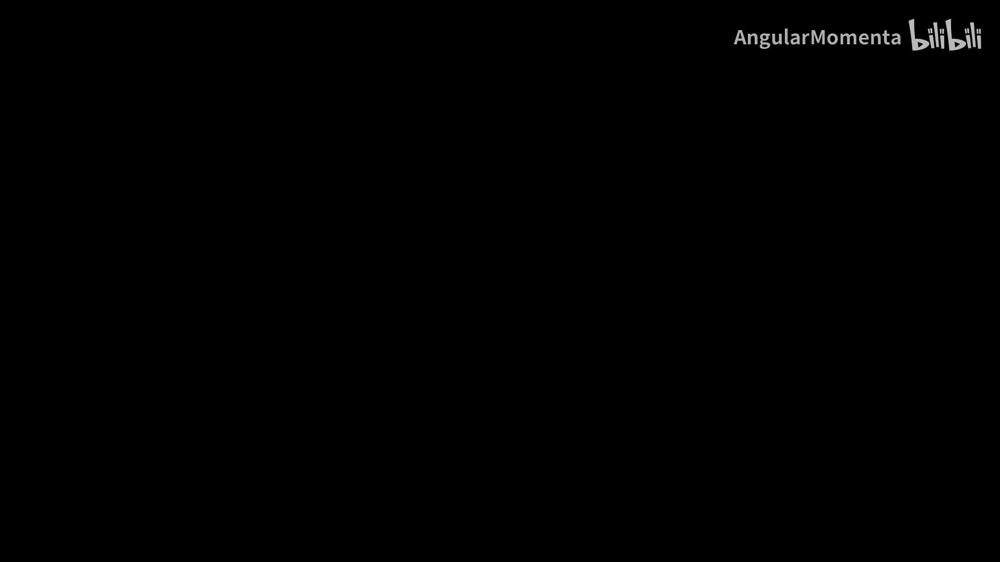
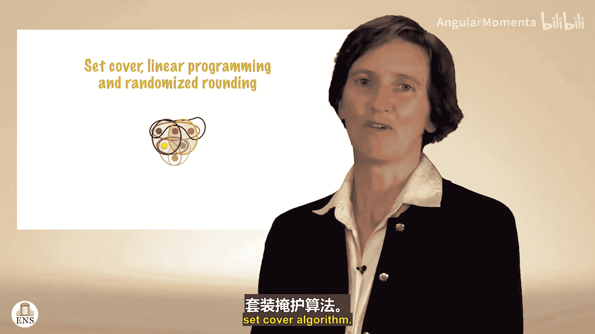

# 【巴黎高等师范学院】近似算法（一） ｜ Approximation Algorithms Part I p27 04_04_01_课程覆盖分析 -BV1X4rrBgEzg_p27-

We have an algorithm for set cover and we have seen that it outputs a collection of sets whose expected causes at most opt Now we need to see whether or not it is a set cover。

😊，Is it correct。 Is the output to cover， Maybe， maybe not。 It depends on our random choices。

 So let us look at this property more closely。Let us analyze， in particular。

 the number of elements covered。The number of elements covered by the sets that are chosen and placed in the output can be written as the sum over every element of the indicator function。

 which is one if element E is covered and0 if not。This is a random quantity。So again。

 we're going to analyze it in expectation。What is this sum on average。

Compute the expectation of the sum。 expectation of the sum。

 What do you do when you see an expectation of a sum， You invert summation and expectation。

Some are the expectation of an indicator function。 What do you do when you have the expectation of an indicator function replaced by your probability。

So what do you get by the same reasoning as what we saw earlier。

The expected number of elements covered is。The sum over every element of the probability that element E is covered by the output collection of sets。

So now to analyze this， we focus on one particular term。Focus on one particular element E。Eい。

What is the probability that E is covered by the output collection of sets。

This is the more technical part of this chapter， I have to say。 So hang on。When is element E covered。

It's covered if。There is a set in the output that covers element E， such as E belongs to S。

The probability that e is covered equals the probability whether exists S in the output containing S。

 containing E。😊，And so。What is this。The probabilitybative， that there exists， something is。

1 minus the probability that it does not exist。 That is the probability that none of the sets containing E are chosen in the output。

So the probability that their exist s in the output containing E is 1 minus。

 the probability that for every set containing E S is not chosen is not part of the output collection of sets。

So now we need to analyze this probability。 We need to upbound the probability that for every set S containing E。

 S is not part of the output collection of sets。So far， elementary reasoning。Now。

 we're going to use independence。 We're going to use a property that only holds when you have an independent collection of events。

If you have two independent events， A and B。Then the probability that both of them occur。

Is equal to the product of the probabilities。 If you are not independent。

 this probability of A And B could be less， could be more。 depends on whether they are correlated。

 whether they' are anti correlated。 But if A and B are independent。

 then this proba is exactly the product of the single probabilities。So what does the algorithm do。

 The algorithm for every S。Puts S in the output with probability x sub S。

 and these probabilities are independent， independent for every S。They're independent。

 so the probabilityb that all of these events occur simultaneously that every S containing E is discarded。

Is the product is equal to the product of the probabilities。

So it's equal to the product over every set containing E。

Of the probability of that set is not put in the output。This is the key thing here is independence。😊。

And so now we have to look at the probability that S is not in the output。😊，That probability。

 we know， is1 minus x of S by the choice of the algorithm。And now we just put everything together。😊。

And we get。The probability that element E is covered is 1 minus the product over every set containing E。

Of1 minus x of S。 This gives us an expression for the probability probability that E is covered by the output collection of sets。

So now we have to go back and see how we incorporate that into the analysis of the number of elements covered by the algorithm。

Now， let's see。We need to do a little bit more work on this product of1 minus x of S。

The first thing we will do is。X is the expectation of log of x。 That's an identity。

Log of x times y is log of x plus log of y。 That's the almost a definition of a logarithm。

Apply this to this product。This expression。Is the exponent of a log of this expression。

 It's a product， so we can replace it by a sum， exchange product and logarithm up to changing it in a sum。

This is the exponential of sum over every set containing element E are the natural logarithm of1 minus excess。

This is the beginning of an algebra calculation。The next thing we will use is the log of 1 minus x subs can be replaced。

 simplified， replaced by minus x subs。 It is well known that log of 1 minus x is at most minus x。😊。

And so we do this。 And what do we get， We get that this exponential with that expression there is at most。

 at most， E to the。😊，Minus the sum over every S containing the element of x of S。Now we look at this。

 the sum over every E containing S of Xod S。 and what do we recognize。

We recognize a constraint of our linear program。We have to constraint that。For every element E。

 if we look at the sum of X S over all sets S containing E。😊，That sum must be at least one。

Apply this， and we did do。The exponential of minus that sum。Is at most the exponential。Of -1。

So what does this tell us， It tells us that the probability factor element E is covered is at least one minus-1 over E。

Therefore， the average number of elements covered by the output collection of sets is in expectation。

 at least the total number of elements times 1 minus1 over E。And what is 1 minus-1 over E。

 It's approximately 63%， a little bit more than 63%，63。2%。 And so what have we proved at this point。

We have proved that with randomized rounding， we have obtained a collection of sets whose cost is in expectation at most opt。

 and that cover how many of the elements on average， at least 63% of the elements。

So we do not have a set cover。 We do not yet have a set cover， but we are getting closer。

 It only remains to modify the algorithm a little bit to turn it into a correct set cover algorithm。

