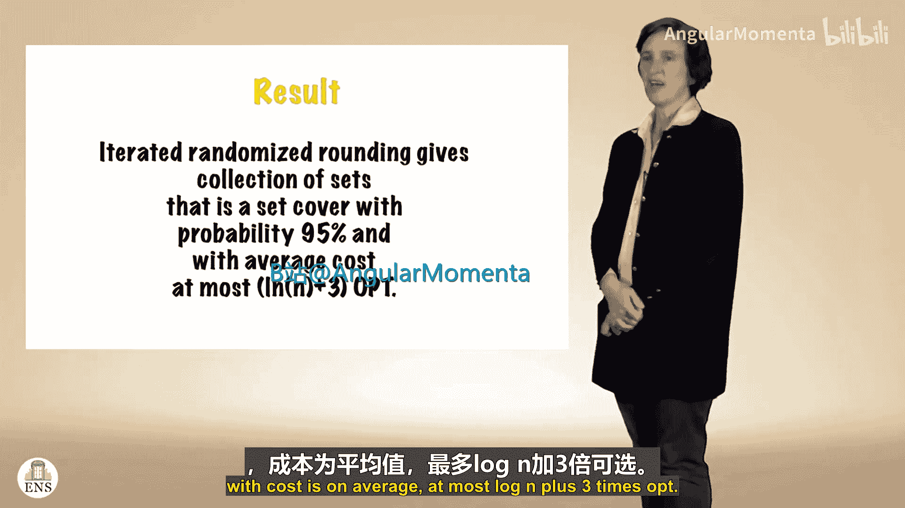
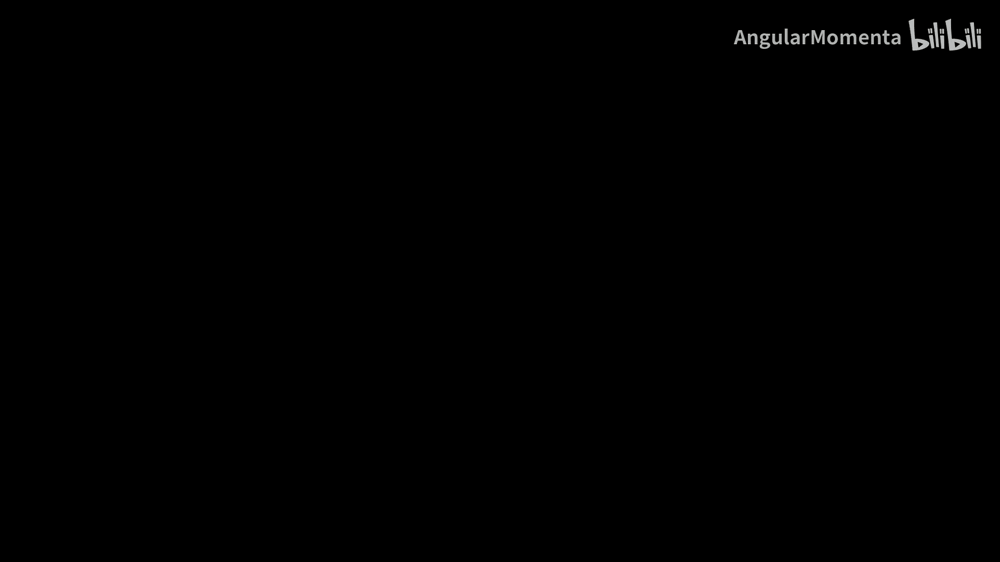

# 【巴黎高等师范学院】近似算法（一） ｜ Approximation Algorithms Part I p28 04_05_01_迭代算法讲座 -BV1X4rrBgEzg_p28-

不度。Yeah。

The algorithm we have so far is great in terms of cost， its average cost is at most opt。

 but it's not so good in terms of coverage， it's not a set cover。

 on average it only covers about 63% of the elements， so what are we going to do。😊。

The idea is simple。Iterate， repeat taking sets until you get a actual set cover。

And so here is a randomized rounding algorithm for Se cover。😊。

Let N denote the number of elements in the set cover。😊。

We will repeat login plus three times the following operation。For each set S。

 we put s in our cover with probability x sub S if of course it's not there already。Y plus 3。Because。

E cubed is about 20。So what do we do with this？ Let's see， what does this mean。

The cost in expectation will be at most log n plus three times opt。Very good。

This will give us a login approximation if it's a set cover。😊，What about correctness。

 What is the probability that the output is a cover。It's one minus the probability。

 but it's not a cover。What is the probability that it's not a cover。

 It's the probability that some element there exists an element that is not covered。

The probability that there exist an element is at most the sum of the probabilitybabilities because probability of a or B is at most probability of a plus probability of B。

 even if A and B are not independent。 This is a general fact。

 So the probability that the output is not a cover is at most the sum over every element E of the probability that E is not covered。

What is that quantity， What is the probability E is not covered。For one element E，6，1 element E。

And for one iteration， let's look at one iteration of the full loop。

 We know from previous analysis that the probability that E is not covered is at most one of the E。

When we put all iterations together。They all。Independent。

So the probability that is not covered is the probability that at every iteration is not covered。😊。

This is the product of the probabilities because all these events are independent from one iteration to the next。

 and so each of them can be bounded by one over E。😊，Its the product。

 there are log n plus three terms， so it's at most one over E to the log n plus 3。What is that。

 one of e cubed n？About one of a 20 N。Putting it together。

The are sum over every element E or the probability that the element E is not covered is at most n times 1 over E cube then。

 which is less than 0。05。Therefore， the output is a correct set cover with probability at least 95%。

In other words， what we have proved is that by doing randomized rounding and iterating。😊。

Iterated randomized rounding。Gives us a collection of set that is a set cover with probability at least 95%。

 and whose cost is， on average， at most log n plus three times opt。

We are almost there， we have something which is essentially a randomized algorithm for set cover。

 for almost set cover， for something that 95% of a time is a set cover。😊，In the next part。

 what we will see is how to transform this into an algorithm that always returns a set cover。😊。

