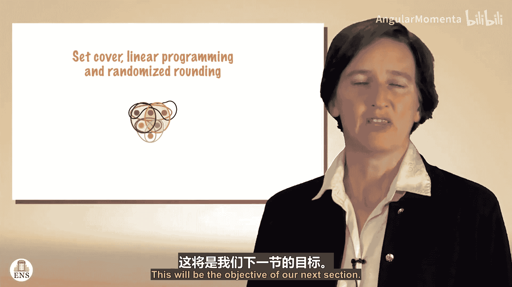

# 【巴黎高等师范学院】近似算法（一） ｜ Approximation Algorithms Part I p29 04_06_01_停止时间算法讲座 -BV1X4rrBgEzg_p29-

We have so far designed and analyzed an algorithm for the set cover problem。

 let us now try to design a better algorithm。😊，What are the weaknesses of the algorithm we have so far。

 Let's see。It's an iterated randomized rounding algorithm that gives us an output。

 a collection of sets that is a set cover with high probability and has a cost that on average is pretty good log n plus a constant times opt。

😊，However。Neither of these things are guaranteed。 It's not guaranteed to be a set cover。

And the cost is not guaranteed to be at most login plus three times opt。

So let's try to deal with the first of these weaknesses。

The algorithm we have so far is not always guaranteed to give us as an output。

 something that is a proper set cover。 It is not always correct。 It's only correct。

 with high probability。So。Let's try to design an algorithm that outputs something that always is a set cover。

Allright。 So what are we going to do if we want the output to always be a set cover。

What we want is an algorithm that gives us an output。

 a collection of sets that always is a set cover guaranteed。

 and with average cost at most big O of log n times opt。Well。

The answer is it's easy to design the variant of the algorithm。To try to get that。

 what is the variant。Instead of repeating our sampling a fixed number of times， log n plus 3。

 what do we do if after this number of times。We still don't have a set cover。 Let's just continue。

 And that us stopped once we have a set cover。So the obvious solution is to fix the algorithm by replacing the condition repeat a fixed number of times by the condition repeat until the output is a set cover。

So。This is the algorithm。Repeat。For every set， we put S in the cover with probably proportional to the value of the fractional variable in the LP solution。

😊，If it's not yet in our collection of sets。Until。What we have in our collection is a set cover。

Equivalently。We can write an algorithm that is essentially the same。

 but a little bit cleaner to analyze。 what is it。Here we have a sequence of repetitions some number of times。

 and in each repetition， we have a four loop where in parallel we take every set with pro the x of S。

Instead。Let's do it， one by one。Let's repeat， choose one set， one set but with the same probability。

 probability， x sub S or rather let's normalize it so that it is a proper distribution so that the sum of every set equals one。

So we choose set S with probability proportional to x sub S。

 x sub S divided by the sum over every set of x sub S prime。Once we have chosen this set。

 we put it in the cover if it's not there yet， and we repeat until we have a set cover。So this。

 let us call this the sample and iterate algorithm。Repeat pick a set at random。

 where set S is taken with probability proportional to X or S。

 the fractional variable given as an output of the linear programming relaxation。

Put it in the cover if it's not there yet and repeat until you have a set cover。

Now we have a nice algorithm that always outputs a set cover。Let us see。

 analyze it to analyze the cost of the output。This will be the objective of our next section。

