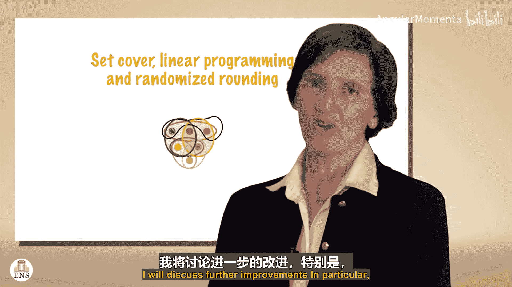

# 【巴黎高等师范学院】近似算法（一） ｜ Approximation Algorithms Part I p30 04_07_01_停时分析讲座 -BV1X4rrBgEzg_p30-

We now have a very nice algorithm for the set cover problem， the sample and iterate algorithm。

 let us now turn to its analysis。😊，As a reminder， the algorithm repeatedly picks a set at random with probability proportional to X or S。

 puts it in the cover and stops once the sets chosen form set cover。How do we analyze this。

 This is perhaps the trickiest analysis in this chapter and maybe in the entire course。

 So we have to go slowly and pay attention。First， some notations。

How do we express the cost of the output。The cost of the output is the sum over every step of the cost of the set chosen at iteration T。

What is the range of T T goes all the way to capital T， the total number of iterations。

 which is something random， the stopping time of our process。😊，So the cost of the output is the sum。

😊，Overall， T from one to capital T of C sub T。This is what we want to analyze。How do we analyze it。

 It's a random quantity。 We're going to analyze its expected value。

 expected value of a sum from t going from1 to capital T of C sub T。😊。

What did I tell you in my last discussion？When we have the expectation of the sum。

We invert sumations and expectation。So we'd like to write that this is the sum of the expectations。

 except。😊，There's a problem here。Tea itself， is random。So we'd like to write that this is capital T。

Times the expected value of Ct， or we'd like to write that this is the sum of all T from 1 to capital T of the expected value of C sub T。

😊，But what do we do with capital T。Capital T is random。

 so we cannot exchange expectation and summation here。So we have a problem here。

 We cannot apply the recipe I gave last time。So what do we do now。

 we turn to probabilists and asked them for a trick。And here it is。If we have a stopping time。

If we have some random variables， bond it from above。If the expected value of x sub T is less than U。

And the stopping time in expectation is less than infinity。Then。

The expected value of the sum of acceptees is less than mu times the expectation of capital T。

This is one way in which we sort of invert expectation and summation。

So as soon as we have an upper bound for x sub T， then we can use it and invert submissions and we can continue our analysis。

So the next step will be let's try to analyze the expected value of x sub T and bound it from above。

What is except T in our case？Exccept T is the cost of a set chosen at time T。

So we want to upbound the expected value of Ccept T。The expected cost of the set chosen at time T。

What is it？It's equal to the sum over every set of the indicator function of whether that set is chosen at time T and you take expectations and then what do you do。

 you invert expectation and sum and then what do you do you have an expectation of an indicator function and what do you do This is a probability we've done this before I'll skip this and。

😊，Some over every set of the probability that this set is chosen during iteration T times the cost of the set。

What is the probability that S is chosen？We said。X sub S divided by the sum of all xs for all sets。

 So we replace the probability that its by its value， and we get this expression。In the numerator。

 some over every S of x sub S， C， S denominator， some over every S of x or S。

This is independent of little T。 Let's call this mu。

Now we can apply world's equation and what do we get the expected cost of the output is the expected number of iterations times mu。

 where mu is this quantity。😊，So to analyze the cost of the output。

 now we need to look at the expected value of T， the expected number of iterations。

 once we have that， we will know the value of the expected cost of the output。

So what is the expected number of iterations？For that， we'll need morenotations。

How do we determine the number of iterations， it depends on whether the sets we have chosen form a set cover。

How do we know that We have to look at the elements that are not yet covered。Let us define N s T as。

The number of elements that are not yet covered after T iterations。What do we know about Ncept T。

 Initially， no at discovered M0 n。In the end， every element is covered n capital T is 0。

Right before the end， we are not quite done yet。 At least one element is not yet covered。

 So n T-1 is at least one。How will this be useful to analyze capital T？The answer is。

What the equation。For dependent decrements。What is this。Consider a random decreasing sequence。

 We will apply it for our insect teeth。And the stopping time capital T， whose expectation is finite。

Assume that a certain property is satisfied on the an of Ts。

 how they change at each step in expectation。Then we have an upper bound for the expected value of T of the total number of iterations。

So in order to bound E sub T， E of T， we want。This expression is our a bound。 And for that。

 we need to analyze the change in end sub T over one step。

The number of elements not yet covered at time T versus at time T plus 1。Consider this。

 What does this represent， your condition on NS T， You assume you know how many elements are not yet covered。

N sub T minus n sub t plus1 is exactly the number of elements that will be covered in the next iteration in iteration T plus1。

And we want the expectation。 So let's fix an element E among the ends of T that are not yet covered。

 And let's look at the probability that E is covered in the next iteration。

The property I discovered is。The probability that the set S that is chosen by the algorithm at iteration T plus 1 contains element E。

What is that， is the sum over every set containing E of the probability that S is chosen x sub S normalized。

And what do we know about this， well， because of the LP relaxation constraint。😊。

We know that this is at least one， and therefore we know that this quantity is at least one over the sum of all the x subss。

Some over every element， and this gives us our desired lower bound on the expected value of nt minus n0 plus1 given Nt。

What is this lower bound？😊，The sum， this expected value is at least n s T。Over this summer。All right。

 the expected value of the change given anp T is at least anp T over this sum。This is our function。

 F of n sub T。And so now we can apply well the equation for dependent decrements and what do we get？

😊，They expect the value of capital T。Is at most one。Plus， expected value of integral。

Inteegral of what， let's see。And sub t -1 is at least one。N sub 0 is n。And what is F of Z。

 one of the F of Z is the sum of all the x subss。Over and。For Z over Z。So here we go。

And this integral。We can take the sum out， and we know that this integral is exactly a logarithm。

So we get this upper bound on the expected value of t1 plus the sum of the x subs times the log of n。

😊，Put everything together。 The expected cost of the output。

Is at most the expected value of capital t1 plus the sum of the x's power the log of n。

Times the expected cost of C sub T， which is this quantity here。

 sum of C S X over the sum of the x's。What is this since the numerator？Is the objective of the LP。

 This is at most one plus log n times opt。So with have we proved， we've proved that the algorithm。

 the sampled and iterate algorithm gives us an output， a collection of sets that is a set cover。

 and the average cost of the output is at most one plus log n times opt。😊，Very good。

So were almost done with set cover。 what remains to be done。

I will discuss further improvements in particular， how to remove the word average from the theorem。

Then I will discuss possible or impossible improvements and finally give you a little bit of background about the people who have worked on this。

