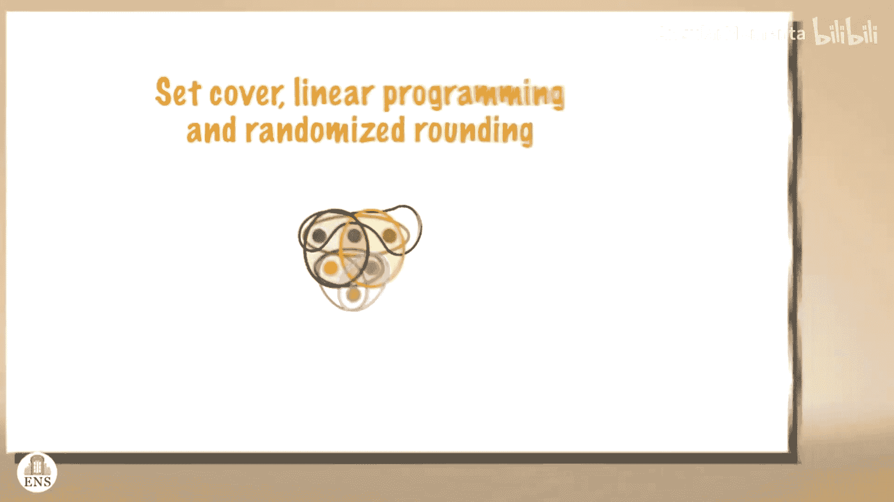

# 【巴黎高等师范学院】近似算法（一） ｜ Approximation Algorithms Part I p31 04_08_01_讲座总结陈词 -BV1X4rrBgEzg_p31-

There are many other things one could say about set cover。Let me just end with a few remarks。

The result we have proved is that the sample and iterate algorithm gives us as an output。

 a collection of sets forming a set cover with cost that is on average at most login plus 1 times opt。

😊，Can we do better than this？ Can we do something whose sc is always at most login plus one times opt。

Can we have a faster algorithm。The answer to these questions is yes。And， yes。

With one single answer to both questions。Linear programming that we use in the first part of our algorithm takes polynommal time。

 but usually it is slower than purely combinator algorithms。

So let us try to replace linear programming by a communal algorithm。The way to do it is to go greedy。

How do we do this？We do a loop that repeats choosing sets until we have a set cover。

 so it is similar to the sample and iterate algorithm。

And what do we repeat at every step we choose a set the best possible set。

The set we choose covers a certain number of elements that are not yet covered。

 and it costs a certain value C sub S。 Let us pick the best possible set。

 the set that maximizes the ratio of the number of new elements covered over the cost of the set。

When you do this， that is a natural greedy algorithm and what is known about this algorithm。

Is that it also outputs a set cover of course， and its cost is always at most login plus1 times opt。

So it's just as good as the sample and iterate algorithm that we have studied。😊，The advantages are。

First， greedy is combinator， it doesn't require solving a linear program。Second。

 the quality of a result is guaranteed in the worst case instead of being on average only。

But the boundouts are the same， and it is not quite a coincidence。

 The two algorithms share some similarity。And you can actually argue that if you take the randomized algorithm and you do some properly done deranization。

 then you may generate the greedy algorithm。 So that is another technique to generate good approximation algorithms。

Can we do better than this， better than log。😊，No。The answer is no。

 it is impossible if p is different from NPp to get in polynommal time。A result。

 a set cover that is better than log n times opt。 That is always better than log n times optt。

 So this algorithm is optimal。 It is the best we can hope for if P is different from N P。

 It is the best approximation for set cover。Who has worked on this problem and proved all these nice results results。

 Many people have worked on this。 Let me just single out a few。In the 1970s， to fatalal。Who is check。

Designed and analyzed the greedy algorithm。In the 1970s， Lovas， who is Hungarian。

Designed and analyzed the greedy algorithm。In the 1970s， David Johnson， who is from the US。

 designed and analyzed the greedy algorithm。Wait。They all did the same thing。😊，Well。

 these were all independent pieces of work， I guess the time was just ripe for the design of the first approximation algorithms and the first developments of the field。

What about optimalloity， the N Hos of getting a better approximation。

 This is due to Ui Figa from Israel。Finally， the presentation I gave you on the last part of a sample and iterate algorithm is largely inspired from lecture notes by Neil Young using world's inequalities。

😊，So what have we learnedt in this chapter？We have learnt a famous problem set cover。

 We have learnedt fundamental algorithms and properties of this basic problem。

This was our first example of an important concept， randomization in the design of algorithms。

For approximation algorithms， we use the basic technique， randomized rounding。

 very useful also in other settings， including the one we will see in the next chapter。

In terms of analysis， the one tool that we saw that is most basic。

 most important really needs to be remembered， if nothing else， linearity of expectation。

 this is really important for every analysis of randomized algorithms。Finally。

 in terms of the way in which we did the analysis， this slow and steady way。

 laying equations one after the other and looking at each step。

 what is the next step in an orderly fashion。😊，Is a little bit like hacking up of mountain。

 You have to go slowly and carefully one step after the other， left， right， left， right。

 And then you will get to the top without getting tired along the way。😊。

In the next chapter， now that we have completed set cover。

 we will look at another application of linear programming and an interesting randomized round for the multiway cut problem。

😊。