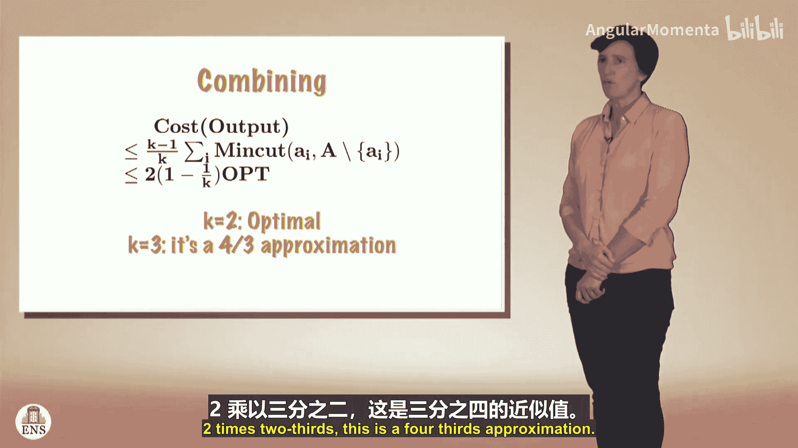

# 【巴黎高等师范学院】近似算法（一） ｜ Approximation Algorithms Part I p32 05_01_01_讲座定义 -BV1X4rrBgEzg_p32-

Welcome back to the course on approximation algorithms in this chapter we're going to study a new problem。

 the multiway cut problem， and develop a new interesting linear programming relaxation and use it to design an original version of randomized rounding。

😊，What is the multiway cut problem， it's defined by its input and its output。😊。

The input is a graph where the edge is of a graph have some weights and in this graph there's some special vertices called terminals。

 we have k of them where k fixed， maybe two， maybe three， maybe6 as in the case of this picture。😊。

Six special though this is called terminals。The goal is to cut those terminals from one another。

 how by cutting edges， so the output is a subset of edges such that subset F。

 such that if you remove those edges from the graph。

 all the terminals are disconnected from one another and your goal is to minimize the weight of the edges you cut。

😊，So that's the multiweight cut problem。There's a special case， which is quite familiar。

When K is equal to 2。K equal2， two terminals， A and B。

Disconnect A from B using edges of minimum weight。That's a cut， a cut disc collectdating A from B。😊。

Minka， that's the famous mintkat problem， which， as we know is polyyammmal time。

 can be solved in polynommal time。😊，Next case， k equal to 3， three terminals， A。

 BC that must be disconnected from one another by a minimum weight set of edges。😊。

That problem is already and beyond， already  for k equal to 3。

This is not really surprising because it's one of many cases of pro in communatal optimization。

 where the case k equals 2 is simple and k equals3 or more is hard and NPhar to solve exactly。😊。

So here's a simple algorithm for k equal to 3。😊，We take our three terminals， A，BC。

Let's compute the minimum way to cut vertex A。From。30 says B and C。

 The minimum way to disconnect A from B and C。Here it is。 If you cut the graph this way。

 this is a minimum， minimum weight set of edges that disconnects the graph。

It's a partition of the vertices in two subsets such as the edges across the cut have minimum weight。

 and it disconnects vertex A from verttices B and C。Second。

 you solve the same problem isolating vertex B， find the minimum cut separating vertex B。😊。

From veres， A And C。A partition of the graph into the photos is on the B side and the ver is on the A orC side。

😊，Third， similarly， you compute the minimum cut separating forex C。From the other two vertices。

 the other two terminals。 And now what do you do， You take these three cuts。

You choose the two cheapest ones and you output their union。

Here it is in this case it turns out that the red and the purple cuts are the cheapest of the3 and so this is your solution。

😊，Okay， so that is the algorithm。 very simple。Now， is this algorithm a working algorithm？😡。

Can it be solved in paranmal time。Let's see。We need to find as subroutine。

 a way to separate vertex A from verexes B and C。😊，In paranmal time。

This can be done easily by a reduction to the Minka problem。 Here is how。😊。

You create a new vertex called S。And another new vertex， called T。You connect S to a。

With a edge of infinite weight。You connect verices B and C to T with edges of infinite weight。

In this new graph， you solve the min cut problem， min cut separating S from T。

This minimum cut will never use the infinite weight edges because that will be too costly。

 so it will use only edges from the inside of the graph and so it will give you a solution that has a on the same side as S B and C on the same as T。

 therefore it will separate A from BC。 In fact the cuts are in exact one to1 correspondence the cuts from S to T and from A to BCC。

😊，So we can solve this in polynomial time。Is the output correct， Is it a three way cut。

 Does it separate the three terminals from one another。Well， let's see。

Here we take the red and the purple solutions。The red cut separates vertex A from both B and C。

So now there is no connection from A to B and no connection from B to C。

There could still be connections between B and C， but thanks to the purple cut that separates C from the other two vertices。

😊，C is disconnected from B。And so the solution is a three way cut。

 It is a correct solution to the problem。Finally， how good is it， what is the cost of the output？

We said over three cuts separating A from B， B from A C and C from A B。

 the output cost is the two cheapest of these three terms。So its cost is at most2 third of the sum。

The cost of the output of this simple algorithm is at most two thirds terms the sum of the min cuts。

So we have upper bounded the cost of the output of the algorithm。To continue the analysis as usual。

 what we need to do is lower bound the cost of opt。😊，Consider opt。

Opt is greater than or equal to the min cut from A to B。 Y。

 because the op solution separates all three terminals from one another。

 so it does separate terminal A from the other2 terminals， so it is a feasible cut from A to B。

 and therefore the value of optt is at least the min cut from A to B。Similarly。

 it's at least the min cut from B to AC， and at least the min cut from C to A B。So。

If it's at least each of these three terms， then it's at least their average。

 at least one third of the sum of the min cuts。The output is at most2 thirds of the sum of the min cuts。

 up is at least one third of the sum of the min cuts， therefore the algorithm is a2 approximation。

We have proved that our solution is a two approximation。Can you do better？

You can do better if you do your analysis a little bit more carefully， let's see。😊。

Let's go directly to an extension for K general。We have K terminals， A 1， A2， A K。

The natural extension of the algorithm is to output the k minus1 smallest of all k min cuts。

Where the I 1 separates terminal I from all the other terminals。Again， here again。

 this can be done in polynammmal time because to compute the min cut separating terminal AI from the other terminals。

 we connect our source as with an infinite edge to AI。😊。

Our sync T with an infinite edges to all the aominals， and then we solve min cut from S to T。

So this is a polynommal time algorithm that gives you a Kway cut， a multiway cut。

 and what we need to do is analyze its value。😊，Let's see， similarly。

We output the k minus1 smallest of k cuts。The cost of this output can be upbounded by what it would be on average if we had a random choice of k minus-1 cuts among K。

😊，And so。The cost of the output is at most K minus over a k times the sum of the min cuts。

 the sum of over every I of the value of the min cut separating terminal AI from all the other terminals。

That's the upper bound on the cost of the output。Now， let's do a lower bound on the cost of opt。

Let's analyze optt。The optimal solution。😊，I claim they find some cuts separating for each eye terminal AI from all the other terminals。

Indeed， consider an N E which is part of the obsolution。😊，Why is E part of opt。

Because if we left E in the graph， then two terminals would be connected。

 there would be two terminals that would be connected， that's why optt has to remove edge E。

So it must be that H E。😊，Once we remove it， it separates some terminalal AI from some terminalminal AJ。

Let's put this L E in a set of edges f of y and in a set of edges f of J。Each a drop opt this way。

We put it into two sets， F and Fj。If this edge。Connect。

If EG connects a vertex which is in the cluster of AI with a vertex that is in the cluster of terminal J。

That is the definition of F of I and F of J。😊，In other words。

They define f of I as the set of edges of optt that separate terminal AI from some terminal Aj4 J different from I。

Every E E in opt belongs to two sets， FI and FJ。So。If we sum the cost of all these Fs。

 every edge appears twice， so we get exactly two times optt。

So this gives us a way to express the value of optt two times optt is equal to the sum over I of the co of F。

Moving on， how do we analyze the cost of F。FI。FI consists of all the edges of opt that separate terminal AI from some other terminal。

So F of I separates AI from the rest of thes。And so the cost of Fi is at least the minimum cost to separate AI from the rest。

 so the cost of Fi is greater than or equal to the min cut， Min cut of AI from the other terminals。

Let's do this， take this and some now。When we sum。We get。Two times optt。

 which is the sum of the cost of Fi。Is at least there's some over eye of all the main cuts。

Two times opt is at least the sum of a I of the min cut separating terminal AI from the other terminals。

Now all we have to do is combine this with our upper bound on the cost of the output of the algorithm。

😊，The cost of the output is that most k minus1 over k times the sum of them in cuts that we proved。

Now this sum of the min cuts is at most two times optt， so what does this give you。

 it shows that the algorithm is a2 times1 minus1 over a k approximation。😊。

The algorithm is an approximation with an approximation ratio of  two times 1 minus1 over a k。😊。

K equals 2。 What does this give us2 times 1-12。 That's 1，1 times optt。 The algorithm is optimal。

Indeed， it's just completing a main cut。K equal to 3。1 minus1 over a k， that's 1 minus1 third。

 that's 2 third，2 times2 third。 This is a4 third approximation。

So actually the analysis I sketch earlier was not tied， actually by doing this more careful analysis。

 we were able to prove that the algorithm is a4 third approximation for k equal to 3 and a2 times1 minus1 over a k approximation for k general。

😊，Now， what we're going to do is we're going to try to design a better algorithm relying on an interesting LP relaxation。

😊。