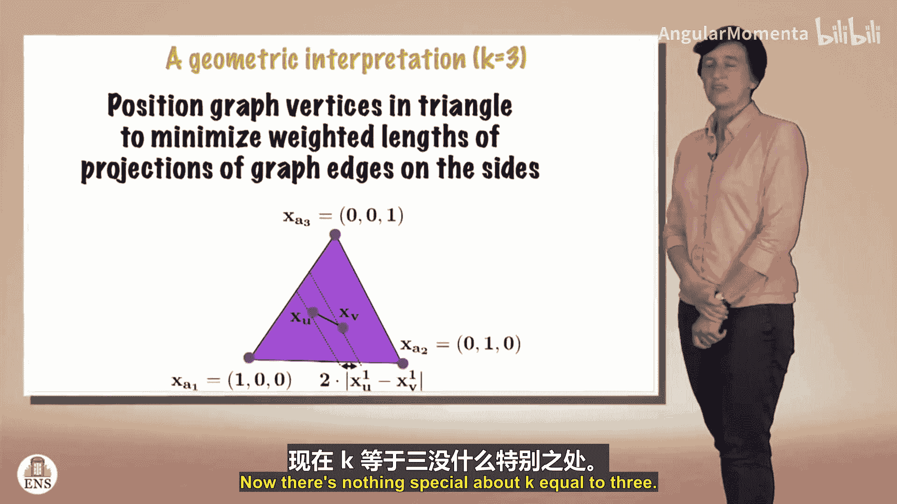

# 【巴黎高等师范学院】近似算法（一） ｜ Approximation Algorithms Part I p33 05_02_01_线性规划松弛讲座 -BV1X4rrBgEzg_p33-

So far， we have designed a simple algorithm for the multi problem Now let us try a more sophisticated and better algorithm based on an interesting linear programming relaxation。

As usual， we start by designing an integer program。

How do we design an inte programming model for the multi Way cat problem？

We have to define some variables。If we think about multiway cut。

 it's a partition of the graph into classes for the vertices。

 Each vertex is associated to one particular terminal。😊，These vertices go with terminal a1。

 those vertices go with terminal A2 and those vertices go with terminal A3。

So this suggests having one variable for each graph verdex and each terminal。

For each graph vertex U and each terminal I， we will define a variable x sub U I。

 whose interpretation is。This x is equal to1 if vertex U is in the cluster of terminal I。Okay。

 so with the X Us， then we're going to have a partition of the vertices into clusters。

Now we want to capture the value of the resulting multiware cut。That is。

 we want to compute the sum of the weights of the edges that cross the cuts。

 all the edges that are drawn here。So we will have a variable for each edge E。😊。

Telling us whether it crosses the cut and how do we do it。

 We will do it in a slightly nontrial manner。 That is for every edge E。For every terminal I。

 we will have a variable Z sub E I that will be set to one if and only if this edge goes out of cluster I。

In other words， here， this E E has Z E A1 equals1 because it goes out of cluster 1。

Z E 2 equals 1 because edge E goes out of cluster 2。 It goes between cluster 1 and cluster 2。

 but Z E 3 will be 0 because this edge does not leave cluster 3。Why do we do this。

 Because this will be。We'll be able to capture this with some constraints。

 So let's move on to the constraints。The constraints of our integer program。 First， every Z。

 E I and every X U I must be 0，1。Second， if you look at terminal AI。

Terminal AI is in its own cluster in cluster I， obviously， where does this spin。

 it means that X AI I must be equal to1。😊，Third。Every vertex is in exactly one cluster。

Every vertex U belongs to some cluster， exactly one。So thes sum of X Us over every terminal。

Must be equal to one。 One of these is one。 All the others are 0。With these， with these constraints。

 we have captured this P that x must defined the partition。

 other purposes into key parts such that part I contains terminal AI。Finally。

 how do we capture the fact that a edge goes across the cluster？Well。

When does the edge U V equals U V， When does it cross between。Cluster I and cluster J。

We can see that because vertex U is in cluster I， vertex v in cluster J。

 We can see that because X U I is1。X U J is 0。 X V I is 0。 X， V J is1， in other words。

If XUI is different from XVI， one of these two is0， the other one is1。

One of these two verices U and V is in cluster I， the other one is not in cluster I， therefore。

 this is exactly the situation when edge UVV crosses out of cluster I。Okay。

 so this is not a condition that is easy to express linearly， we will see that in a minute。😊。

So we're still left with this constraint that we don't quite know how to express。

 but before we express it， let's write the objective。 That is the easy part。H E。

If we look at the sum over every eye of Z EI， what will this be equal to？It depends。

If the edge is internal to a cluster。Then all the zs are0， this will contribute0。Good。

If the edge is between two clusters like this one here。Then。😊。

Z E I will be1 once for I and one another time for J。 So we'll have two of them。

 And so if we multiply by one half， the contribution will be exactly C sub B。

So the objective is exactly 12 times the sum over every edge E， sum over every terminal I of c sub E。

 z sub E I。😊，So we have our variables， we have our objective。 we have part of our constraints。

 we are left with these slightly mysterious constraints that we are not quite done dealing with yet。

Let's finish this。How do we express this？This can be written with absolute values。😊。

Z U V I must be at least the absolute value of the difference between X， U， I and X， V I。

Consider this。 What does it mean。If。U and V are in the same cluster。X Ui equals x V。

 this difference is 0， and this constraint says Z EI is created integral equal to 0。😊。

It doesn't add any constraints to the problem， good。If U and V are in different clusters。

 then one of these two variables is 0 and the other one is 1。😊。

The absolute value of a difference is exactly one。 And so this says Z EI must be at least one。😊。

So with this absolute value， we had exactly expressed this condition that Z UVI is one。

 if and if XQI is different from XVI。😊，And finally。

 how do we transform this absolute the value into linear inequalities， we can just write。😊，Z Ei。

Must be greater than both X， U， Y minus X V I and the opposite X V minus X U Y， indeed。

If ZEI is greater than both， then it's greater than the max of these two quantities。

And the max of these two quantities is exactly the absolute value。😊，So， this condition。Z。

 greater than an absolute value is equivalent to two linear conditions。

Beware you cannot always get rid of absolute values in this way。

 You're lucky here that the inequality is greater than an absolute value。

 If it said less than an absolute value， then we would not be able to employ this trick because when you do the max。

 this doesn't work anymore。 The inequalities would go in the wrong direction。

 So here we're just lucky。😊，Okay， so now we have an integer program for the multi vehicle problem。

Here it is to summarize to recap。😊，Variable， X U， Y， Z EI。That are have value 001。For terminalal AI。

 X， AI I is equal to one。 for other terminals， the sum over every I must be equal to one。

Z EI is greater than both X U minus Xbi and Xbi minus x Ui if E is at UV and the objective is to minimize one half of the sum over every E and I of the cost of E times Z EI。

😊，This is。An integer programming formulation of the multi wC problem。Now， what do we do。

We do a linear programming relaxation。 How do we do that， We know how to do this。😊，There。

I took this line。😊，X， U， E， Z， E， I equal to 0，1， replace it by X U， E Z， E I。

 real numbers between 0 and 1。 The rest is identical。Unchanged。

It's all the same and so that's all linear programming relaxation and what is interesting about this。

😊，This is just a slightly more complicated variant of what we have seen in previous chapters。

 so what's interesting about this is that we do not stop here。😊。

We take this linear programming relaxation and we do a geometric interpretation of it。😊。

We study it and we see it as a geometric object。Let's do it。Let's do it。Forever vertex you。

We couldn't define a vector。Was that the X？Of all the variables X U I， sitting in K dimensions。

 K is the number of terminals。XUI， if you remember。

 is one if by XU belongs to the cluster of terminalal AI。So we have one dimension for each terminal。

And what is the sum of the X Uis？We know it has to be one。

 but it's also the sum of the absolute values， because because all the X Uis are non negative。

 And what is this If you have a vector X U。With these coordinates and you sum the absolute value of the coordinates。

 what do you get， You get the L1， the length of a vector in the L1 metric。So we have vectors。

In K dimensions。And we have a constraint that says that their L1 length must be equal to 1。

Let's keep going。All right， one dimension for each terminal。

 Let's think about the case when k is equal to 3。😊，Three dimensions。

What can we say about terminal a1 say？Terminal a1， we know that it's first coordinate X A 1。

1 equals1。X812 is0， x A13 is 0。Here it is。Tminal 1 corresponds to this vector 10，0。

Tminal 2 corresponds to that vector， 010， terminal 3 corresponds to this vector， 0，01。

What about all the other vectors？The other vectors must satisfy。

The sum of their coordinates must be equal to one and they are not negative。

What object is defined and argued by these equations。Exactly this， a triangle。This is a triangle。

 It's a two dimensional object in a cubed， a triangle of equation x2 plus x1 plus x3 equal to 1。

 and all the Xs are greater than equal to 0。 a triangle bounded by the three。😊。

Vtices corresponding to the three terminals。So。If we think about the。The constraint。

That the sum of the Xs， X us must be equal to 1。 that says verex u。Must be in this triangle。

 especially if we add X Ui is always greater than record to 0。😊。

Then this can be translated geometrically into。The vector associated to vertex U must be somewhere in this triangle。

And the three terminals are the three corners of this triangle。Now， what are we trying to minimize？

We' are trying to minimize Z， E I， where if it E is H U V。CEI is at least。Is at least what。

The sum of X U 1 minus X v1。X U2 minus x v2。X U 3-63。

 This is no other than just the L1 distance between X U and X V。 so we can write the objective as。

One half of the sum over every edge UV of C UV times the L1 metric of the vector X U minus X v。

So now the problem is to embed。😮，The graph focusess inside the triangle to minimize this quantity。

Let's think about this triangle some more。What can we say about the coordinates of the points in on this triangle？

Let's first look at an edge along this triangle， this edge。Is bounded by the two vertics 0，0，1 and 0。

1，0。 It contains all the linear combinations， convex combinations of these two points。

 in other words。All the veres on this edge。Have x1 equal to 0。 That's true for this vertex。

 Tru for that one， true everywhere in between。And then if we look at that coordinates x 2 and x3。

 this sum to 1， x2 plus x3 is1， x2 plus x3 is 1。😊，So that's what this line is about。

What about a line parallel to this， but inside the triangle？Got to go this line。It goes from 0。60。4。

 the sum must be equal to 1， the second coordinate must be equal to 0。2。6。40。

 The sum must be equal to one。 The third coordinate must be 0 because it's on this edge。What is this。

 this consists of all vertices that have x1 equal to 0。6 and x2 plus x3 equal to 0。4。

So these are the coordinates on these parallel edges of this triangle。

Let's continue studying this triangle。A particular vertex x in this triangle。

What can you say if you draw this line here？You get to the point where x1 is the same。

 The first coordinate has not changed x1。The third coordinate must be 0。

 so the second coordinate must be 1 minus x1。So the parallel projection of x along this edge of the triangle has coordinate x x1。

1 minus x10。Similarly， if you do a parallel projection of x along this edge of a triangle。

 you get 0 x2，1 minus x2。And along the third edge，1 minus x3，0， x 3。

So these are the coordinates of the projections of x on the three sides of the triangle。

Let's continue looking at this triangle further。 So these are just elementary geometric facts。

Look at two vertics， X and Y。Look at their projections， X and y。

 they both project on the bottom edge。 Their projections are x1，1 minus x10 and y1，1 minus y10。

What is the distance between the two projections。It's。X1 minus y1。Plus。

In absolute value plus 1- x 1-1- y 1。 It's exactly two times。X 1，- Y1， absolute value。

If you look at the other edges， you get again two times the absolute value of x2 minus y2 and 2 times the absolute value of x3 minus y3。

😊，If you sum all these things the length of this projection plus the length of that one。

 plus the length of this one， what do you get， you get exactly two times the L1 distance between x and y。

 x minus y。So that is a geometric interpretation of what we're trying to minimize in our objective function。

😊，What do we try to minimize12 times the sum over every L UVV up C UV times the L1 distance between x U and Xv。

 and what is the L1 distance， it is half of the sum of the distance between the projections of x U and Xv on the three sides of the triangle。

So with this， we are well equipped to start thinking about this problem in geometric terms。😊，So。

 in other words。The problem being solved by the linear programming relaxation in the case where k is equal to 3 is the following。

The LP relaxation is positioning the graph vertices inside this triangle。😊。

With the three terminals at the three corners of a triangle。

To minimize the weighted lengths of all the projections of the edges on the sides of the triangle。

 that is what the LP relaxation is doing。It's constrained to have the three terminals at the three corners。

And given that， it tries to position all the atices so as to minimize the weighted legs of their projections。

😊，So again， let me repeat the geometric interpretation for k equal to 3。😊。

Ebed the graphottics inside the triangle。😊，To minimize the weighted lengths of the projections of the graph edges on the sides of the triangle。

 given that the three terminals are at the three corners。

Now there's nothing special about k equal to 3， we could also do everything we have done so far。

 this reasoning could be done， also for k equal to4， we'd have a tetrahedron instead of a triangle。

 k equal to 5 and so on， just by going to higher a dimensional space。

 but it's easier to visualize things for k equal to 3。😊。

Now we can think about rounding。So this will be the object of our next section。

