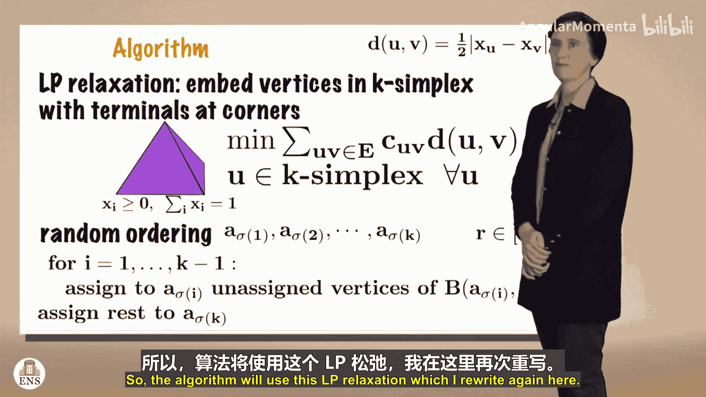

# 【巴黎高等师范学院】近似算法（一） ｜ Approximation Algorithms Part I p34 05_03_01_讲座：随机化舍入 -BV1X4rrBgEzg_p34-

Now that we have set up linear programming relaxation for the problem and seen a geometric interpretation。

 we need to figure out how to round the solution of the LP relaxation。😊。

So how to round geometrically， this can be seen as the following problem。

Let's take the case K equal to 3，3， we cut。We want to partition the triangle into three areas。

1 for vertex 0，0，1，1 for vertex 1，0，0， and  one for vertex 0，1，0。Remember。

 every graph vertex is embedded onto the triangle， and the three terminals are mapped to the three corners of the triangle。

So what we will do is partition the triangle into three areas。

Every vertex that is embedded in the first area there， the black vertices will go with terminal a1。

The red verices will go with terminal A3， and the green verices will go with terminal A2。

So what happens when we do this？ This defines a partition of the vers into three sets。

 one for each terminal。And then we have the corresponding cost。

 which is the total cost of the edges that cross that are diromatic。

 whose end pointss have different colors。 For example， edge U V there U is associated to a1。 V2 a2。

 U is black V is green， they have different colors。

 So after we do this partition will have to pay C U U V， the cost of edge U V。

So a good round is a small cost choice of partition of the triangle into three areas。

So how to think about this。Remember， the LP relaxation can be seen as placing the vertics in the triangle so as to minimize the length of the edge projections on the sides。

😊，Here， it is convenient to define the distance between two vertices as1 half of the L1 distance between their embedding。

 one half of the L1 distance between x U and X v。Y12， Because if you look at the terminals。

 the L1 distance between X A1 and X A 3， for example， is2。1 half of that is one。

 So these two vertices are a distance exactly one。 Those are a distance， exactly one and so on。

So solving the upper relaxation， what we have done is we have found an embedding of the vertices on the triangle with the terminals at the corners to minimize the sum over every edge of CUV times the distance of UVV。

😊，With this， now we need to figure out how to round。Let's think a little bit more about this。

 Let's think about projections。So， consider。Vertex X。Its projection onto。

This side of a triangle has coordinates x 3。 The third coordinate is unchanged because this is parallel to the third to the bottom side。

0， because the second coordinate is 0 because it's on this edge away from this vertex。

 and then since the sum of the three coordinates is1， the first coordinate must be 1 minus63。

1 minus6，3，0， x 3。 That's the projection here。 Similarlyly， the projection up on this edge is 0 x2。

1 minus x2。 and on the bottom edge， x 1，1 minus x，1，0。

So what we can see is that the distance between x prime and y prime。

 the two projections of x and y on the bottom edge。Is just x1 minus y1。

And the distance between U and V is1 half of the L1 distance between x and y。

 x1 minus y1 plus x2 minus y2 plus x3 minus y3， that is one half of distance between x prime and y prime plus distance between x double prime and y double prime plus distance between x triple prime and y triple prime。

Now， what do we do？The hardest thing is not to get confused between all these factors of two and factors of one half that come in all over the place。

What they're going to do is use is use some balls， balls in the L1 metric。

Consider the ball centered at vertex A1 and of radius R， for example， let's take R equal to 0。7。

 about 70% of the way from a1 to a3。Or from a1 to a2。Okay， what is this ball well。

It's bounded by a line that is parallel to the third side of the triangle。

 So here it is this green area， B of a1 R is。The set of all vericees。

 such as the distance from a1 to U is less than or equal to R。

 which is also this part of the big purple triangle。How are we going to use this？Well， intuitively。

If a vertex is close to a1， then it should go with a1。 If it's close to a2， it should go with A2。

 If it's close to a 3， it should go with a3。So we're going to basically give to a1 the vertices that are close enough to a1 that are in the ball center that a1 and of radius R。

The promise is that we cannot do this for all though they say simultaneously all three terminals。

 So we need to do this in some order。And also， the other problem is。😊，What should be the value of R。

 What value should we choose for our radius R。We don't know the answer to either of these questions。

 We don't know in what order we should consider the terminals。

 We don't know which value we should choose for R。 So when you don't know， what is the solution。

Try to do it randomly。Okay。So let's start with terminalmin A 3。Bick a random R。

Assign all vertices in the ball center at A3 and of radius R to A3。So。A3 is up there。

The balls of raius are。Are limited by a horizontal line。This is when r is close to 0。

That's when R is close to one。You cut at R。 You take the green rectangle and all the voidice is in there。

 They're going to go with a3。So let's look at the possibilities if we think about a particular pair of Oices Uv probably linked by an edge in the underlying graph。

😊，If R。I small。If R is smaller， then the distance from v to a3 here in this example observe that V is closer to a3 than U is。

If R is less than the distances from V to A3 and from U to A 3。

 then this ball does not catch either V or U。That's the first case。Second case。

If R is between the distance from v to a 3 and the distance from U to a 3， greater than the min。

 but smaller than the max。 then this ball contains V。But not U。

 What this means is that when we assign the verttices in this ball to terminal A 3， then vertex 3。

 vertex V will go to terminal A 3， but not vertex U。Fortex U will go to one of the other terminals。

And therefore， if there's an edge between U and V。This edge will go between different parts and will count in the cut。

 And so we'll have to pay C U V。Third case。 Third case， If R is bigger。

 If R is bigger then the distance from U to a 3 bigger than both other distances。 Then both notices。

 U and V are inside ball。So both of them will get assigned to a 3。 So they have the same color。

 And so if there's a net between them， this edge will not be digmatic。

 Both of its ver it says will be in the same part。 and so will we will not pay the cost C UV of Ed Uv。

So。What do we do with this。What do we do with this， let's look at these probabilities。

The probability that the first case happens。That neither you nor we are in this ball。

That's the probability， but the random R that we picked is less than。DV， A 3。

What is the range of honor？R ranges from 0 to  one。

So the probabilityative that R is less than d of a3 v is exactly the distance from B to A 3。

The probability of a second case is。The probability that R falls between D of A A 3 U and D of A 3 V。

 So it's the difference between these two distances。

Which is also the difference between the third coordinates of U and V， U 3 minus V 3。Finally。

 the probability at the ball contains both the third case is the remainder 1 minus d of a3 U。

So these are the probabilities of the three cases。How do we use this for rounding？

What we're going to do is since we do not know how to do how to assign vertices to terminals in what order to do it。

 we will consider terminals in random order。We pick a random permutation， Sigma 1， Sigma 2， Sigma 3。

 among all six possibilities， random uniform， probability 1，6，1，6，1，6，1，6，1，6，1，6。Here it is。

 a Sigma 1， as Sigma 2， as sigma 3。😊，How do we assign the vertex U to one of the three terminals。

First， first priority， a Sigma 1。If。U is in the ball center that a sigma 1 and of radius R。

They small here。Then we assign U to terminal a Sigma 1， and we're done with the assignment of U。What。

 if not。If not， we try again with a sigma 2。We look at the ball。Center that A by 2 and of radius R。

And if it's in there， we assign it to asigma 2 and otherwise， well we have one terminal left。

 we assign it to as Sigma 3。So。That is the randomized rounding。

 That is the way in which we assign every vertex to one of our three terminals。

We use the geometric embedding， the geometric interpretation to decide how to round the solution of our LP relaxation。

So here's the full algorithm for threeway cut。First， we saw the L relaxation。In other words。

 we embed the vertics in the triangle。Then。We pick a random permutation of the terminals。

To the first terminal in the permutition， we assign all vertices in the ball center that a terminal and of raius R。

 where R is random uniform between 0 and 1。😊，Then。Among all unassigned vertics， not yet assigned。

 we assign all the ones in the ball center at the second terminal and of radius R to that second terminal。

 Finally， we assign to the third terminal， all remaining vertics。That's the algorithm。

 which we will soon analyze。So the algorithm will use this LP relaxation。

 which Ill rewrite again here。

So it can be written here for k general， not just k equal to 3。

So here I write it more mathematically and I give it to you for k， not just equal to 3 but k general。

😊，LP relaxation。 We embed the vertices in a case simple with the terminals at the corners。

 So triangle if K equals 3，tetrahion if K equals 4， and so on。😊。

Defined by Xi greater and equal equal to 0， some of the X is equal to 1。

VP relaxation can be seen as minimize the weighted sum of distances between vertices that are n points of edges。

 such that U is embedded in the case complex for every vertex u of the graph。😊。

Then we pick a random ordering of our K terminals。We pick a random R in 01。

OurK terminals are at the K corners of our case in。And finally， for I going from 1 to k 1。

 we assign to the K terminal to the I terminal in the random model。

 all not yet assigned vertic is that belong to the ball center that a smal Y and of radius R。😊。

The remaining vericees are assigned to the last terminal in the random ordering。That's the algorithm。

So what remains to be done， it remains to analyze this algorithm to see the quality of approximation。

