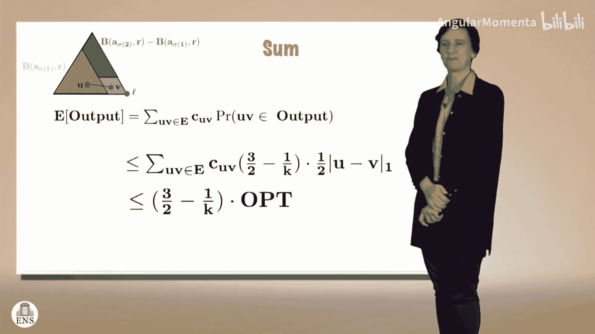

# 【巴黎高等师范学院】近似算法（一） ｜ Approximation Algorithms Part I p35 05_04_01_讲座分析 -BV1X4rrBgEzg_p35-

。

Now that we have designed an algorithm for multiway cut， we need to analyze it。First。

 it is clear that our algorithm runs in polynommal time。

Also clear that it outputs a proper multiway cut。 So the question is， how good is the output。

How good is the output。The value of the objective is the sum over every edge of C UV times。One。

 if and only if the edge cross， crosses the cut。So our algorithm is randomized。 As usual。

 we look at the expected value of the output。Dil linearity of expectation。

 we can invert the summation and the expected sign。

So the expected value of the output is the sum over every edge in the graph of。

C UV times the expected value of the random variable， which is one if and a leaf。

 the edge crosses the cut。 So what does this give us the probability that U V is in the output。

You should be used to this by now， we have already used this trick several times。

 linearity of expectation is very， very good to enable us to treat things independently。😊。

So because of that， all we need to do is focus on a particular edge UVv in the graph。

 a particular pair of vertics U and V， and look at the probability that UV edge UVV is in the output cut。

So we can forget about the rest of the embedding。 Just think about UN V。Now。

 remember how our rounding works。A round in the case of k equal to 3。

Chooses a random order of the three terminals。 Let's let's call a the first terminal， B。

 the second one， C， the second one， the third one。 It's easy in the case of k equal to 3。

 easier to use this kind of notations。So。In the case of a drawing。

 U belongs to the first ball centreed at A V belonged to the third part Santaed at C and therefore will have to pay the cost C U V because Ed U V crosses the cut。

What is the condition in general for U V belonging to the output。Well。E走。The first ball。

 the green ball， contains exactly one of the two vertics U and V。

 that is either the radius R is between the min and the max of the two distances from U to a and from V to a。

Or。Or neither U nor V was placed in the first ball。

 But exactly one of them is placed in the second ball。That is。

 How can it be that neither you nor V are placed in the first ball， It must be that R is small。 R。

 the radius of the first ball is smaller than their min distance。To a。

And then it must be that R is in between in terms of the second distances。

 between the min and the max of their distances to terminal B。😊，So these are our two conditions。

UV is in the output， if on leaf， one or the other of these two thesejo conditions are met。

So now we need to analyze the probability of these two conditions。Let's see。

How can it be that AI terminal AI is the first one to catch U or V。

 and it catches exactly one of them。Well， there's a particular terminal there that is lucky。

 that has better luck than the others。Let's look at the terminal that is closest。2， either U RV。

That is。For each terminal， let's look at the min distance from U to AI and from V to AI。

 The min are these two quantities。That's how big R needs to be in order to catch at least one of them。

Okay， look at this for every terminal。 and then。Look at the terminal that minimizes this quantity。

That's terminal L in the case of our drawing。V is quite close to this terminal。 So that's L and。

This is the main distance here。From， from U or V to L。

So R needs to be at least this big in order to have a chance of catching U orV。Okay。So。

If we look at terminal I， what are the chances that terminal I will get？One or the other of U or V。

First， in the random ordering。I must proceed， L。It must proceed L because if it comes after L in the order of the terminals in the random permutition。

 then L will get first first shot will have priority。😊，And。If L fails to catch them。

 then I will also fail to catch them。I has no chance to catch exactly one of them。

 If L already didn't do it。Okay。So I must have priority over L。 I must receive L。Moreover。

The ball centered at AI and of Radius R must separate U from V must catch exactly one of them。

So these are they' are not sufficient conditions because other terminals might come into play。

 but certainly these two conditions are necessary in order for one of the two terminals to be in the ball centered at AI and the other one to be outside called exactly at the time when we considered terminal AI。

😊，All right。So， now。We know the probability of this event。Wai。Because these two conditions。

 I perceives L， and this ball separates for this is U and V。 these two conditions。

 they are independent of each other。The first one。For a random ordering， I and L play the same role。

 The probabilityb that I precedes L is exactly12。The second one for R。

 a random radius between 0 and 1， the probability that the ball center at AI and of radius R separates U from V is the difference between the two distances from AI to U and from AI to V。

So。For every terminal I different from L， we have this upper bound on the probability that when we deal with terminal I。

 we separate U from V。Second case， I equal to L。R equal to L。

Then how can it be that when we consider terminalal L and draw the ball center at L and of radius R。

 we separate you from V。Well， first， L must not be the last terminal because the last terminal doesn't have a chance to draw a ball。

O。And then。😊，When it comes up， its ball must separate you from thee。Again。

 these two events are independent of one another。What is the probability that L is not the last terminal。

For k equal to 3， it's two third。 We have a random permutation。For k general， it's 1 minus1 over k。

Then what is the probabilityitive that the ball separates them again。

 it's the difference between the two distances from A。

So now we have our expressions where we have used these joint events， independent events。

 multiplying probabilities， summing we can proceed。😊，Together。Together。

The probability that Uv is in the output is。Consider terminal L 1-1 of a K times the difference of distances from U And V to A L。

Plus。For every terminal I different from L。The sum of one half times the difference of distances from AI to U and to V。

Now， what is nice is that here what we see is we almost have the entire sum。

So let's do a little bit of a calculation here。Let's take part of this， part of this quantity here。

 Let's take one half out of this， and let's。Let's bring it in here。 This way we'll have a sum。

 not just over I different from L， but over every I， I equal to L I different from L。

 all possible terminals。So the right hand side will become some overall all possible terminals of one half times the difference of distances。

And the left hand， the left hand side becomes the first part of the expression becomes what's left。

 that is。One2 times 1 minus-2 of a K times this difference。Okay， so。Now， what is this。

The second part is nice。 The last expression。What is it。

It is the sum over I of one half times the difference between the I coordinates。D L 1 metric。

So this is very close to the objective function of the appear relaxation。 We are in good shape here。

😊，What about the first term， the first term， Well， again。

 we have the difference between the L coordinates of the two embedded vertices， UN V。

So we need to do a little bit more work for that。 We need to analyze this expression。 U L minus V L。

 How can we upbound it。Observe。Observe。You have this triangle。

 All the vertices on the triangle satisfy the sum of the coordinates are equal to one。

It's true for you。It's true for thee。So。If you look at U L minus V L。

 the difference between their coordinates， their L coordinates。It's at most， one half。

Of the M1 distance。Why， well we saw many examples of this， imagine， for example， that UL is 0。6。

 VL is 0。5。UL minus VL is 0。1。Even if they are as equal as possible in the other coordinates。

 the other coordinates must sum 2。4 for UL。05 for VL。For example。U could be 06040。 V could be 05。50。

And then what do we have。UL minus V L is 01。But the L1 distance is 01 plus 0。1 plus 0。Two times 01。

And actually， that's the best you can do。U L minus V L can never be more than half of the sum of the U I's minus Vs can never be more than half of the L1 distance。

So let's take this up bound and plug it in to our calculation。😊，Together。The probability。

That at U V is in the output is12 minus1 over k times Ul minus Vl plus12 of the sum over I of Ui minus V。

Replace U L minus V by half of the L1 distance。Half。Times one half。 Basically。

 let's ignore that one of a K for a moment。 half times one half。 That's one quarter。

 So we have one quarter here。One half there。So。That's three4。

3 quarters are the sum of the I of UI minus V plus a little bit leftover that depends on K。So。

 what we get is。3 hals minus-1 of a K times one half of the L1 distance。 Again， these one halves。

 these factors of two。 theyre kind of a bother to deal with。 Theyre kind of a bother because you're。

 you're almost sure to forget one along the way。 It's a little bit like programming。 You know。

 doing this proof this calculation， It's a little like coding。 you have to be careful。

 Every step you have to make sure you never forget a factor of two。

 Otherwise your final result will be wrong。 But the idea is still correct。 But， you know， a big deal。

 if you can't really prove it。Okay， so let's put all this together。

The expected value of the output is that sum over every edge in the graph of CV times the probability that U is in the output。

😊，The probability that Uv is in the output is at most3/2s minus1 of a k times。

1 half of the L1 distance between U and V。Nao。Let's take out the3/2 minus1 of a K。

 And what do we get。We get the objective function。 We get exactly the objective of the LP relaxation。

😊，So we know by definition of the relaxation。That that value。Is at most opt。

And so what we have proved is the expected value of the output is at most3/ hals minus1 of a k times opt。

And so what have we proved in this analysis， weve proved that by doing linear programming and randomized rounding guided by the geometric interpretation of the problem。

 we can get a3/2s minus1 of a K approximation for the multiway cut problem。😊，Now。

 what do we need to do next。We're going to try to do better。

 and we're going to see the story behind this problem。

