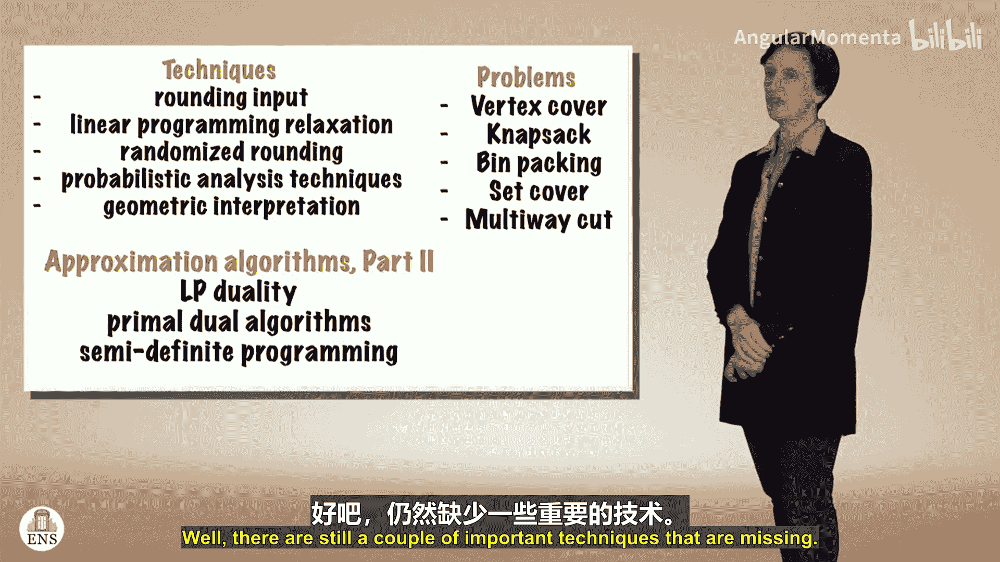

# 【巴黎高等师范学院】近似算法（一） ｜ Approximation Algorithms Part I p36 05_05_01_讲座结论 -BV1X4rrBgEzg_p36-

So we have designed and analyzed an approximation algorithm for multiway cut。

 What else can we say about this problem？😊，First。We had this cool geometric embedding。

To interpret the LP relaxation。 And then we used it for inspiration to design our rounding。😊。

Can we get a better randomized rounding to have a better approximation for multi cut。

 Is it possible to get better than3 halves minus1 of a K。😊，Well， the answer is yes。 for k equal to 3。

 for example， it's possible to get 1211s by using the linear programming relaxation to find a better rounding。

😊，And so instead of just using these balls， we can represent the problem of finding a good randomized rounding as a linear programming problem。

Finding。The right way to do randomized rounding can be expressed as linear programming。

So we round the LP relaxation using a linear program。That's cool。And then for larger K。

 the same method can also be used to try to get a better approximation。

 It's possible to beat this three/ hs approximation。However， the problem is AP Px hand。

 It is not possible to get one plus epsilon。 There is no approximation scheme for this problem if P is different from NP P of course。

So let's look a little bit at the story behind the story of the multiwe problem。

The first paper that dealt with approximation algorithms gave us a little bit of a story about applications。

This is what they said。 this said， this problem comes up in the minimization of communication costs in parallel computing systems。

It also comes up when you assign program modules to processor。

 when you try to partition files among the nodes of a network。

 when you try to assign users to computers in a multicomputer environment and when you try to partition the elements of a circuit into the subsoit that will go on different ships。

 that problem in a way is more geometric， so it is perhaps a little bit easier。

Because it's a special more special case， if I may say。So this problem。

 variants of these problems come up in a number of settings where you have to assign。😊。

Something to something else。 And there's an underlying graph structure。

Now who started studying this from the viewpoint of approximation algorithms？

Here are the first people who designed the basic algorithm we saw at the beginning of this chapter。

Eliaas Dalhaus， David Johnson， Mihalisnaakekis， Christov Papidimitry U and Paulymour。

They proved the AX harmness， and they gave an approximation with mint cuts。

Some of these names you have seen before， these people are well known in the field of approximation algorithms。

When。Who came up with the geometric representation。Kalinesu， Kiff， and Rabani。

They came up with a geometric embedding and how to use it。 That is really cool。

 I think this is really。😊，The most novel idea of this chapter， in my opinion。

 and this is how they got the three/2s minus1 of a K。Third。

 who came up with the ways to improve this approximation by getting a better randomized rounding by finding the correct rounding using a linear program。

David Conger， Philip Klein， Michael Thorbe， Clivestein and Neil Young。They got the 1211th。

So these are the main steps of designing approximation algorithms for the multiway cut problem。Now。

 what。Well， let's see。In the past five weeks， we have studied a number of techniques in the design of approximation algorithms。

Rounding the input in a way that may be adaptive。Writing a linear programming relaxation。

 a tool we have studied at length。Randomized rounding。

 sometimes a sophisticated version of randomized rounding。

Probabilistic analysis techniques in the context of Se cover in particular to try to prove that our result is good and a geometric interpretation of the LP relaxation。

😊，This is already a good array of tools。 this is starting to be a solid knowledge of approximation algorithms。

In terms of problems。What problems have we studied in the past few weeks。Ftex cover。Npsack。

 bin peing， set cover。Multi wickcut。5 basic foundational problems of combor optimization。

Theyre all NPhold。 And for all of them， we designed good approximation。

 and each of them was an opportunity for us to study a new。😊。

Technique either for designing approximation algorithms or for analyzing the quality of the solution。

So what's missing。Well， there are still a couple of important techniques that are missing。

 If you want to discover discoverover them， you'll have to take the follow up course。

 approximation algorithms part 2 in which we will study。

LP duality， a fundamental， basic tool using linear programming。

Primmal dual algorithms using LP duality to have efficient approximation algorithms and semideinite programming a really powerful technique for problems that were are previously sea out of reach。

 so if you want to learn about these techniques， take approximation algorithms part2。

 I hope to see you there。😊。